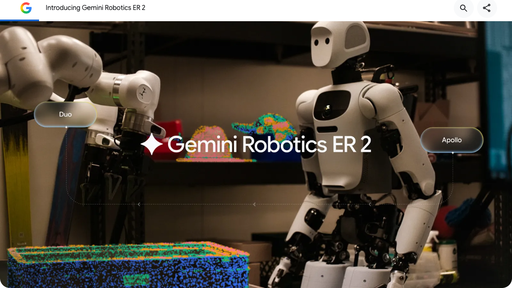
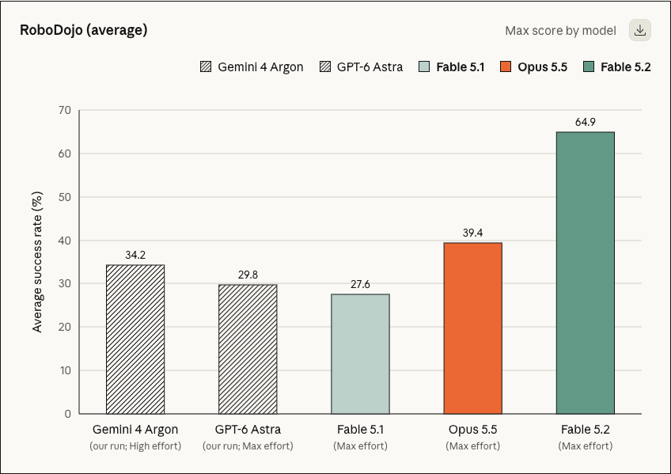
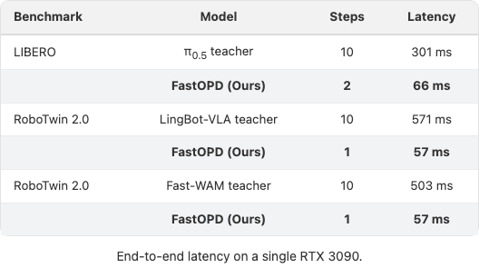
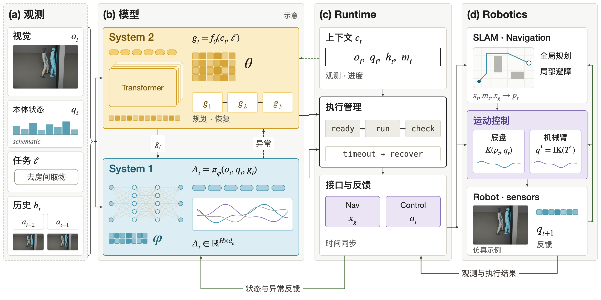
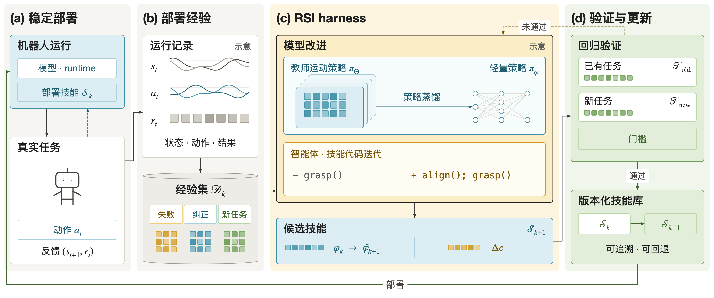

今年 2 月我开始做分层的 agentic system，7 月发帖讨论 Agentic Robot 会是下一个大火的方向。
当时和不少投资人聊，大家更期待一个端到端模型直接接管整个机器人。
我也认可模型会往这个方向走，但中间怎么把机器人做出来、让它持续运行，有很多系统工程绕不过去。
到这次 CoRL，Agentic Robot 已经是一个大家认真讨论的方向了。
现在我想得更多的是，等这套思路普及以后，具身公司接下来半年到底该把精力放在哪里。

## 这几个月，模型能做的事变多了

这几个月 OpenAI、Anthropic 和 Google 的进展放在一起看，我的感觉是，通用模型能承担的机器人工作，比我们原来划给它的范围更大。
Astra 和 Fable 5.2 出现之后，根据视觉和机器人状态直接决定动作的能力已经被展现出来了，Google 的 Gemini Robotics 也在往持续理解视频、跟踪任务和协调执行推进。
各家的方法还不一样，公开展示离长期稳定运行也有距离，但具身能力跟着通用模型一起进步，这个趋势已经很明显了。

> 图中结果由 Anthropic 在相同 harness 下运行，采用各模型可用的最高推理档位。
> 这里比较的是仿真任务的成功率，不能直接当作真实工作环境里的可靠性。

## System 2 和 System 1 都会继续变化

所以我现在很认可一个判断，System 2 和 System 1 的通用模型能力，大概率都会越来越多地被大模型厂商做掉。
System 2 负责理解任务和规划，模型本来就在学怎么使用工具、根据反馈继续执行。
把机器人任务变成能批量训练、能验证结果的环境，就能接进他们已有的训练体系。
PEAR 用仿真任务的成败反馈训练通用模型使用机器人，也是这个方向的一个例子。
对创业公司来说，自己搭一套类似的训练 infra，确实很难单独构成长期优势。

System 1 这边，我也不会把 latency 看成一个长期留给小团队的机会。
大 policy 学会操作以后，可以用动作数据和执行反馈，把一部分能力蒸馏进更小的 policy，在本地根据最新观测持续出动作。
这个过程还有成功率和泛化的取舍，也需要相应的机器人数据，但模型推理慢这件事是有明确优化路径的。
我预计接下来几个月，会更常见到强模型提供能力、小模型承担高频执行的组合，遇到小模型处理不了的情况，再由顶层模型介入。
两层未必来自同一个模型，但厂商完全有可能一起提供。

> FastOPD 在 LIBERO 仿真评测中，用两步推理保留了教师策略约 84% 的表现，推理延迟降低 78.1%。
> 表格来自单张 RTX 3090 上的测试，不是整个机器人从感知到执行的闭环延迟，也不是对 Astra 或 Fable 的蒸馏结果。

## 模型之外，机器人还需要怎样的系统

按这个方向想，只做一层 harness 确实会越来越难。
今天花很多时间设计的任务拆分和工具路由，下一个版本的模型可能就能自己完成。
我觉得做分层系统也要接受这件事，模型能接过去的职责就让它接过去，系统里的分工会继续变。
把某一版模型的不足补上，和积累出一家公司的能力，中间还有距离。

但跳出模型以后，一台机器人依然需要稳定的 robotics 系统。
模型根据画面给出一个合理动作，现场还要保证它看到的画面和机械臂状态对应得上，动作能在要求的时间里执行。
一次调用超时了，机械臂到底没动、动了一半，还是已经做完，系统得知道，然后才能决定后面怎么继续。
这些状态最后还要能被查清楚，否则换了模型、换了工位，出了问题还是得靠人守在旁边判断。

这也是我从 2 月做分层架构到现在，一直没有改变的判断。
模型能力可以不断升级，机器人运行的责任仍然要有人承担。
我对未来半年的预期，是越来越多团队能做出以前很难做的 demo，模型之间的差距也会继续变化。
具身公司需要证明的是，换上更强的模型后，整套产品真的能稳定地多做一些事，现场需要人处理的问题越来越少。
模型升级带来的收益，得能体现在实际运行里。

具身的下半场该做什么，我想来想去，又回到了 robotics 的系统和工程。
比如机器人要去另一个房间拿东西，SLAM 得提供定位和地图，导航系统得做全局规划，走到一半还要根据现场情况避障。
runtime 也得把机器人当前的状态、任务进度和执行反馈整理好，让模型知道现在发生了什么，才能继续决定下一步。
这些模块很多都有成熟的方法，但把它们和模型接起来，在真实环境里持续稳定地工作，依然是具身公司要做的事情。

再结合大模型本身越来越强的能力，我觉得可以进一步做真机的 RSI。
一套稳定的 runtime 和机器人系统，接上机器人大脑，再加一层负责持续改进的 RSI harness，把实际执行中的反馈用于学习和验证，让机器人在稳定部署的过程中积累新的技能。
这样每次部署留下的经验，就能继续改善后面的运行。
那接下来评价一家具身公司，是不是也该看看，机器人部署几个月之后，在原来能稳定完成的任务之外，又从真实环境里学会了多少新的事情？
