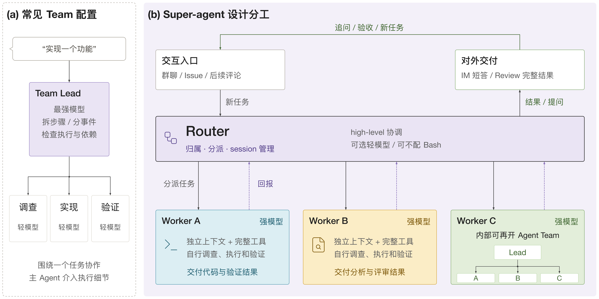
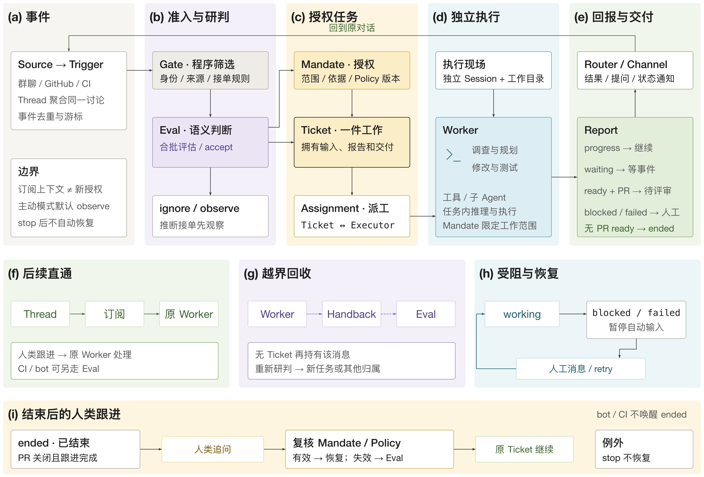
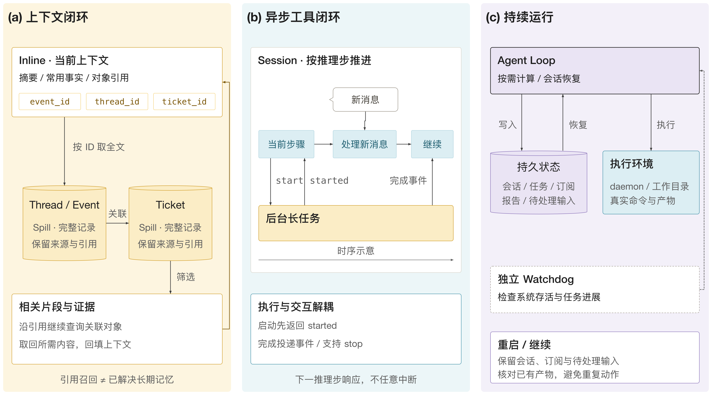
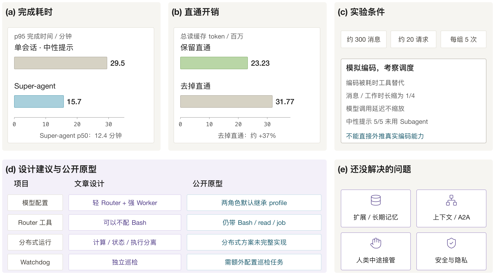

常见的多智能体编程系统采用“强主弱从”的结构：由最强的模型担任主 agent，拆分任务、分发事件、追踪进度，并在出错时重新调度，成本较低的模型作为 sub agent 负责具体执行。DeepSeek 产品部在《Super-agent 设计探索》中提出了相反的配置：常驻的 Router 只负责高层的任务归属、分派与会话管理，能力最强的模型放在 Worker 上，由 Worker 独立完成理解、执行和验证。这个设计能否成立，取决于它是否把任务的整个后续生命周期也纳入了系统结构。

本文将其作为一个系统设计来分析，依次讨论角色分工、领域对象与任务生命周期、事件路由与订阅、授权与重新校验、失败与恢复，再与 orchestrator-worker 模式比较，最后核对实验数据能支持的结论。材料有三类，需要区分：原文（[ChainCatcher 署名转载](https://www.chaincatcher.com/article/2300676)）描述的设计；[官方开源原型](https://github.com/deepseek-ai/dsh-superagent-prototype/tree/6337fc823ce20251c8de8085948165c81aaa701e)的实际实现；以及本文自己的分析。官方 README 明确说明该仓库是研究原型，不是正式产品，也不等同于原文所述的内部实现，文章中的部分设计只是后续方向。本文引用的原型文档均固定在提交 `6337fc8`。

## 角色分工

### 两层结构

原文把系统分为两层。Router 是常驻的交互层，负责与人沟通、任务分派和全局记忆，不直接执行具体任务。Worker 是上下文相互隔离的执行层，并发地推进各自的任务，并把状态汇报给 Router。两层是逻辑上的职责划分，并不要求每层恰好一个会话。Worker 内部仍然可以再使用 subagent 或 agent team，因此“强主弱从”的结构可以嵌套在 Worker 之内。

在原型中，对应的术语是主 Session（代码中称 `orchestrator`）与执行器 Session（代码中称 `worker`）。每个 Ticket 获得一个名为 `worker-<ticket id>` 的执行器 Session 和一个独立目录。

### 为什么 Router 可以较轻

Router 的判断集中在“这件事属于谁”：是新任务、已有任务的后续，还是应当忽略。稳定的判断被写成程序（例如发送者是否在允许名单内），只有语义判断交给模型。这降低了对 Router 模型能力的要求。需要注意原文与原型的差别：原文称 Router 甚至可以不配置 bash 工具，而公开原型的 Router 仍带有 bash、read 与 job 工具，“不读代码”只是提示词约束；`src/policy.ts` 中评估与执行两个角色的 model 默认都是 null，即沿用同一个 harness profile 的默认模型。因此“轻主强从”是设计建议，不是原型的默认配置。

## 领域对象与任务生命周期

原型的 [001 Domain model](https://github.com/deepseek-ai/dsh-superagent-prototype/blob/6337fc823ce20251c8de8085948165c81aaa701e/docs/001-domain.md) 文档给出了系统的对象模型。主流程可以写成

$$
\text{Source}\xrightarrow{\text{Trigger}}\text{Thread}\xrightarrow{\text{batch}}\text{Eval}\xrightarrow{\text{accept}+\text{Mandate}}\text{Ticket}\xrightarrow{\text{Assignment}}\text{Executor}\xrightarrow{\text{Channel}}\text{Source}.
$$

各对象的含义如下。

- Source：事件流，例如 GitHub 通知或飞书消息。它保存自己的读取位置，丢弃机器人自己发出的消息，并把每个事件翻译成所属的 Thread 与回复地址。
- Trigger：一个不可变的事件。同一个 Trigger 被接受两次只创建一个 Ticket，这是幂等性的单位。
- Thread：按时间排序的一组 Trigger。同一时刻对一个 Thread 至多运行一次 Eval，期间到达的 Trigger 合并进下一批。
- Eval：对一批 Trigger 的判断，分为两层：确定性的准入（Gate）与模型的研判（Assessment）。输出为 Decision：accept、stop、ignore 或 unavailable。Eval 本身不保存状态。
- Mandate：accept 所授予的内容，包括策略版本、范围、强度（explicit 或 inferred）、匹配的规则和发送者身份。Mandate 不可变，要扩大范围必须新建 Ticket。
- Ticket：一个被授权的工作单元，只有 Eval 能创建。它拥有自己的状态，不跟随执行器会话的状态。
- Assignment：Ticket 与某个执行器实例的绑定，一个 Ticket 在其生命周期内可以有多个 Assignment。
- Subscription：Ticket 与 Thread 之间多对多的关系，由 Thread 持有。

### Ticket 的阶段

[003 Execution](https://github.com/deepseek-ai/dsh-superagent-prototype/blob/6337fc823ce20251c8de8085948165c81aaa701e/docs/003-execution.md) 将每个打开的 Ticket 按“正在等待什么”归入一个阶段，规则是自上而下取第一条匹配的行。

| 阶段 | 条件 |
| --- | --- |
| person / delivery | 向执行器投递输入失败 |
| person / answer | 存在等待人回答的问题（Attention）|
| person / review | 最新 Report 为 ready |
| person / blocked、failed | 最新 Report 为 blocked 或 failed，且此后没有人的消息到达 |
| working / queued | 没有 Assignment，或只有待启动的 |
| idle | 最新 Report 为 waiting，或 Assignment 已结束 |
| working | 其余情况 |

Report 有六种取值：progress、waiting、ready、blocked、failed 与 dropped。Ticket 的终止条件取决于实际交付物。没有 pull request 的 ready 直接结束 Ticket；带 pull request 的 ready 表示等待评审；当 Ticket 所开启的 pull request 都已关闭或合并、且没有未处理的后续时，它才结束，并保留订阅，以便之后的人类评论恢复它。

## 事件路由与订阅

### 两条路径

进入系统的消息走两条路径之一。第一条是 Eval，用于判断是否开始新工作；第二条是订阅，用于继续已有的工作。订阅的规则是：一个订阅 Thread 上的每条消息，包括机器人和 CI 的消息，都以上下文的形式扇出（fan-out）到所有存活的已订阅 Ticket。设 $\mathcal{K}(t)$ 为订阅了 Thread $t$ 的存活 Ticket 集合，则 Trigger $x\in t$ 的投递为

$$
\operatorname{deliver}(x)=\{\,k\in\mathcal{K}(t)\,\},
$$

这一步不检查发送者，也不经过 Gate，因此不产生新的权限。这里需要区分“上下文”与“授权”：扇出只传递信息，每个 Ticket 的行动范围仍由它自己的 Mandate 限定。

其效果是后续的人类追问可以直接送回原来的 Worker，测试结果和 CI 也可以作为上下文送进去，不需要 Router 每次重新理解后再分发。人类的追问由该 Ticket 的 Worker 持有，在 Ticket 的范围内继续处理，若请求越界或属于另一个 Ticket，则交回一次，交回后只有在没有任何 Ticket 仍持有这条消息时才进入新的 Eval。持有期间，主 Session 只能应人的请求停止任务，accept、attach、ignore 都被拒绝。

### 仅作上下文的订阅

Worker 可以为获取上下文而关注相关的 Thread，例如另一个 issue。这类订阅不赋予跟进归属，也不能恢复已结束的 Ticket；这些消息可以被独立评估。Correlation（Thread 之间的关联）同样只增加上下文，不参与路由，路由只由订阅决定。

### 并发与优先级

执行器的并发由 worker slot 控制。设配置的并发上限为 $C$，则常规任务最多占用 $C$ 个槽位，另外额外保留 1 个槽位专供人的消息或状态请求唤醒。因此有效上限为

$$
C_{\text{eff}}=C+1 ,
$$

新任务的启动不会阻塞人对已有 Ticket 的继续交互；CI 结果等其他输入则等待常规槽位。此外，worker 预设会把前台命令在 5 秒后转为后台任务，使 Worker 能在下一个推理步接收新消息，而不是阻塞到长命令结束。新输入在当前推理步结束后处理，并不是随时打断模型的 token 流。

## 授权

[002 Authorization](https://github.com/deepseek-ai/dsh-superagent-prototype/blob/6337fc823ce20251c8de8085948165c81aaa701e/docs/002-authorization.md) 的基本原则是由宿主程序强制执行允许名单、规则和 Mandate，消息、评论和被引用的文档只是决策的输入，不能修改这些权限。

### 强度与准入表

Mandate 的强度分为 explicit 与 inferred。在允许名单内的人明确提到 agent，或者对已有 Ticket 的 Thread 追问，属于 explicit。机器人只能产生 inferred 的候选，不能提出 explicit 请求，也不能停止 Ticket。每个 Source 的策略包含一张准入表，行是接收范围（例如某个群、私信，或 GitHub 的新 issue），列是三种情形：在名单内但未提到 agent、不在名单内但提到 agent、不在名单内且未提到 agent。每个单元格决定该消息成为明确请求、推断候选或被忽略。

### 接单模式

接单模式属于策略的一部分，有三种取值：`off` 时没有任何推断候选；`observe`（默认）对推断候选做评估，肯定的评估只记录为带“would accept”标记的 ignore；`auto` 才会真正接单。明确请求在所有模式下都有效。建议先在 `observe` 下运行，复核记录的决定之后再切换到 `auto`。一次主动接单至少要匹配一条规则，Mandate 会记录匹配的规则，执行器也会收到这些规则的名称与说明。

### 策略版本与重新校验

规则、接单模式与各 Source 的策略共同构成策略版本，每个 Mandate 记录它被接受时的版本。版本变化会丢弃正在运行的 Eval 并重新排队，同时向受影响的存活 Ticket 发送策略变更通知，但不会立即撤销它们的 Mandate。已结束的 Ticket 在被人的消息恢复之前，需要用当前策略重新校验：显式的跟进 Mandate 通过；推断的 Mandate 需要 `auto` 模式且匹配的规则仍然启用；通过准入表获得的 Mandate 要求当前表格与发送者成员关系仍提供不低于原来的强度；机器人的 Mandate 要求该机器人仍在名单内。可以把恢复条件写成

$$
\text{resume}(k)=\text{listening}(\text{Source},t)\;\wedge\;\text{valid}\bigl(\text{Mandate}_k,\ \text{Policy}_{\text{now}}\bigr)\;\wedge\;\neg\,\text{stopped}_{\text{human}}(k).
$$

校验失败时，Ticket 保持结束状态，等待的消息被视为没有到达任何 Ticket，若无其他 Ticket 持有则进入 Eval。被人手动停止的 Ticket 不会自动恢复，需要重新 accept。另外，人在 Thread 里说“停止”只是普通的 Trigger，由 Eval 决定是否停止，执行器不能自行宣称“人要求我停止”；而在面板中点击停止是直接作用于 Ticket 的命令。

## 失败与恢复

### 阻塞、失败与重试

当执行器报告 blocked、failed，或启动出错时，Ticket 暂停接收自动输入：CI 与机器人消息被记录但不投递，也不唤醒会话；会话的工具仍然可用，所以人可以直接在会话里继续。模型服务或网络的瞬时故障（HTTP 408、429、5xx，或连接被拒绝、重置、超时）先自动重试三次，退避逐步增长。人的新消息、一个既非 blocked 也非 failed 的 Report，或手动重试都会解除暂停。重试会结束当前 Assignment 并在同一个会话、目录、分支与 pull request 中启动新的 Assignment。暂停状态由已存储的 Report 与 Input 推导，所以重启后依然成立。

### 先存储后执行

系统在做出决定之后的动作，例如把候选转给主 Session、启动 Assignment、投递 Input，都是先存储再执行。失败的转发或投递按 2 秒起、每次翻倍、最长一分钟的间隔重试：

$$
d_n=\min\bigl(2\cdot 2^{\,n-1},\,60\bigr)\ \text{秒},\qquad n=1,2,\dots
$$

对外的消息（Channel）从 5 秒起翻倍，最长 300 秒。同一个 Ticket 发往同一会话的消息保持先后顺序，前一条尚未发出时，后一条等待，直到前一条连续失败三次并被标为系统问题。

### 重启

重启时，仍在运行的 Assignment 以“host restarted”结束，新的 Assignment 带着恢复说明启动，要求执行器在重复任何外部动作之前先检查自己的目录、git 历史与 GitHub。会话、目录、订阅、待处理消息与存储的工作在重启后依然存在，系统还记录每个会话已读入历史的消息，以避免重复或丢失。

### 评估超时

Eval 有时间限制，从候选到达主 Session 起算。超时的 Eval 把 Trigger 重新排队，连续两次重试之后，第三次超时记录为 unavailable。面板只在这类 unavailable 的决定不超过 24 小时、仍是该 Thread 的最新决定且未被忽略时请求人工处理。独立的 Watchdog 在原文中是设计的一部分，公开部署文档只给出了定时巡检的做法，它不是原型默认自动安装的组件。

## 与 orchestrator-worker 模式的比较

[Anthropic (2024)](https://www.anthropic.com/engineering/building-effective-agents) 将 orchestrator-workers 描述为：中央 LLM 动态拆分任务、分配给 worker LLM 并汇总其输出，子任务不是预先定义的，而由 orchestrator 根据具体输入决定。[Anthropic (2025)](https://www.anthropic.com/engineering/multi-agent-research-system) 的多智能体研究系统是这一模式的实例：lead agent 规划并生成并行运行的 subagent，汇总结果后决定是否继续研究。[AutoGen](https://arxiv.org/abs/2308.08155) 则代表以多 agent 对话为中心的框架。单个 agent 的推理与行动交替循环可参见 [ReAct](https://arxiv.org/abs/2210.03629)。

两种设计的区别可以归结为 orchestrator 所处的层次。

| 维度 | orchestrator-worker（如研究系统）| Super-agent |
| --- | --- | --- |
| 协调对象 | 一个任务内部的子任务 | 跨会话、多任务的归属与交互 |
| 中心节点的工作 | 拆分子任务、汇总结果、决定是否继续 | 判断归属、授权、分派、对外统一回复 |
| 子任务的生命周期 | 随任务结束 | Ticket 可挂起、恢复、由不同 Executor 接手 |
| 后续消息 | 由 orchestrator 重新理解后分发 | 订阅直接扇出到原 Worker |
| 对中心节点的模型要求 | 高，需要规划与整合 | 较低，稳定判断写成程序 |
| 权限 | 由系统提示和工具限定 | 宿主强制：允许名单、Mandate、策略版本 |

两者并不互斥。Super-agent 的 Worker 内部可以采用 orchestrator-worker 完成一个复杂任务，Router 管理的是更外层的任务之间的协调。因此不能把既有的 agent team 概括为“强主弱从”，更不能说它们已被取代。

## 实验能说明什么

原文的实验使用约 300 条消息、20 条工作请求，每个方案重复 5 次。输入包含群聊和 GitHub CI，编码由只消耗时间的工具模拟，消息间隔和工作时长缩放到 1/4，模型调用耗时不缩放。下表数值取自原文，我们没有运行原型，也没有复现实验。

| 指标 | 结果 |
| --- | --- |
| Super-agent 完成时间 p50 / p95 | 12.4 / 15.7 分钟 |
| 单会话加 Subagent 工具（中性提示）p95 | 29.5 分钟 |
| Super-agent 总读缓存 token（每次实验）| 2323 万 |
| 去掉订阅直通后的总读缓存 token（每次实验）| 3177 万 |

去掉直通后增加的比例为

$$
\frac{31.77-23.23}{23.23}\approx 36.8\%,
$$

与原文所述约 37% 一致，而完成时间近似，增加的主要是 Router 的决策次数与 token 开销，这说明订阅直通节省的是 Router 的推理。中性提示组的 5 次运行都没有调用 Subagent，在偏向委派的提示下也有 1 次自行执行形成长尾，所以这个结果支持的是“把职责拆分固化在系统结构里，可以减少临场选择带来的不稳定”。它不能证明优于所有成熟的 agent team，也不能推到真实的编码能力。多会话整体使用的读缓存 token 多于单会话，这一点原文也明确指出。

## 局限与小结

需要保留的边界有以下几点。原型以操作系统用户身份无需审批地运行执行器命令，目录与会话的分离不能当作强安全沙箱。分布式云端与自带机器（Bring Your Own Machine，BYOM）的方案没有完整进入公开原型。原文列出的开放问题包括 Router 的扩展与长期记忆、人类中途接管、跨组织的上下文边界与 agent 间通信，以及云端与端侧之间的安全和凭据隐私。

从系统设计的角度，这篇工作的可借鉴之处有三点。第一，把“可读取的信息”与“获准的动作”分开：订阅传递上下文，Mandate 限定行动。第二，把稳定的判断写成程序，让模型只处理语义判断，由此才可能使用较轻的 Router。第三，把任务的后续（追问、CI、评审、恢复）纳入同一套对象和状态，而不是依赖中心节点每次重新理解。评估这类系统时，除成功率与延迟之外，还可以记录每个任务的人工介入次数、重复解释上下文的次数和无用通知的数量，这三项是本文的建议，原文并未测量。
