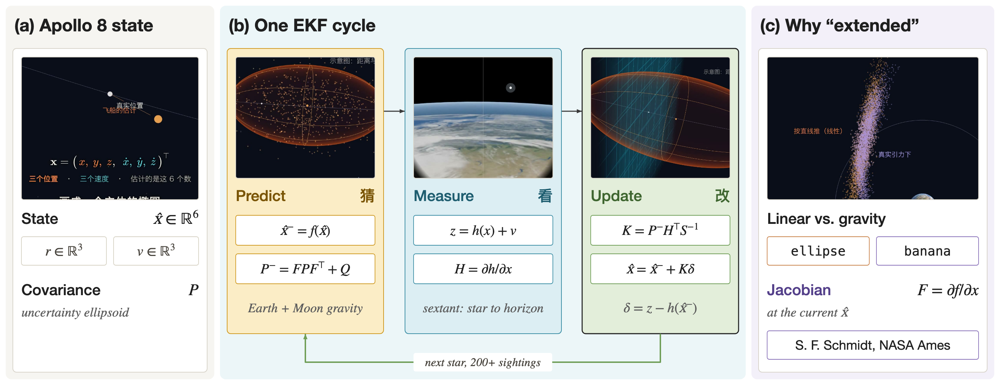
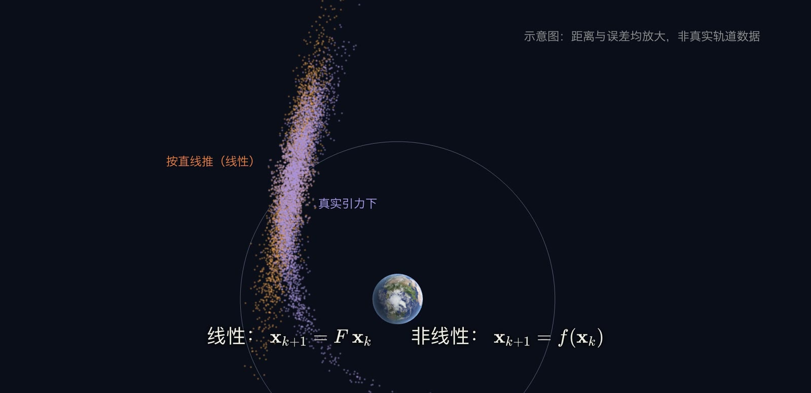
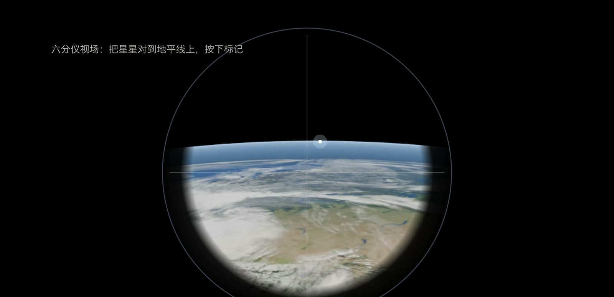
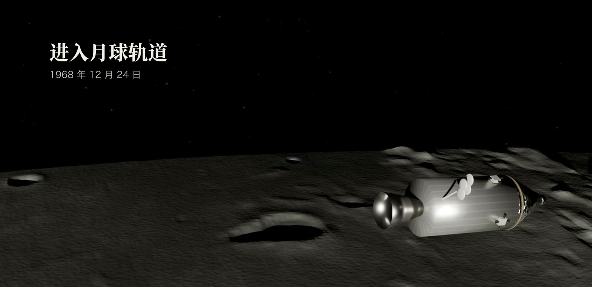

机器人定位、同时定位与地图构建（Simultaneous Localization and Mapping，SLAM）和自动驾驶所依赖的基础估计方法，在 1968 年就已用于飞往月球的途中。Apollo 8 飞向 38 万公里之外的月球，沿途必须持续估计自身的位置和速度，机载计算机完成这项估计所用的就是扩展卡尔曼滤波（Extended Kalman Filter，EKF）。本文先交代问题设定，再推导 EKF 的预测与更新公式，说明线性化为什么在短步长下成立，最后回到 Apollo 8 的六分仪观测。

## 问题设定：用不准的模型和不准的测量估计状态

发射上升段由土星五号仪器舱内的惯性平台负责导航，不属于 EKF 的工作范围。惯性平台的陀螺仪每小时漂移约 1 毫弧度（[Apollo PGNCS](https://en.wikipedia.org/wiki/Apollo_PGNCS)），飞行时间越长，累积的误差越大。进入奔月轨道之后，需要另一种信息来源把这些误差修正回来，这个来源就是宇航员用六分仪对恒星和地球或月球地平线进行的角度观测。

飞船的状态取位置 $\mathbf{r}\in\mathbb{R}^3$ 与速度 $\mathbf{v}\in\mathbb{R}^3$，共六个量：

$$
\mathbf{x}=\begin{bmatrix}\mathbf{r}\\ \mathbf{v}\end{bmatrix}\in\mathbb{R}^6 .
$$

估计量记为 $\hat{\mathbf{x}}$，它的不确定性用协方差矩阵 $P=\mathbb{E}\big[(\mathbf{x}-\hat{\mathbf{x}})(\mathbf{x}-\hat{\mathbf{x}})^{\top}\big]$ 表示。$P$ 是 $6\times 6$ 的对称正定矩阵，在位置空间中对应一个椭球，椭球越大，说明估计越不可靠。滤波器的任务，是在每个时刻给出 $\hat{\mathbf{x}}$ 和 $P$，并借助观测使 $P$ 保持较小。

### 过程模型与测量模型

EKF 假设系统服从下面的离散时间非线性模型：

$$
\begin{aligned}
\mathbf{x}_k &= f(\mathbf{x}_{k-1})+\mathbf{w}_{k-1}, & \mathbf{w}_{k-1}&\sim\mathcal{N}(\mathbf{0},Q_{k-1}),\\
z_k &= h(\mathbf{x}_k)+v_k, & v_k&\sim\mathcal{N}(0,R_k).
\end{aligned}
$$

其中 $f$ 是过程模型，把上一时刻的状态推进到下一时刻；$h$ 是测量模型，把状态映射为传感器应当读到的数值；$\mathbf{w}$ 和 $v$ 分别是过程噪声和测量噪声，协方差为 $Q$ 与 $R$。$Q$ 描述模型没有计入的扰动，例如引力模型的误差和小推力；$R$ 描述六分仪读数的误差。

本文采用两个简化，以便把公式写清楚。其一，过程模型只取地球与月球的点质量引力：

$$
\dot{\mathbf{r}}=\mathbf{v},\qquad
\dot{\mathbf{v}}=-\sum_{i\in\{\text{地},\text{月}\}}\mu_i\,\frac{\mathbf{r}-\mathbf{r}_i}{\lVert\mathbf{r}-\mathbf{r}_i\rVert^{3}},
$$

$\mu_i$ 是天体的引力常数，$\mathbf{r}_i$ 是天体中心位置，$f$ 即该微分方程在步长 $\Delta t$ 上的数值积分。其二，测量模型只考虑一次观测：六分仪给出已知方向的恒星与行星地平线之间的夹角，后文给出它的形式。真实的 Apollo 软件包含更多修正项，这里的形式属于教学简化。

## 方法：EKF 的预测与更新

### 线性化与雅可比矩阵

$f$ 与 $h$ 都是非线性函数，高斯分布经过非线性映射之后不再是高斯分布，精确的贝叶斯递推因此无法用有限维参数表示。EKF 的做法是在当前估计点做一阶泰勒展开。记误差 $\mathbf{e}=\mathbf{x}-\hat{\mathbf{x}}$，则

$$
f(\mathbf{x})\approx f(\hat{\mathbf{x}})+F\,\mathbf{e},\qquad
h(\mathbf{x})\approx h(\hat{\mathbf{x}})+H\,\mathbf{e},
$$

$$
F=\left.\frac{\partial f}{\partial\mathbf{x}}\right|_{\hat{\mathbf{x}}_{k-1|k-1}},\qquad
H=\left.\frac{\partial h}{\partial\mathbf{x}}\right|_{\hat{\mathbf{x}}_{k|k-1}} .
$$

$F\in\mathbb{R}^{6\times 6}$ 与 $H\in\mathbb{R}^{1\times 6}$ 称为雅可比矩阵（Jacobian），它们给出“误差在这一小步里如何被放大或缩小”的线性描述。对上面的引力模型，连续时间下的雅可比矩阵为

$$
A=\begin{bmatrix}0 & I\\ G & 0\end{bmatrix},\qquad
G=\sum_i\mu_i\left(\frac{3\,\mathbf{d}_i\mathbf{d}_i^{\top}}{\lVert\mathbf{d}_i\rVert^{5}}-\frac{I}{\lVert\mathbf{d}_i\rVert^{3}}\right),\quad \mathbf{d}_i=\mathbf{r}-\mathbf{r}_i ,
$$

$G$ 是引力加速度对位置的导数，即引力梯度张量。离散化之后，短步长下可取 $F\approx I+A\,\Delta t$（精确形式是状态转移矩阵 $\exp(A\Delta t)$）。

线性化成立的条件是展开式的二阶余项远小于一阶项，余项的量级为 $\lVert\mathbf{e}\rVert^{2}$ 乘以 $f$ 的二阶导数。在奔月途中，位置误差为公里量级，而飞船到天体的距离为数万至数十万公里，引力场在误差尺度上近似为线性；每一轮预测只推进一小段时间，误差椭球来不及弯得很厉害；高频的观测又会不断把误差压回很小的范围。三个条件同时满足时，把弯曲的路径当作一小段直线处理，造成的偏差可以忽略。反过来，若步长过长或观测稀少，误差分布在引力作用下会弯成香蕉形，高斯近似失效，滤波器可能发散，这是 EKF 的已知局限。

上图是视频中的示意：同一团初始误差，按线性模型推进仍然是椭圆，按真实引力推进则弯曲成香蕉形。强非线性的问题通常改用无迹卡尔曼滤波或粒子滤波，它们不在本文讨论范围内。

### 预测步

以 $\hat{\mathbf{x}}_{k-1|k-1}$ 和 $P_{k-1|k-1}$ 表示上一时刻的后验估计，预测步为

$$
\begin{aligned}
\hat{\mathbf{x}}_{k|k-1}&=f(\hat{\mathbf{x}}_{k-1|k-1}),\\
P_{k|k-1}&=F_k\,P_{k-1|k-1}\,F_k^{\top}+Q_{k-1}.
\end{aligned}
$$

第一行用非线性模型本身推进估计，第二行用线性化后的 $F_k$ 推进协方差。$F P F^{\top}$ 把椭球按引力的拉伸方向变形，$Q$ 再加上一份模型外的不确定性。没有观测时，$P$ 只会越来越大。

### 更新步

设在时刻 $k$ 得到一次读数 $z_k$。更新步依次计算：

$$
\begin{aligned}
\tilde{y}_k&=z_k-h(\hat{\mathbf{x}}_{k|k-1}),\\
S_k&=H_k\,P_{k|k-1}\,H_k^{\top}+R_k,\\
K_k&=P_{k|k-1}\,H_k^{\top}\,S_k^{-1},\\
\hat{\mathbf{x}}_{k|k}&=\hat{\mathbf{x}}_{k|k-1}+K_k\,\tilde{y}_k,\\
P_{k|k}&=(I-K_k H_k)\,P_{k|k-1}.
\end{aligned}
$$

$\tilde{y}_k$ 称为新息（innovation），是实际读数与预测读数之差；$S_k$ 是新息的协方差，由预测不确定性映射到测量空间的部分 $HPH^{\top}$ 与测量噪声 $R$ 相加得到；$K_k\in\mathbb{R}^{6\times 1}$ 是卡尔曼增益。增益的含义可以从极限情形看出：当 $R$ 远大于 $HPH^{\top}$（测量不可信）时 $K$ 趋近于零，估计几乎不动；当 $R$ 趋近于零（测量可信）时，估计被拉向测量。预测越不准，$P$ 越大，$K$ 越大，新估计就越偏向测量，这就是“按信任程度折中”的含义。在线性高斯条件下该增益是最优的，在 EKF 中只是近似最优。

EKF 一轮的流程可以概括为：

1. 用 $f$ 推进估计，得到 $\hat{\mathbf{x}}_{k|k-1}$。
2. 在当前估计处计算 $F_k$，推进协方差，加上 $Q$。
3. 在预测估计处计算 $H_k$ 与预测读数 $h(\hat{\mathbf{x}}_{k|k-1})$。
4. 计算新息 $\tilde{y}_k$、新息协方差 $S_k$ 和增益 $K_k$。
5. 修正估计与协方差，并以此作为下一轮的起点。

上述公式与 [EKF 条目](https://en.wikipedia.org/wiki/Extended_Kalman_filter)中的预测与更新方程一致。

## 六分仪测量模型

六分仪固定了一条指向地平线的视线，另一条视线由可转动的反射镜对准某颗恒星，宇航员把星像压到地平线上后按下标记，计算机记录此刻的夹角与时间。设恒星方向为已知的单位向量 $\mathbf{s}$（恒星距离极远，方向不随飞船位置变化），飞船到天体（地球或月球）中心的距离为 $\rho=\lVert\mathbf{r}_p-\mathbf{r}\rVert$，指向中心的单位向量为 $\mathbf{u}=(\mathbf{r}_p-\mathbf{r})/\rho$，天体半径为 $R_p$。从飞船看去，天体边缘（地平线）偏离中心方向的角度满足 $\sin\beta=R_p/\rho$。取靠近恒星一侧的地平线，测量模型可以写成

$$
h(\mathbf{r})=\arccos(\mathbf{s}^{\top}\mathbf{u})-\arcsin\!\left(\frac{R_p}{\rho}\right).
$$

第一项是恒星与天体中心的夹角，第二项扣除地平线相对中心的张角。读数 $z_k$ 是一个标量，$H$ 只在位置分量上不为零：

$$
H_{\mathbf{r}}=\frac{(I-\mathbf{u}\mathbf{u}^{\top})\,\mathbf{s}}{\rho\sqrt{1-(\mathbf{s}^{\top}\mathbf{u})^{2}}}-\frac{R_p\,\mathbf{u}}{\rho^{2}\sqrt{1-R_p^{2}/\rho^{2}}},\qquad H=\begin{bmatrix}H_{\mathbf{r}} & \mathbf{0}_{1\times 3}\end{bmatrix}.
$$

直观上，一个角度只提供一个标量方程，在三维位置空间里把飞船限制在一层曲面上，$H_{\mathbf{r}}$ 就是这层曲面的法线方向。更新步中 $K\tilde{y}$ 沿着 $P H^{\top}$ 的方向修正估计，协方差只在这个方向上被压缩，其余两个方向基本不变。因此一次观测不足以把椭球压成一个点；换一颗星，曲面的法线随之改变，经过多个方向的观测交叉，椭球才从各个方向缩小。

## 历史脉络：从线性滤波到地月导航

[Kalman (1960)](https://doi.org/10.1115/1.3662552) 发表的滤波器针对线性系统，用状态空间表示重新处理了经典的滤波与预测问题。美国国家航空航天局（NASA）艾姆斯研究中心的 Stanley F. Schmidt 当时负责动力分析研究，需要为环月飞行任务设计中途导航方案。据 [Aerospace America](https://aerospaceamerica.aiaa.org/departments/honoring-a-legacy-algorithm/) 的回顾，Schmidt 起初并未完全读懂 Kalman 的论文，却认为它可以用来解决阿波罗环月轨道的估计问题；[Schmidt 的维基条目](https://en.wikipedia.org/wiki/Stanley_F._Schmidt)记录了他把卡尔曼滤波应用于阿波罗载人登月任务的非线性导航方程。[McGee 与 Schmidt (1985)](https://ntrs.nasa.gov/citations/19860003843) 的 NASA 技术备忘录回顾了这一历程，指出在线性化的滤波器基础上围绕最新估计重新线性化，就是后来所称的扩展卡尔曼滤波。[Aerospace America](https://aerospaceamerica.aiaa.org/departments/honoring-a-legacy-algorithm/) 还提到，阿波罗制导计算机的内存不足 1 兆字节，EKF 只需保存最近一次的状态估计，这对当时的硬件至关重要。

阿波罗的制导、导航与控制系统通过卡尔曼滤波把每次新的测量并入位置估计（[Apollo PGNCS](https://en.wikipedia.org/wiki/Apollo_PGNCS)）。

## Apollo 8 的观星记录

下面的数字来自本期视频的研究笔记和讲解稿，尚未对照原始任务报告逐条核实。Apollo 8 往返途中，宇航员 Lovell 完成了 200 多次六分仪导航观测。他瞄准的地平线比模拟训练时低约 8 公里，这个系统偏差在去程阶段就被找出来。第二次中途修正只需要约每秒 0.4 米的速度增量，任务结束时，星光导航与地面无线电跟踪得到的结果几乎一致。把地平线高度偏差当作一个额外的待估参数并入状态，是处理这类系统偏差的常用做法。

## 小结

EKF 的核心是两个循环往复的动作：用模型推进估计，用测量修正估计，修正的幅度由协方差决定。它通过当前估计点的雅可比矩阵，把非线性问题转化为局部线性问题，代价是依赖线性化足够准确，并且假设噪声近似为高斯分布。今天的机器人定位、SLAM 前端和车载组合导航仍大量使用这一结构。尚未完全解决的问题包括：强非线性下的一致性（协方差是否低估了真实误差）、测量偏差的在线估计，以及在算力受限的平台上选择合适的滤波形式。
