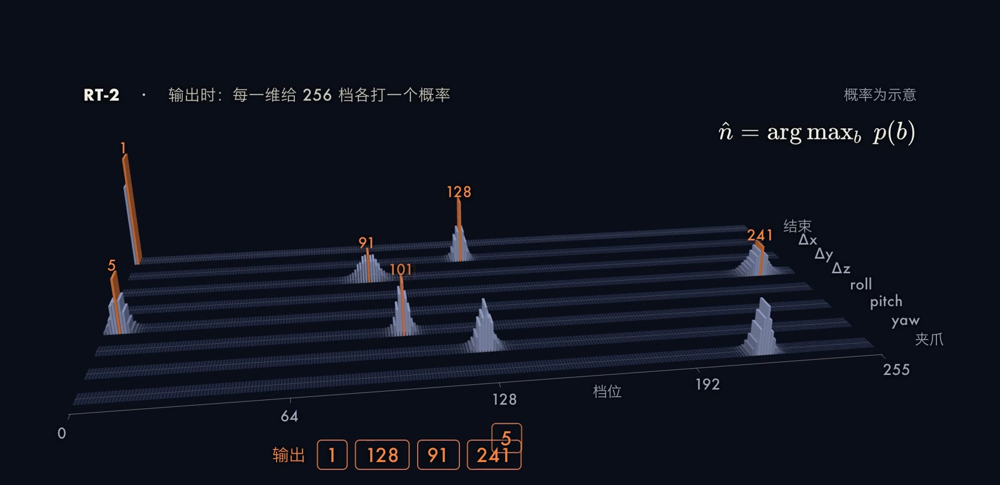

让机器人理解“把灭绝的动物捡起来”这样的指令并完成抓取，需要同时具备语言理解、物体识别和运动控制三种能力。传统做法把它们拆成独立模块，模块之间的接口需要人工设计。Google 在 2023 年提出的 [RT-2](https://arxiv.org/abs/2307.15818) 采用了另一条路线：把图像、文字和机器人动作全部表示成 token，用同一个大型 Transformer 完成从观测到动作的映射，并由此提出了视觉-语言-动作模型（Vision-Language-Action model，VLA）这一名称。[项目页](https://robotics-transformer2.github.io/)中有一个常被引用的演示：桌上摆着几个玩具，指令是拾起一种灭绝的动物，机器人拿起的是恐龙玩具。本文说明这类模型的形式化定义、动作 token 化的细节、训练方式，以及 RT-1、RT-2 和 OpenVLA 之间的关系。

## 问题设定

在时刻 $t$，机器人得到相机图像 $I_t$ 和自然语言指令 $\ell$，需要输出一个末端执行器动作 $\mathbf{a}_t$。RT-2 的动作由终止标志、末端位置的三维位移、姿态的三维旋转变化和夹爪开合程度共 8 个量构成（[Brohan et al., 2023](https://arxiv.org/abs/2307.15818)）。策略记为

$$
\pi_\theta(\mathbf{a}_t\mid I_t,\ell),\qquad \mathbf{a}_t=(a_t^{1},\dots,a_t^{D}),\quad D=8 .
$$

模仿学习的目标是在示范数据集 $\mathcal{D}=\{(I_t,\ell,\mathbf{a}_t)\}$ 上最大化示范动作的似然。VLA 的特点在于，$\pi_\theta$ 就是一个预训练视觉语言模型（Vision-Language Model，VLM），动作被当作另一种“语言”来预测。

 摄像头画面被切成小块，每块对应一个 token，和指令的 token 排成一长串，16×16 的划分是示意。(b) 送进多层 transformer，每个 token 用 attention 读取其他 token，extinct 这个词逐渐和画面中恐龙所在的块建立联系，弧线是示意。(c) 动作也是 token，八个数、每个数 256 档，每档给出一个概率，取最高的一档，逐维输出，概率分布由固定种子的 softmax 生成。(d) 没见过的任务上，RT-1 成功率 32%，RT-2 为 62%，数字来自 RT-2 论文。画面全部来自本期视频。")

## 方法：把观测和动作都写成 token

### 图像与文字的 token 化

文字经过分词器得到词表中的整数序列。图像经过视觉编码器得到一组向量，再投影到与文字 token 相同的嵌入空间，二者拼成一个序列 $x_{1:N}$。不同模型的视觉编码器不同：[RT-1](https://arxiv.org/abs/2212.06817) 使用以指令为条件的 EfficientNet-B3，输出 81 个视觉 token，再经 TokenLearner 压缩到 8 个；RT-2 以 [PaLI-X](https://arxiv.org/abs/2305.18565) 和 [PaLM-E](https://arxiv.org/abs/2303.03378) 作为底座，直接沿用它们的图像编码方式。

### Transformer 中的注意力

序列送入多层 Transformer。每一层的自注意力（[Vaswani et al., 2017](https://arxiv.org/abs/1706.03762)）为

$$
\operatorname{Attention}(Q,K,V)=\operatorname{softmax}\!\left(\frac{QK^{\top}}{\sqrt{d_k}}\right)V ,
$$

$Q$、$K$、$V$ 分别是由各 token 的表示线性映射得到的查询、键和值，$d_k$ 是键的维度。每个 token 对其他所有 token 计算相关性权重，再对值做加权平均，因此指令中的词与图像中的区域可以直接建立联系。逐层叠加之后，extinct 这个词的表示会与画面中恐龙所在区域的表示高度相关。这种常识来自底座模型此前在网络图文数据上的训练，而不是机器人数据。

### 动作离散化

RT-1 提出的做法是把每个连续的动作维度均匀离散为 256 个区间（[Brohan et al., 2022](https://arxiv.org/abs/2212.06817)），RT-2 沿用了这一设计，把终止标志以外的连续维度都离散为 256 档，使一个动作可以表示成 8 个整数。设某一维的取值范围为 $[l_j,u_j]$，离散化可以写成

$$
b^{j}=\operatorname{clip}\!\left(\left\lfloor 256\cdot\frac{a^{j}-l_j}{u_j-l_j}\right\rfloor,\,0,\,255\right).
$$

这是一种常见的均匀分箱写法，用来说明过程，各论文的具体取整方式以原文为准。[OpenVLA](https://arxiv.org/abs/2406.09246) 同样对每一维独立分成 256 档，区间取训练数据动作的 1% 到 99% 分位数，而不是最小值到最大值，这样少数异常动作不会拉宽区间、降低有效分辨率。

整数还需要对应到词表中的 token。RT-2 的两个底座处理方式不同：PaLI-X 的词表里 1000 以内的整数各有一个 token，动作档位直接对应相应数字的 token；PaLM-E 没有这样的整数 token，则把词表中最不常用的 256 个 token 改写成动作词。OpenVLA 同样改写 Llama 分词器中最不常用的 256 个 token。动作最终被写成一个字符串，格式为“终止标志 位移x 位移y 位移z 旋转x 旋转y 旋转z 夹爪”，例如论文给出的示例 `1 128 91 241 5 101 127`。

### 自回归解码与训练目标

设动作的 $D$ 个维度对应的 token 为 $b^{1},\dots,b^{D}$，模型把整个动作的概率按链式法则分解：

$$
p_\theta(b^{1:D}\mid I,\ell)=\prod_{j=1}^{D}p_\theta\big(b^{j}\mid I,\ell,b^{1:j-1}\big),
$$

训练使用与语言模型相同的交叉熵损失：

$$
\mathcal{L}=-\sum_{j=1}^{D}\log p_\theta\big(b^{j}_{\text{demo}}\mid I,\ell,b^{1:j-1}_{\text{demo}}\big).
$$

推理时，模型在每一步对词表给出一个 softmax 概率分布。RT-2 在处理机器人任务时把采样范围限制在合法的动作 token 内，保证输出一定是可执行的动作；本期视频为了演示，每一维取概率最高的档位（贪心解码）。八个 token 依次生成，再反量化为连续动作交给机器人执行。OpenVLA 的训练同样采用标准的下一 token 预测，并且只在动作 token 上计算损失。

### 与网络数据联合微调

直接用机器人数据微调，模型容易遗忘网络预训练得到的知识。RT-2 采用联合微调（co-fine-tuning）：每个训练批次同时包含机器人轨迹和原有的网络视觉语言任务，并提高机器人数据的采样权重。若记机器人数据和网络数据的分布为 $\mathcal{D}_{\text{robot}}$ 与 $\mathcal{D}_{\text{web}}$，混合比例为 $\lambda$，则目标可以写成

$$
\min_\theta\ \lambda\,\mathbb{E}_{\mathcal{D}_{\text{robot}}}\big[\mathcal{L}_{\text{action}}\big]+(1-\lambda)\,\mathbb{E}_{\mathcal{D}_{\text{web}}}\big[\mathcal{L}_{\text{text}}\big].
$$

这是对论文做法的概括写法，论文没有给出这个公式。附录给出的混合比例是：RT-2-PaLI-X 的训练数据中机器人数据约占 50%，RT-2-PaLM-E 约占 66%。

## 代表性工作

- [RT-1](https://arxiv.org/abs/2212.06817)：35M 参数的 Transformer，把相机图像和指令映射为离散动作，以 3 Hz 的频率控制 Everyday Robots 的移动操作臂。训练数据约 13 万条示范，由 13 台机器人在 17 个月内采集，覆盖 700 多条指令。它确立了每维 256 档的动作离散化。
- [RT-2](https://arxiv.org/abs/2307.15818)：把 RT-1 的动作表示搬到 5B 与 55B 的 PaLI-X、12B 的 PaLM-E 之上，用联合微调保留网络知识。它没有采集新的机器人数据，所用的是 RT-1 的数据。
- [Open X-Embodiment](https://arxiv.org/abs/2310.08864)：汇集 22 种机器人的数据集，并训练了 RT-1-X 和 RT-2-X。
- [OpenVLA](https://arxiv.org/abs/2406.09246)：70 亿参数的开源 VLA，以 Llama 2 为语言骨干，视觉端融合 DINOv2 与 SigLIP 的特征，用 97 万条真实机器人示范训练。

## 实验结果与读法

下表整理自 RT-2 与 OpenVLA 论文，以及本期的事实核查笔记。成功率均为论文报告的数值，评测任务和机器人各不相同，不同行之间不能直接比较。

| 比较 | 设置 | 结果 |
| --- | --- | --- |
| RT-1 与 RT-2 | 训练时没见过的物体、背景、环境，平均 | RT-1 为 32%，RT-2（两个版本）为 62% |
| RT-1 与 RT-2 | 训练中见过的任务 | RT-1 为 92%，RT-2 为 91% 和 93% |
| RT-2-X 与 OpenVLA | WidowX（Bridge），170 次试验 | RT-2-X 为 50.6%，OpenVLA 为 70.6% |
| RT-2-X 与 OpenVLA | Google 机器人，60 次试验 | RT-2-X 为 78.3%，OpenVLA 为 85.0% |

OpenVLA 摘要中的“比 55B 的 RT-2-X 高 16.5 个百分点”，是 29 个任务、多种机器人上的平均值，所用参数少 7 倍。这里需要注意两点。其一，RT-2 在见过的任务上与 RT-1 持平，提升集中在没见过的情形，论文明确指出机器人并没有因此学会新的动作，能做的抓取仍来自 RT-1 的示范数据，进步体现在对新指令和新物体的理解上。其二，RT-2-X 在语义泛化上仍优于 OpenVLA。

RT-2 论文还单独评测了需要推理的“涌现能力”，例如符号理解、数学计算和对人物的识别。这些任务的平均成功率为：RT-1 为 17%，VC-1 为 11%，RT-2-PaLM-E-12B 为 40%，RT-2-PaLI-X-55B 为 60%。同一篇论文的消融实验还表明，无论模型大小，联合微调得到的策略比只用机器人数据微调更能泛化。这两项结果共同说明，增益来自网络预训练知识的迁移，而不是机器人数据本身的增加。

OpenVLA 的另一个贡献是使用门槛：预训练使用 64 张 A100 训练了 14 天，而在新任务上用 LoRA 微调只需单张 A100 约 10 到 15 小时，仅更新约 1.4% 的参数，效果与全参数微调相当。需要区分的是，“消费级显卡”只适用于 LoRA 微调和 4 位量化推理，预训练并不在此列。OpenVLA 基础模型也是单臂、单张图像输入的策略，没有使用动作分块。

推理速度是这类模型的主要限制。55B 的 RT-2-PaLI-X 运行频率为 1 到 3 Hz，依赖云端多 TPU 服务；5B 版本约 5 Hz。OpenVLA 在 bfloat16 下占用约 15 GB 显存，在单张 RTX 4090 上约 6 Hz。每次只输出一个动作，高频、精细的操作（例如折叠衣物）因此难以胜任，下一篇文章讨论的动作分块与 flow matching 针对的就是这一点。

本期视频中的机器人和抓取是在 MuJoCo 中的仿真，用来演示原理，并不是对上述论文实验的复现，图中的 attention 弧线和概率分布均为示意。

## 小结

VLA 的核心是一个统一的序列接口：图像、文字和动作都变成 token，由同一个预训练 Transformer 按自回归方式处理，网络上学到的常识因此可以直接作用于动作输出，中间不需要再接一个独立模块。它的代价是离散化带来的精度损失，以及逐 token 解码造成的低控制频率。如何在保留大模型知识的同时输出连续、高频的动作，是后续工作的重点。此外，RT-2 没有公开代码和权重，开源模型直到 Octo 和 OpenVLA 才出现，因此本文的许多细节只能依据论文的描述，无法自行复现检查。
