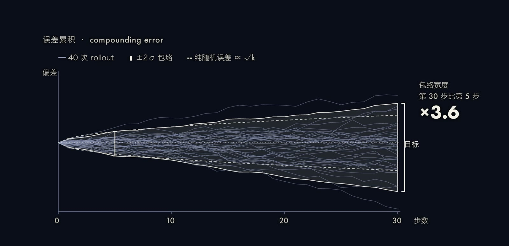
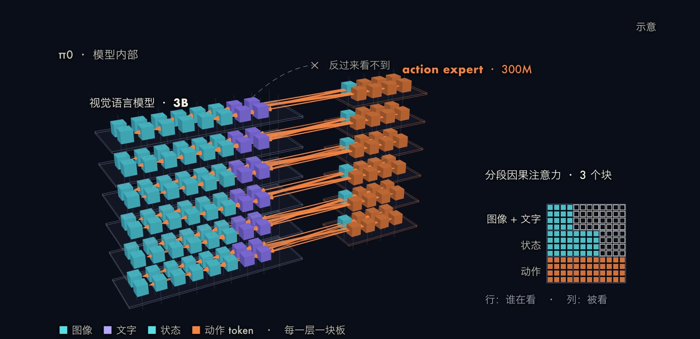
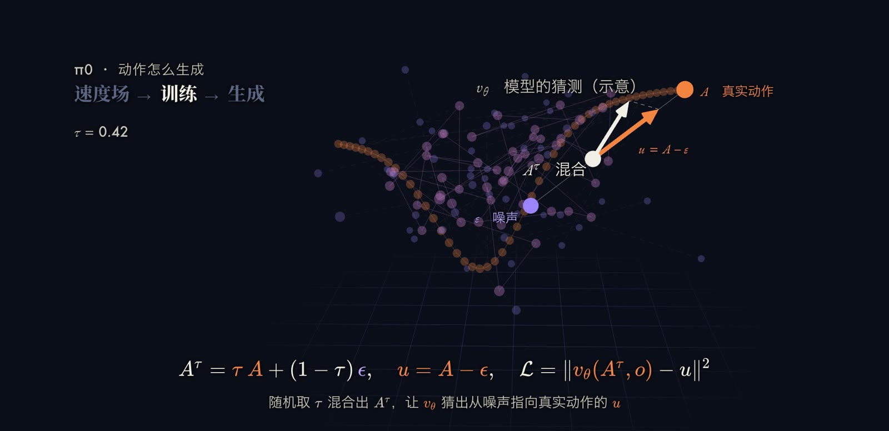
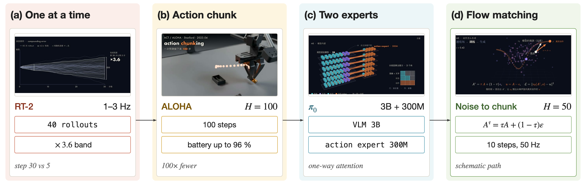

折叠衣物这类任务要求机器人以较高的频率输出平滑的动作，并且布料的形状在每一步都在变化。上一篇介绍的 RT-2 一次只输出一个动作，控制频率只有每秒 1 到 3 次，不适合这类场景。本文说明两个改进：一是动作分块（action chunking），即一次预测未来一整段动作；二是用条件 flow matching 生成这一段连续动作，代表模型是 Physical Intelligence 的 [π0](https://arxiv.org/abs/2410.24164)。最后概述 π0.5 与 π*0.6 在这一架构上做的扩展。

## 问题设定：为什么逐步预测会累积误差

设专家策略为 $\pi^{*}$，任务长度为 $T$ 步。行为克隆在专家的状态分布下训练，每一步的期望错误率为 $\epsilon$；部署时策略一旦偏离专家的轨迹，就会进入训练中很少见到的状态，后续的错误随之增多。[Ross et al. (2011)](https://arxiv.org/abs/1011.0686) 给出了这一现象的界：

$$
J(\pi)\le J(\pi^{*})+T^{2}\epsilon ,
$$

$J$ 是 $T$ 步内的累计代价（代价取值在 $[0,1]$ 内）。误差随任务长度呈二次增长，而不是线性增长，这就是复合误差（compounding error）。对于布料操作，每一步的小偏差改变了布料形状，下一步的观测又与示范中的不同，偏差因此被放大。

本期视频用一个数值模拟展示这一点：40 条固定种子的 rollout，每一步加入一个小的随机误差，并带有各条 rollout 自身的小偏置，误差会带入下一步。第 30 步的误差带宽度是第 5 步的 3.6 倍，高于纯随机误差按 $\sqrt{k}$ 增长所对应的约 2.4 倍（$\sqrt{30/5}$）。这是一个示意性的模拟，不是真实策略的统计结果。

## 方法一：动作分块与时间集成

### 动作分块

[ACT](https://arxiv.org/abs/2304.13705)（Action Chunking with Transformers，Zhao et al., 2023）提出的做法是让策略每次预测未来 $k$ 步的动作，而不是一步：

$$
\pi_\theta(\mathbf{a}_{t:t+k}\mid \mathbf{o}_t)\quad\text{代替}\quad \pi_\theta(\mathbf{a}_t\mid \mathbf{o}_t).
$$

每隔 $k$ 步读入一次观测，依次执行预测出的 $k$ 个动作，因此任务的有效决策次数缩小为原来的 $1/k$。论文把这称为有效时间跨度的 $k$ 倍缩短，按上一节的界做一个粗略的推断，需要做的决策数从 $T$ 降到 $T/k$，累积误差的机会随之减少。分块还可以处理示范中的时间相关因素，例如示范者在中途的停顿。ALOHA 实验中取块长 $k=100$；论文的消融实验中，增强基线方法的成功率从 $k=1$ 时的 1% 提高到 $k=100$ 时的 44%。

ACT 把策略训练成条件变分自编码器（CVAE），目标函数为重构项加上 KL 正则项：

$$
\mathcal{L}=\mathrm{MSE}\big(\hat{\mathbf{a}}_{t:t+k},\mathbf{a}_{t:t+k}\big)+\beta\,D_{\mathrm{KL}}\big(q_\phi(\mathbf{z}\mid \mathbf{a}_{t:t+k},\bar{\mathbf{o}}_t)\,\Vert\,\mathcal{N}(\mathbf{0},I)\big),
$$

$\mathbf{z}$ 是编码示范风格的隐变量，$\bar{\mathbf{o}}_t$ 是不含图像的观测。编码器只在训练时使用，推理时令 $\mathbf{z}=\mathbf{0}$ 做确定性解码。

### 时间集成

若每 $k$ 步才换一次观测，动作会在块的边界处出现跳变。ACT 的做法是在每个时刻都运行一次策略，使不同时刻预测的动作块相互重叠，在某一时刻 $t$ 就有多个对该时刻动作的预测，再按指数权重做加权平均：

$$
\mathbf{a}_t=\frac{\sum_i w_i\,\mathbf{A}_t[i]}{\sum_i w_i},\qquad w_i=\exp(-m\,i),
$$

$\mathbf{A}_t[i]$ 是第 $i$ 个（最早的为 $i=0$）对时刻 $t$ 的预测，$m$ 控制新观测被吸收的速度，$m$ 越小吸收越快。与普通平滑不同，这里平均的是针对同一时刻的多个预测，因此不会引入偏差，也不增加训练代价。值得一提的是，π0 的作者在早期尝试过时间集成，发现它降低了策略性能，最终选择不做聚合，而是开环执行动作块。

## 方法二：π0 的结构与 flow matching

### 结构：VLM 加 action expert

π0 的观测为 $\mathbf{o}_t=[I_t^{1},\dots,I_t^{n},\ell_t,\mathbf{q}_t]$，即 2 到 3 张相机图像、语言指令和关节角状态；输出为长度 $H=50$ 的动作块 $\mathbf{A}_t=[\mathbf{a}_t,\dots,\mathbf{a}_{t+H-1}]$。模型以 [PaliGemma](https://arxiv.org/abs/2407.07726)（30 亿参数的开源 VLM）为骨干，另加 3 亿参数、从头初始化的 action expert，总计 33 亿参数。结构借鉴了 [Transfusion](https://arxiv.org/abs/2408.11039)：同一个 Transformer 内部，连续输出由 flow matching 损失监督，离散输出由交叉熵监督。图像与文本 token 使用 VLM 的权重，机器人状态与动作 token 使用 action expert 的权重，两组权重相当于只有两个专家的混合专家。注意力采用分块因果掩码，共三块：图像与语言、机器人状态、带噪动作。前面的块看不到后面的块，action expert 因此可以读取 VLM 的信息，反过来 VLM 读不到它。action expert 内部的动作 token 之间使用全双向注意力。

### 条件 flow matching 的训练目标

[Flow matching](https://arxiv.org/abs/2210.02747)（Lipman et al., 2022）学习一个向量场，使得沿着这个向量场积分可以把噪声分布搬运到数据分布。π0 采用线性高斯概率路径（也称最优传输路径），取 $\tau=0$ 为噪声、$\tau=1$ 为数据：

$$
q(\mathbf{A}_t^{\tau}\mid\mathbf{A}_t)=\mathcal{N}\big(\tau\mathbf{A}_t,\,(1-\tau)I\big).
$$

训练时采样噪声 $\boldsymbol{\epsilon}\sim\mathcal{N}(\mathbf{0},I)$，构造带噪动作

$$
\mathbf{A}_t^{\tau}=\tau\,\mathbf{A}_t+(1-\tau)\,\boldsymbol{\epsilon},
$$

这条路径对 $\tau$ 求导，得到目标向量场 $u(\mathbf{A}_t^{\tau}\mid\mathbf{A}_t)=\mathbf{A}_t-\boldsymbol{\epsilon}$，即从噪声指向真实动作的方向。网络 $v_\theta$ 的损失为

$$
L^{\tau}(\theta)=\mathbb{E}_{p(\mathbf{A}_t\mid\mathbf{o}_t),\,q(\mathbf{A}_t^{\tau}\mid\mathbf{A}_t)}\Big\lVert v_\theta(\mathbf{A}_t^{\tau},\mathbf{o}_t)-u(\mathbf{A}_t^{\tau}\mid\mathbf{A}_t)\Big\rVert^{2}.
$$

含义是：给定观测和一个混合了噪声的动作块，让网络预测“应该朝哪个方向走才能回到真实动作”。时间步 $\tau$ 从强调较低值（噪声较大一侧）的 Beta 分布采样，$p(\tau)=\mathrm{Beta}\!\big(\tfrac{s-\tau}{s};1.5,1\big)$，其中 $s=0.999$。论文给出的理由是：以观测为条件的动作分布比以文字为条件的图像分布集中得多，因此需要更重视高噪声的时间步。

### 采样

推理时从 $\mathbf{A}_t^{0}\sim\mathcal{N}(\mathbf{0},I)$ 出发，用前向欧拉法沿向量场从 $\tau=0$ 积分到 $\tau=1$：

$$
\mathbf{A}_t^{\tau+\delta}=\mathbf{A}_t^{\tau}+\delta\,v_\theta(\mathbf{A}_t^{\tau},\mathbf{o}_t).
$$

论文取 10 个积分步，即 $\delta=0.1$。观测前缀 $\mathbf{o}_t$ 的注意力键值可以缓存，每个积分步只需重新计算 action expert 对应的后缀，因此一次生成整个动作块的成本约为一次前缀计算加 10 次小网络计算。对照逐个 token 的自回归解码，这样的开销要低得多，同时输出的是连续值，不存在离散化误差。论文在 RTX 4090 上测得的整机推理时间约为 73 毫秒（机载）到 86 毫秒（离机）。执行时，50 Hz 的机器人每 0.5 秒（执行 25 个动作）重新推理一次，20 Hz 的机器人每 0.8 秒（执行 16 个动作）重新推理一次，动作块开环执行。论文提到的控制频率最高为 50 Hz，这是机器人执行动作的频率，不等于模型每秒推理的次数。

### 算法小结

1. 训练：采样一个动作块 $\mathbf{A}_t$、噪声 $\boldsymbol{\epsilon}$ 和时间步 $\tau$，构造 $\mathbf{A}_t^{\tau}$，用 $L^{\tau}$ 回归 $\mathbf{A}_t-\boldsymbol{\epsilon}$。
2. 推理：编码观测前缀并缓存键值；从噪声出发做 10 步欧拉积分，得到 50 步的动作块。
3. 执行：开环执行动作块的前若干步，再用最新观测重新生成。

π0 的预训练数据包含 Physical Intelligence 自采的约 1 万小时灵巧操作数据（7 种机器人配置、68 类任务），以及 OXE、DROID 和 Bridge 数据集。模型再针对叠衣服、从烘干机取衣服等复杂任务做后训练，后者需要的数据从几个小时到一百多个小时不等。

## 后续工作

### π0.5：先说出下一步，再动手

[π0.5](https://arxiv.org/abs/2504.16054) 把策略分解为两层，由同一个模型表示。给定观测 $\mathbf{o}_t$ 和高层指令 $\ell$，先预测一句文本子任务 $\hat{\ell}$（例如“拿起盘子”），再以它为条件预测动作块：

$$
\pi_\theta(\mathbf{a}_{t:t+H},\hat{\ell}\mid\mathbf{o}_t,\ell)=\pi_\theta(\mathbf{a}_{t:t+H}\mid\mathbf{o}_t,\hat{\ell})\;\pi_\theta(\hat{\ell}\mid\mathbf{o}_t,\ell).
$$

训练分两阶段：预训练时把动作通过 [FAST](https://arxiv.org/abs/2501.09747) 分词器转成文本 token，用交叉熵训练，与网络图文数据混合；后训练阶段加入 action expert，用 flow matching 损失监督连续动作，推理时先自回归解码文本，再做 10 步去噪。论文指出，预训练混合数据中有 97.6% 并非来自执行家务的移动操作机器人，而是跨机器人的实验室数据、网络多模态数据等。用于家务的移动操作数据约 400 小时，来自约 100 个家庭环境；评测时在三个训练集中没有出现的真实家庭里清理厨房和卧室，任务时长 10 到 15 分钟。

### π*0.6：从自身经验中学习

[π*0.6](https://arxiv.org/abs/2511.14759) 提出 Recap 方法，让 VLA 能从自己的成功和失败里改进。方法分三步。第一步用蒙特卡罗回报训练一个价值函数 $V^{\pi_{\mathrm{ref}}}(\mathbf{o}_t,\ell)$，它预测距离完成还有多少步（归一化到 $(-1,0)$，0 表示完成）。第二步由价值函数估计每个动作的优势：

$$
A^{\pi_{\mathrm{ref}}}(\mathbf{o}_t,\mathbf{a}_t)=\mathbb{E}\Big[\sum_{t'=t}^{t+N-1}r_{t'}+V^{\pi_{\mathrm{ref}}}(\mathbf{o}_{t+N})\Big]-V^{\pi_{\mathrm{ref}}}(\mathbf{o}_t),
$$

并把优势二值化为指示变量 $I_t=\mathbb{1}\big[A^{\pi_{\mathrm{ref}}}(\mathbf{o}_t,\mathbf{a}_t,\ell)>\epsilon_\ell\big]$，其中 $\epsilon_\ell$ 是与任务相关的阈值。第三步训练一个以 $I_t$ 为条件的策略，使用全部数据（包括成功与失败的尝试）：

$$
\min_\theta\ \mathbb{E}_{\mathcal{D}}\Big[-\log\pi_\theta(\mathbf{a}_t\mid\mathbf{o}_t,\ell)-\alpha\log\pi_\theta(\mathbf{a}_t\mid I_t,\mathbf{o}_t,\ell)\Big].
$$

推理时令 $I_t$ 为“优势为正”，策略就倾向于输出被判定为更好的动作。这个做法与 classifier-free guidance 的思路相近，避免了对流匹配模型很难做的策略梯度。论文还规定，人类在自主执行过程中给出的纠正动作，其 $I_t$ 一律置为正。论文报告，在最困难的任务上，Recap 使吞吐量增加一倍以上，失败率约减半。其中除折叠多样衣物以外，最终模型的成功率均在 90% 以上。论文还报告系统连续制作了 13 小时的意式咖啡；Physical Intelligence 的博客配图说明写的是约 18 小时，两处不一致，这里以论文为准。

之后的 [π0.7](https://arxiv.org/abs/2604.15483) 用更丰富的提示（速度、质量等元数据和视觉子目标图像）引导同一个模型，报告称它能在一台没有采集过叠衣服数据的 UR5e 上完成叠衣服。

## 结果的解读与局限

上面提到的 π0.5、π*0.6 和 π0.7 的结果都由公司自己公布，笔者没有查到独立复现。本期视频中的机器人和布料是 MuJoCo 仿真，误差带和 flow matching 的路径都是示意图，与论文的真实实验无关。ALOHA 的 96% 是 Slot Battery 一项任务在 25 次试验下的成功率，同一篇论文中 Thread Velcro 的最终成功率只有 20%，不能把它当作所有任务的水平。

## 小结

动作分块把决策次数缩减为原来的 $1/k$，缓解了复合误差；条件 flow matching 让模型一次生成连续、平滑的动作块，同时把推理成本控制在“一次前缀加 10 次小网络”的量级。π0 把这两点与预训练 VLM 结合，后续的 π0.5 加入高层子任务预测，π*0.6 加入基于优势的强化学习。仍待解决的问题包括：开环执行动作块与实时反馈之间的取舍、公司内部结果的独立复现，以及如何在不增加大量人工示范的前提下持续改进。
