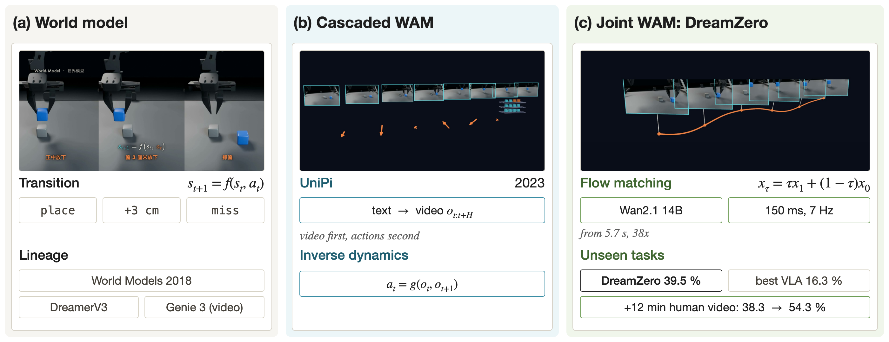
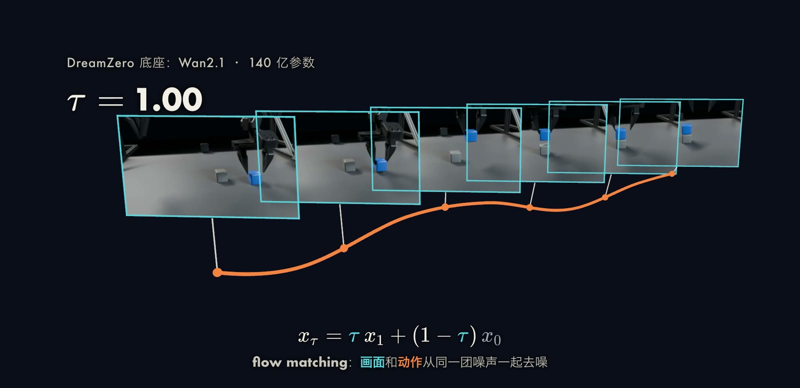
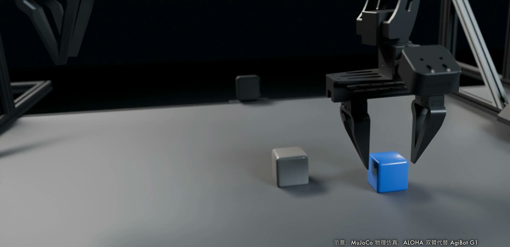
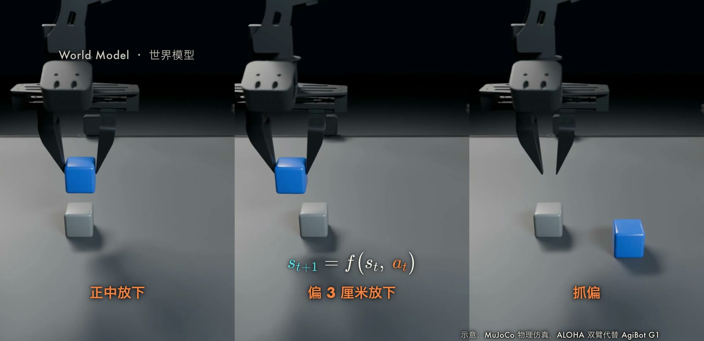

让机器人在行动之前先预测后果，是一个很自然的想法：如果模型能够回答“在当前场景下执行某个动作，接下来画面会怎样变化”，就可以先在模型内部比较多种动作，再选择其中一种执行。
这条技术线最初是低维的世界模型，随后发展为视频生成模型，近期出现了在同一个网络中同时生成未来画面与动作的世界动作模型（World Action Model，WAM）。
NVIDIA 在 2026 年 2 月发布的 [DreamZero](https://arxiv.org/abs/2602.15922) 是其中的代表：在 AgiBot G1 机器人的未见任务（如熨衣服、解鞋带）上，它的平均任务进度为 39.5%，而最好的预训练视觉-语言-动作（Vision-Language-Action，VLA）模型为 16.3%。
本文先给出世界模型的形式化定义，再依次介绍视频世界模型、级联式 WAM（以 UniPi 为例）和联合式 WAM（以 DreamZero 为例），重点推导联合去噪所用的 flow matching 目标，最后讨论其局限。

## 问题设定与世界模型

记时刻 $t$ 的观测为 $o_t$，机器人动作为 $a_t$，语言指令为 $c$。
世界模型学习的是条件转移分布：

$$
p_\theta(o_{t+1} \mid o_{\le t},\, a_{\le t}),
$$

即给定历史观测与已执行的动作，预测下一时刻的观测。
动作不同，预测的未来也不同，这一点正是它能够用于决策的原因。

直接在像素空间建模代价很高，因此常见做法是先用编码器把观测压缩为隐变量 $z_t = \mathrm{enc}(o_t)$，再在隐空间中学习转移模型：

$$
z_{t+1} \sim p_\theta(z_{t+1} \mid z_t,\, a_t,\, h_t), \qquad h_{t+1} = f_\theta(h_t,\, z_t,\, a_t),
$$

其中 $h_t$ 是循环网络的隐状态，用来汇总历史。
有了这样的转移模型，就可以在模型内部做规划（以下为通用形式）：对一段候选动作序列 $a_{t:t+H-1}$，在模型中展开得到想象轨迹 $\hat z_{t+1:t+H}$，再选择使累计回报最大的动作序列：

$$
a^{*}_{t:t+H-1} = \arg\max_{a_{t:t+H-1}}\ \mathbb{E}_{\hat z \sim p_\theta}\Big[\sum_{k=1}^{H} \gamma^{k-1}\, r(\hat z_{t+k},\, a_{t+k-1})\Big].
$$

这里 $H$ 是规划视野，$\gamma$ 是折扣因子，$r$ 是奖励或目标函数。
实际系统中，这个最大化可以用采样优化（如模型预测控制）完成，也可以像下文的 Dreamer 那样训练一个策略网络来近似。

### 早期工作

[Ha 与 Schmidhuber（2018）](https://arxiv.org/abs/1803.10122)的 World Models 由三部分组成：变分自编码器（VAE）把每一帧压缩为隐向量 $z$（CarRacing 为 32 维，VizDoom 为 64 维）；MDN-RNN 预测下一时刻 $z$ 的混合高斯分布；控制器 $C$ 是一层线性映射，输入 $z_t$ 与 RNN 隐状态 $h_t$，输出动作。
论文报告 CarRacing 上控制器只有 867 个参数，得分为 906 ± 21（100 条随机赛道）。
在 VizDoom 任务中，智能体完全在 MDN-RNN 生成的“梦境”里训练，放回真实环境后平均存活约 1092 步，高于 750 步的通过线。
训练梦境时作者把采样温度调到 $\tau = 1.15$，使梦境更难，以减轻模型被智能体利用的问题。

[DreamerV3](https://arxiv.org/abs/2301.04104)（Hafner 等，2023，后发表于 Nature 2025）沿用这一思路：先从回放的真实经验学习世界模型，然后让 actor 和 critic 完全在世界模型预测的隐轨迹上训练。
它用一套固定配置在 150 多个任务上超过了专门调参的方法，并成为第一个不依赖人类数据和课程学习、从零在 Minecraft 中获得钻石的算法。

## 视频世界模型

上述模型预测的是低维隐向量，而不是可以直接观看的画面。
视频世界模型把视频压缩成时空 token 或隐变量，再用 transformer 或扩散模型生成后续内容。
2025 年 8 月发布的 [Genie 3](https://deepmind.google/blog/genie-3-a-new-frontier-for-world-models/) 可以根据用户输入的方向键实时生成新画面，官方给出的规格是 720p、24 帧每秒，视觉一致性可保持数分钟。
这类模型从大量视频中学到物体如何运动与碰撞，但它们本身不输出机器人的动作。
要用于控制，就必须再接上动作。

## 把动作接到视频模型上

接法有两类。

### 级联式：先生成视频，再反推动作

[UniPi](https://arxiv.org/abs/2302.00111)（Du 等，NeurIPS 2023）把决策问题改写为文本条件的视频生成。
给定当前图像 $x_0$ 和文本目标 $c$，条件视频生成器输出一段长为 $H$ 的未来图像序列：

$$
\rho(\cdot \mid x_0, c)\ :\ \mathcal{X} \times \mathcal{C} \rightarrow \Delta(\mathcal{X}^{H}).
$$

随后，一个单独训练的逆动力学（inverse dynamics）模型根据相邻两帧估计中间的动作：

$$
\hat a_t = g_\phi(x_t,\, x_{t+1}).
$$

按论文附录的描述，该模型是一个小网络，用均方误差回归 7 维控制量；视频生成器则使用扩散模型，并通过 classifier-free guidance 加强对文本与首帧的条件作用：$\hat s = (1+\omega)\,s(\tau_k, k \mid c, x_0) - \omega\, s(\tau_k, k)$。
级联式的优点是两个模块可以分别训练，视频部分能够利用没有动作标注的数据；缺点是动作只在视频生成完成之后才被确定，视频中的任何误差都会直接传递给逆动力学模型，且两者之间没有联合优化。

### 联合式：画面与动作一起生成

联合式把未来画面和动作放入同一个生成模型。
[Zhu 等（2025）](https://arxiv.org/abs/2504.02792)的 UWM 是较早的一例：它在一个 transformer 中同时做动作扩散和视频扩散，并为两种模态使用相互独立的扩散时间步，通过在推理时设置时间步，可以在策略、视频预测、前向动力学和逆动力学四种模式之间切换。
下面介绍的 DreamZero 采用的是同一类思想，但把骨干换成了大规模预训练的视频扩散模型。

## DreamZero 的方法

[DreamZero](https://arxiv.org/abs/2602.15922)（Ye 等，2026）以 Wan2.1-I2V-14B-480P 为骨干，是一个 140 亿参数的自回归视频扩散模型。
在骨干上只增加了状态编码器、动作编码器和动作解码器，视频隐变量来自冻结的 VAE，语言来自冻结的文本编码器；训练时更新所有 DiT 模块以及状态与动作的编码和解码器。
模型按块（chunk）自回归地生成：每一块包含 $K$ 个视频隐帧及其对应的动作序列，论文附录中 $K = 2$，默认使用 $M = 4$ 个块；动作时域在 AgiBot 上为 $H = 48$（30 Hz，约 1.6 秒），在 DROID 上为 $H = 24$（15 Hz，同样约 1.6 秒）。

### 联合 flow matching 目标

[Flow matching](https://arxiv.org/abs/2210.02747)（Lipman 等，2022）训练一个速度场，把高斯噪声沿直线输运到数据。
设第 $k$ 个块的干净视频隐变量为 $\mathbf z_1^k$，归一化后的动作为 $\mathbf a_1^k$，噪声为 $\mathbf z_0^k, \mathbf a_0^k \sim \mathcal N(\mathbf 0, \mathbf I)$，则 DreamZero 的线性插值（论文式 2）为：

$$
\mathbf z_{t_k}^{k} = t_k \mathbf z_1^k + (1 - t_k)\,\mathbf z_0^k, \qquad
\mathbf a_{t_k}^{k} = t_k \mathbf a_1^k + (1 - t_k)\,\mathbf a_0^k .
$$

回归目标是从噪声指向数据的恒定速度 $\mathbf v^k := [\mathbf z_1^k, \mathbf a_1^k] - [\mathbf z_0^k, \mathbf a_0^k]$，训练损失（论文式 3）为：

$$
\mathcal L(\theta) = \mathbb E_{\mathbf z,\mathbf a,\{t_k\}}\Big[\frac1K \sum_{k=1}^{K} w(t_k)\,
\big\lVert \mathbf u_\theta\big([\mathbf z_{t_k}^k, \mathbf a_{t_k}^k];\ \mathcal C_k, \mathbf c, \mathbf q_k, t_k\big) - \mathbf v^k \big\rVert^2 \Big].
$$

式中 $\mathbf u_\theta$ 是网络预测的速度，$w(t_k)$ 是时间步权重，$\mathbf c$ 是语言条件，$\mathbf q_k$ 是机器人状态；$\mathcal C_k = \{(\mathbf z_1^j, \mathbf a_1^j)\}_{j<k}$ 是此前所有块的干净视频与动作，即 teacher forcing：模型以干净的历史为条件，去噪当前这一块。
关键之处在于方括号：视频与动作被拼接在一起，用同一个网络、同一个时间步一起去噪，因此动作与它对应的画面之间天然保持一致。

### 推理流程

推理时，当前块从联合噪声 $\mathbf x_0 = [\mathbf z_0, \mathbf a_0] \sim \mathcal N(\mathbf 0, \mathbf I)$ 出发，沿学到的速度场积分到 $t = 1$。
以最简单的欧拉格式说明，每一步为 $\mathbf x_{t_{i+1}} = \mathbf x_{t_i} + (t_{i+1} - t_i)\,\mathbf u_\theta(\mathbf x_{t_i}, t_i)$；论文实际使用的是 Flow UniPC 调度器，这里的欧拉形式仅用于说明原理。完整流程如下：

1. 将相机图像、语言指令和机器人状态编码为条件。
2. 为当前块采样联合高斯噪声。
3. 沿速度场做若干步去噪，得到未来视频隐变量与动作序列。
4. 执行动作，并将真实观测写回 KV cache，替换掉模型生成的画面，从而避免视频误差在后续块中累积。
5. 进入下一块，重复上述过程。

### 实时化

朴素实现需要 16 个去噪步，一个动作块在单张 GPU 上约需 5.7 秒。
论文通过 DiT 缓存把有效去噪步数从 16 降到 4；再提出 DreamZero-Flash，在训练中解耦视频与动作的噪声水平：

$$
t_k^{\text{video}} = 1 - \eta,\quad \eta \sim \mathrm{Beta}(\alpha, \beta),\ \alpha > \beta, \qquad t_k^{\text{action}} \sim \mathcal U(0, 1).
$$

这样视频部分更多地处于高噪声状态，模型学会即便画面还很粗糙也能给出可用的动作，推理步数可进一步降到 1 步。
综合各项优化，延迟从 5.7 秒降到约 150 毫秒（论文报告加速 38 倍），闭环控制频率约为 7 Hz。

## 实验结果

以下数字均来自 DreamZero 论文与项目页。

| 设置 | DreamZero | 对比 |
| --- | --- | --- |
| AgiBot G1，已见任务，平均任务进度 | 62.2% | 最佳预训练 VLA 27.4% |
| AgiBot G1，未见任务，平均任务进度 | 39.5% | 最佳预训练 VLA 16.3%，从零训练的 VLA 低于 1% |
| 未见任务，加 12 分钟人类视频（无动作标注）| 38.3% 升至 54.3% | 相对提升约 42% |

对比的 VLA 为 GR00T N1.6 与 π0.5。
未见任务包括解鞋带、熨衣服、画圆、折叠地图等。
论文还报告，仅用 12 分钟没有动作标签的人类视频，未见任务的任务进度就能由 38.3% 升至 54.3%，原因在于视频预测目标本身不需要动作标注；在新机器人 YAM 上，约 30 分钟的 play data 就足以完成适配，同时保留零样本泛化。

## 局限

论文指出，DreamZero 的大多数失败来自视频生成错误，而不是动作预测错误：策略会忠实执行视频所预测的轨迹，所以画面一旦出错，动作也随之出错。
这既是弱点，也说明了改进方向：视频骨干越准确，整体策略越好。
此外，当前模型的上下文窗口只有约 6 秒，对插钥匙这类亚厘米精度的任务仍然不够精确。

下图是我们为讲解世界模型而做的一个小示意：在 MuJoCo 中让 ALOHA 机器人从同一个起始状态出发，分别执行三种动作，得到三种不同的未来。
它只用于说明“动作不同则后果不同”，不是 DreamZero 的实验，也没有测量任何成功率。

## 小结

世界模型学习 $p(o_{t+1} \mid o_{\le t}, a_{\le t})$，视频世界模型把它扩展到高维画面，而 WAM 进一步让同一个网络同时输出画面与动作。
级联式（UniPi）实现简单、数据利用灵活，联合式（DreamZero、UWM）则通过共享的去噪过程让动作和画面保持一致。
目前的瓶颈集中在视频生成的准确度、上下文长度和高精度操作上，这些也是后续工作的主要方向。
