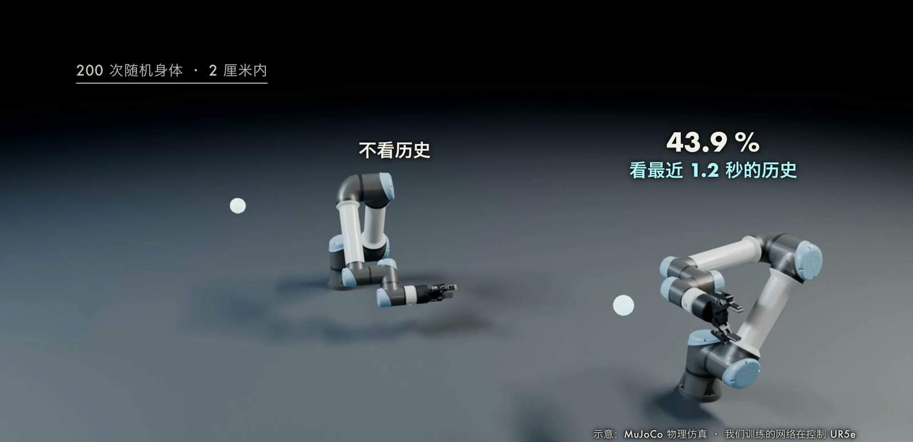
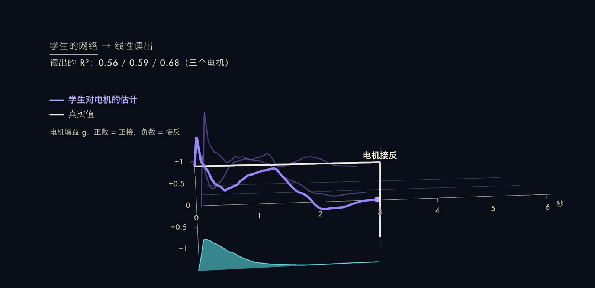

神经网络通常通过梯度下降更新权重来适应新任务，而大型语言模型表现出另一种能力：只要在输入中给出若干示例，模型就能在不改变任何参数的情况下完成新任务，这被称为上下文学习（In-Context Learning，ICL）。
对机器人而言，类似的需求更加迫切：身体的变化（负载、磨损、电机故障、接线错误）无法穷举，而重新训练既慢又不安全。
本文先给出 ICL 的形式化定义，介绍两种主流的理论解释，再用两个我们自己做的仿真实验说明：一个小型 transformer 如何在上下文中学会线性函数，以及一个只看最近 1.2 秒历史的策略如何识别出被接反的电机。
最后概述 LocoFormer 和 S1 这两项机器人 ICL 的代表工作。

 小transformer在上下文里学没见过的线性函数，1000个新提示的平均误差，看到5个例子降到0.04，19个只剩0.0016；打乱y的顺序后误差是1.26，函数放大2.5倍后是0.045。(b) UR5e的电机增益随机变化、约35%接反，老师知道接法，学生只看最近1.2秒的历史。(c) 200次随机身体里2厘米内的比例，看历史的60.5%，不看历史的0.5%；从网络里读出的电机估计，R²在0.56到0.68之间，接反后0.1秒内翻过零。画面截自本期视频。")

## 问题设定：上下文学习的形式化

设有一族任务，每个任务由隐变量 $\tau$（例如一个线性函数的权重，或者一台机器人的身体参数）决定。
训练时，模型 $f_\theta$ 看到大量不同的任务；测试时，给它一段来自某个新任务的上下文（提示）

$$
P_n = (x_1, y_1, \dots, x_n, y_n, x_{q}),
$$

要求它预测查询点 $x_q$ 对应的输出 $y_q$。
记预测为 $\hat y_q = f_\theta(P_n)$。
训练目标是在任务分布上最小化各前缀位置的平均损失：

$$
\min_\theta\ \mathbb E_{\tau,\,x_{1:n+1}}\Big[\frac{1}{n+1}\sum_{i=0}^{n}\ell\big(f_\theta(P_i),\, y_{i+1}\big)\Big].
$$

这里 $P_i$ 表示只含前 $i$ 对示例的提示。
关键的一点是：测试时 $\theta$ 固定，所谓“学习”只发生在前向计算内部，$f_\theta$ 把 $P_n$ 当作数据，隐式地推断 $\tau$ 并据此输出预测。

[Brown 等（2020）](https://arxiv.org/abs/2005.14165)的 GPT-3 论文把这种用法称为 few-shot learning：将少量示例作为条件输入，不做任何梯度更新或微调。
论文报告 1750 亿参数的模型在三位数加法上，零样本准确率为 34.2%，few-shot 约为 80%。

## 为什么 transformer 能做到

### 回路层面：induction head

[Olsson 等（2022）](https://arxiv.org/abs/2209.11895)发现了一种由两个注意力头组成的回路，称为 induction head：当序列中出现 $[A][B] \dots [A]$ 时，它会把 $[B]$ 补全出来。
作者观察到这一回路在训练中突然出现，并与 ICL 能力的突然提升同时发生。

### 算法层面：一次前向传播中的学习算法

另一类解释是：transformer 在前向传播里实现了某种标准学习算法。
[von Oswald 等（2022）](https://arxiv.org/abs/2212.07677)证明，在合适的参数下，一层线性自注意力可以精确实现线性回归平方损失上的一步梯度下降。
对于损失 $L(W) = \frac{1}{2N}\sum_{i=1}^{N}\lVert W x_i - y_i\rVert^2$，从 $W_0 = 0$ 出发的一步更新为

$$
W_1 = W_0 - \eta\,\nabla_W L(W_0) = \frac{\eta}{N}\sum_{i=1}^{N} y_i x_i^{\top},
$$

于是对查询点的预测为 $\hat y_q = W_1 x_q = \frac{\eta}{N}\sum_i y_i\,(x_i^\top x_q)$：它恰好是一种以内积 $x_i^\top x_q$ 为注意力权重、对 $y_i$ 加权求和的形式，这就是线性注意力能够表示它的原因。
堆叠 $K$ 层可对应 $K$ 步。
作者称之为 mesa-optimization。
[Akyürek 等（2022）](https://arxiv.org/abs/2211.15661)进一步证明 transformer 可以实现梯度下降与闭式岭回归，并发现训练出的 ICL 预测器随深度和噪声的变化，在梯度下降、岭回归和最小二乘之间过渡。
需要说明，这两项工作的结论都限于线性回归这一玩具设定。

## 实验一：在上下文里学线性函数

[Garg 等（2022）](https://arxiv.org/abs/2208.01066)提出了研究 ICL 的标准设定：每个提示采样一个新的函数 $f$，输入 $x_i \sim \mathcal N(0, I_d)$，输出 $y_i = f(x_i)$。
线性函数类取 $f(x) = w^\top x$，$w \sim \mathcal N(0, I_d)$。
他们发现训练后的 transformer 与最优最小二乘估计器表现相当。
我们按此设定做了一个小规模复现。

**设置。** $d = 5$，无噪声，每个提示含 20 对 $(x, y)$，每个提示都是全新的随机函数。
模型是 6 层、4 头、宽度 128 的因果 transformer，共 1,195,905 个参数。
使用 Adam，学习率 $3\times10^{-4}$，批大小 128，训练 30,000 步，在 M5 Max 的 MPS 后端上约 9 分钟。
评测用 1000 个新提示，误差按维度归一化，因此预测 0 时约为 1。
基线是最小二乘（$n \ge d$ 后可以精确解出 $w$）和最近 3 个邻居平均。

| 看过的例子数 $n$ | 0 | 1 | 2 | 3 | 4 | 5 | 6 | 7 | 9 | 19 |
| --- | --- | --- | --- | --- | --- | --- | --- | --- | --- | --- |
| transformer | 0.952 | 0.879 | 0.595 | 0.458 | 0.198 | 0.040 | 0.013 | 0.005 | 0.003 | 0.0016 |
| 最小二乘 | 0.954 | 0.873 | 0.592 | 0.449 | 0.184 | 0 | 0 | 0 | 0 | 0 |
| 最近 3 个邻居平均 | 0.954 | 2.041 | 1.525 | 1.525 | 1.102 | 1.003 | 0.763 | 0.768 | 0.569 | 0.460 |

**解读。** 在 $n < d$ 时，最小二乘本身是欠定的，transformer 的误差与它几乎重合；$n \ge 5$ 之后最小二乘降为 0，transformer 也迅速降到 $10^{-2}$ 量级以下，到 19 个例子时为 0.0016。
测试前后参数总和完全相同，因此所学内容只能来自上下文。
两个对照也符合预期：把每个提示中 $y$ 的顺序打乱（破坏 $x$ 与 $y$ 的对应）后，误差不降反升，最后为 1.26；把函数放大到 2.5 倍（训练中没出现过的尺度），最终误差为 0.045，约为正常情况下 0.0016 的 28 倍。
这说明模型学到的是训练分布内的一种算法，而不是对任意线性函数都稳健的求解器。

**局限。** 模型很小，函数类单一，且只有 5 维；这个实验验证的是机制，不能直接推出大模型的行为。

## 实验二：电机接反的机械臂

### 问题设定

把上下文从示例换成机器人自己的历史。
我们在 MuJoCo 的 UR5e 上控制三个关节（肩部旋转、肩部抬升、肘部），以关节速度命令控制，频率 20 Hz，每回合 6 秒。
每个回合随机抽取隐藏的身体参数：第 $i$ 个电机的增益 $g_i = s_i \lvert g_i \rvert$，其中 $\lvert g_i\rvert \sim \mathcal U(0.4, 1.4)$，符号 $s_i = -1$ 的概率为 0.35（电机接反）。
训练中使用理想化的速度跟踪模型

$$
q_{t+1} = q_t + \mathrm{diag}(g)\,u_t\,\Delta t, \qquad \Delta t = 0.05\ \mathrm{s},
$$

其中 $q_t$ 是关节角，$u_t$ 是命令（限幅 $\pm 2$）。
策略看不到 $g$，只能通过“发出命令后关节怎么动”来推断它。

### 老师与学生

**老师**知道 $g$。它先用雅可比阻尼伪逆算出末端走向目标所需的关节速度 $v^{*}$，再除以增益：

$$
v^{*} = \operatorname{clip}\Big(J^{\top}\big(JJ^{\top} + \lambda I\big)^{-1}\, 2.5\,(p^{\mathrm{goal}} - p),\ \pm 1.2\Big), \qquad u^{*} = \operatorname{clip}\big(v^{*} \oslash g,\ \pm U_{\max}\big).
$$

式中 $p$ 是末端位置，$J$ 是雅可比，$\lambda = 10^{-3}$，$\oslash$ 为逐元素除法。
**学生**是一个因果 transformer，输入最近 $H = 24$ 步（1.2 秒）的观测，每步 15 维：关节角、到目标的误差、放大 10 倍并截断的近距离误差、上一步命令、测得的关节速度。
学生用均方误差回归老师的动作，并通过 DAgger 训练（共 8 轮，每轮 500 个回合），所以它见到的是自己策略所产生的状态分布。
**对照**是只看当前一步的多层感知机（只输入关节角和到目标的误差）。
训练的任务还包括回合中途换新目标，其中六成同时接反一个电机。
这样设计的原因是：机械臂停在目标上时，电机接反了也没有任何可观察的后果，只有运动才产生证据；第一版没有这一设计，2 厘米内的成功率只有 18.5%。

### 结果

在 200 次随机身体（权重冻结）的评测中：

| 策略 | 2 cm 内 | 3 cm 内 | 有电机接反时 2 cm 内 | 换目标并接反后 3 cm 内 |
| --- | --- | --- | --- | --- |
| 看最近 1.2 秒历史 | 60.5% | 79% | 54.7% | 76% |
| 不看历史 | 0.5% | 1% | 0.7% | 2% |
| 知道接法的老师 | 100% | 100% | 100% | 95% |

此外，我们把冻结的学生放到完整的 MuJoCo UR5e 上（带自己的位置伺服，训练时没见过）：同一场景中，看历史的网络最终误差 1.58 cm，不看历史的网络越甩越远，最终差 86 cm，老师为 0.01 cm。
接反的那一刻，看历史的网络第一条命令是 $-1.05$（仍按原来的接法），关节朝相反方向走了约 0.07 秒，随后它把命令改为 $+2.0$。

### 探针实验：身体参数是否写在隐状态里

为检验网络是否真的推断了增益，我们取学生最后一层的隐藏状态 $h_t$，用线性回归读出 $g$：$\hat g = W h_t + b$，只在机械臂运动的时刻拟合。
三个电机的 $R^2$ 分别为 0.56、0.59 和 0.68。
在演示回合中，电机 0 在第 60 步（3 秒）被接反并同时换目标：读出的估计在 0.1 秒内越过零，0.3 秒后达到 $-0.86$；机械臂停下以后，估计又慢慢回到 0 附近。

**限制。** 这是一个三关节、仅有增益变化的仿真任务；学生在理想化模型上训练，只在 MuJoCo 中做了一次迁移检验；$R^2$ 说明增益信息部分可线性读出，不代表网络采用了某种特定算法。
机械臂静止时，接反的电机无法被发现，这是上下文方法的固有边界：没有动作就没有证据。

## 机器人上的 ICL 工作

[LocoFormer](https://arxiv.org/abs/2509.23745)（Liu、Pathak 与 Agarwal，Skild AI，2025）用大规模强化学习（PPO）加较强的域随机化，在程序化生成的双足、四足和轮足机器人上训练一个带 segment 级循环的 Transformer-XL，上下文可以跨越回合边界。
论文中的骨干为 6 层，有效记忆约 896 个时间步，在 50 Hz 下约 18 秒，训练覆盖约 10 万个机器人（公司自述约一千年的模拟经验）。
在 10 个训练中没见过的机器人上，模拟中的平均归一化目标位移为：zero-shot 0.96，few-shot 0.98，专家策略 0.99。
论文展示的案例包括膝关节被锁死后约 2 至 3 秒内改用三条腿行走；真机部分只有定性展示，没有定量成功率。

[S1](https://www.skild.ai/blogs/s1)（Skild AI，2026 年 8 月）则把任务说明从语言换成一段示范视频，示范可来自不同的场景、视角甚至本体。
官方博客报告，在 10 万小时预训练数据规模下，没见过的任务上 ICL 的成功率为 66%，以语言提示的 VLA 为 9%，且展示的例子没有微调或后训练。
这些数字来自厂商博客而非同行评审的论文，评测任务为长时程任务且失败时有人类介入恢复，解读时应当注意。

## 小结

ICL 把“适应”从权重更新转移到了前向计算：训练阶段让模型见过足够多样的任务，使它在测试时能从上下文中推断任务的隐变量。
我们的两个仿真实验显示了两点：其一，小 transformer 在线性回归上的行为接近最小二乘，但超出训练分布后误差明显变大；其二，让学生只看 1.2 秒历史，就能在 200 次随机身体中让 60.5% 的回合停在目标 2 厘米以内，而不看历史的对照只有 0.5%。
对于自己的机器人，一种可复现的做法是先写一个知道真实参数的老师，再训练只看历史的学生，历史长度和身体变化的范围决定它能适应到哪一步。
开放问题包括：上下文如何超出训练分布、静止时的不可观测性、以及能否在真机上量化这种适应能力。
