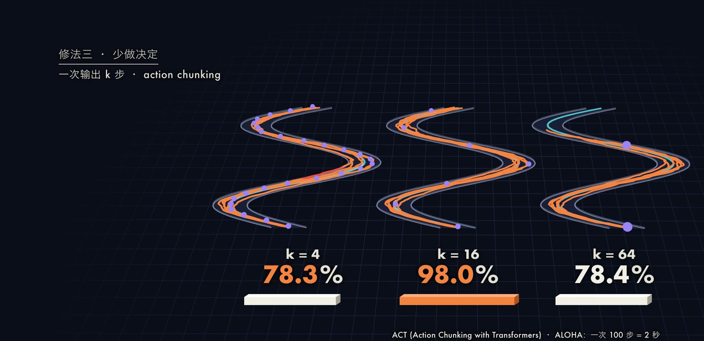
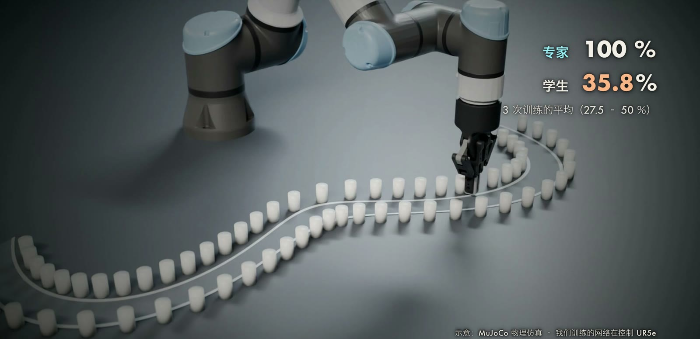
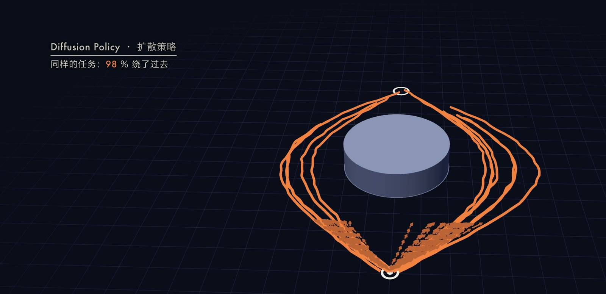

模仿学习（Imitation Learning）让机器人从专家示范中学习策略，其中最直接的方法是行为克隆（Behavior Cloning，BC）：把示范中的状态与动作配成监督学习数据，训练网络“看到什么就做什么”。
然而 BC 有一个经典问题：策略一旦出现小误差，就会进入示范中没有覆盖的状态，在那里的预测更不可靠，误差逐步放大，最终偏离很远。
本文先用 Ross 等人的分析说明误差为什么随时域长度 $T$ 以平方速度累积，再介绍三类修复：在线纠正（DAgger）、示范时注入噪声（DART）和一次输出动作序列（action chunking），最后讨论多模态示范下均方误差回归的失效，以及扩散策略（Diffusion Policy）如何处理。
文中的实验都是我们自己做的二维小规模仿真，用来说明机制，不能直接外推到真实机器人。

 左边只学完美示范的BC有35.8%留在车道里，右边补过一轮标注的DAgger是100%；下方柱子是单个种子里偏离中线的中位数，BC在第25步0.075、第50步0.169（车道半宽0.12），专家约0.007。(b) 三种修法的成功率，三个种子的均值：DAgger补一轮；DART给示范每步加0.002或0.005的偏差；action chunking一次走4、16、64步。(c) 绕障碍实验，BC用均方误差，200次全撞，缩小版扩散策略98%绕过去；下方是Chi等2023年真机推积木的结果，来自原论文。画面来自本期视频，机械臂是MuJoCo仿真。")

## 问题设定与行为克隆

设状态为 $s$，动作为 $a$，专家策略为 $\pi^{*}$，时域长度为 $T$。
示范数据集 $\mathcal D = \{(s_i, a_i)\}$ 由专家在其自身的状态分布 $d_{\pi^{*}}$ 下采集，其中 $a_i = \pi^{*}(s_i)$。
行为克隆通过监督学习最小化

$$
\hat\pi_{\mathrm{BC}} = \arg\min_{\pi_\theta}\ \mathbb E_{(s,a)\sim\mathcal D}\big[\ell\big(\pi_\theta(s),\,a\big)\big],
$$

其中 $\ell$ 为损失函数，连续动作常取均方误差 $\ell(\hat a, a) = \lVert \hat a - a\rVert^2$。

### 为什么误差会累积

监督学习假设测试分布与训练分布一致，但策略执行时，下一个状态由策略自己的动作决定，所以测试时的状态分布 $d_{\hat\pi}$ 与训练分布 $d_{\pi^{*}}$ 不同，这称为协变量偏移（covariate shift）。
[Ross 等（2011）](https://arxiv.org/abs/1011.0686)给出了形式化的结论。
记任务代价 $C \in [0,1]$，策略的总代价为

$$
J(\pi) = \sum_{t=1}^{T}\mathbb E_{s\sim d^{t}_{\pi}}\big[C_\pi(s)\big] = T\,\mathbb E_{s\sim d_\pi}\big[C_\pi(s)\big],
$$

其中 $d_\pi^{t}$ 是策略 $\pi$ 在第 $t$ 步的状态分布，$d_\pi$ 是其对 $T$ 步的平均。
假设损失 $\ell$ 是 0-1 损失的上界，且在专家的状态分布上的期望损失为 $\mathbb E_{s\sim d_{\pi^{*}}}[\ell(s,\pi)] = \epsilon$，则（论文定理 2.1）

$$
J(\pi) \le J(\pi^{*}) + T^{2}\epsilon,
$$

论文指出这个界是紧的。

直观上可以这样理解（这是启发式的推导，不是论文的证明）：每一步以概率约 $\epsilon$ 犯错；一旦犯错，策略进入专家从未示范过的状态，此后剩余的 $T - t$ 步都可能付出代价。
对所有时刻求和，得到 $\sum_{t=1}^{T}\epsilon\,(T-t) \approx \epsilon T^2/2$，即误差随 $T$ 平方增长，而不是监督学习所预期的线性增长 $O(T\epsilon)$。

## 修复一：DAgger，在线纠正

DAgger（Dataset Aggregation）的思路是让训练分布覆盖策略自己会到达的状态。
第 $i$ 轮执行混合策略

$$
\pi_i = \beta_i\,\pi^{*} + (1-\beta_i)\,\hat\pi_i ,
$$

收集访问到的状态，并由专家标注动作：$\mathcal D_i = \{(s, \pi^{*}(s))\}$。
随后聚合数据 $\mathcal D \leftarrow \mathcal D \cup \mathcal D_i$，在全部数据上训练下一轮的策略 $\hat\pi_{i+1}$。完整流程如下：

1. 用专家示范训练初始策略 $\hat\pi_1$。
2. 执行混合策略 $\pi_i$（通常 $\beta_i$ 随 $i$ 衰减），记录访问到的状态。
3. 让专家对这些状态给出动作标签，得到 $\mathcal D_i$。
4. 聚合 $\mathcal D \leftarrow \mathcal D \cup \mathcal D_i$，重新训练得到 $\hat\pi_{i+1}$。
5. 重复若干轮，选出验证表现最好的策略。

在损失强凸且有界、混合系数满足 $\beta_i \le (1-\alpha)^{i-1}$ 等假设下，论文证明（定理 3.2，无限样本情形）：当迭代轮数 $N$ 为 $\tilde O(uT)$ 时，存在某个 $\hat\pi \in \hat\pi_{1:N}$ 使得

$$
J(\hat\pi) \le J(\pi^{*}) + u\,T\,\epsilon_N + O(1),
$$

其中 $\epsilon_N$ 是在迭代所见分布上的最优策略的平均损失，$u$ 满足：在策略可能到达的任何状态，偏离专家一步所多付出的代价至多为 $u$（通常 $u$ 为常数量级）。
与 BC 相比，$T^2\epsilon$ 降为 $T\epsilon$：误差由平方累积变为线性累积。
代价是需要专家在训练过程中持续在场给出标注。

## 修复二：DART，示范时注入噪声

[DART](https://proceedings.mlr.press/v78/laskey17a.html)（Laskey 等，CoRL 2017）不修改学习算法，而是改变数据采集：在采集示范时向专家的动作中注入噪声，使数据中包含“被扰动之后如何回到正轨”的样本。
按论文摘要，噪声水平会被优化，使其逼近机器人所训练策略的误差。
可以写成：执行动作 $\tilde a_t = \pi^{*}(s_t) + \varepsilon_t$（$\varepsilon_t$ 为零均值噪声），而监督标签仍记录专家在该状态下的动作 $\pi^{*}(s_t)$。
这样得到的数据覆盖了更宽的状态分布，且不需要专家在训练阶段在线参与。
论文还给出理论分析，说明在策略存在非零误差时，DART 对协变量偏移的减轻优于 BC。

## 修复三：action chunking

[ACT](https://arxiv.org/abs/2304.13705)（Action Chunking with Transformers，Zhao 等，RSS 2023）让策略一次预测未来 $k$ 步的动作 $a_{t:t+k}$，而不是单步。
论文指出，这使任务的有效时域缩短为原来的 $1/k$，从而减少误差累积的机会。
ACT 把策略训练为条件变分自编码器（CVAE），目标为

$$
\mathcal L = \mathcal L_{\mathrm{reconst}} + \beta\,\mathcal L_{\mathrm{reg}}, \qquad
\mathcal L_{\mathrm{reg}} = D_{\mathrm{KL}}\big(q_\phi(z \mid a_{t:t+k}, \bar o_t)\,\big\|\,\mathcal N(0, I)\big),
$$

其中 $\bar o_t$ 为观测，$z$ 为风格变量，论文中取 $\beta = 10$、$k = 100$。
推理时，可以对多次重叠预测做时间集成（temporal ensembling）：

$$
a_t = \frac{\sum_i w_i\, A_t[i]}{\sum_i w_i}, \qquad w_i = \exp(-m\,i),
$$

其中 $A_t[i]$ 是各次预测中针对时刻 $t$ 的动作，$m$ 控制新观测被纳入的速度，较小的 $m$ 表示更快。
需要注意，块的长度存在折中：太短时决策次数多，每次都可能在没见过的状态下出错；太长时开环执行时间过久，被扰动后无法及时修正。

## 修复四：多模态示范与扩散策略

当同一状态下存在多种合理动作时（例如绕障碍时可以从左也可以从右），均方误差回归会学到条件均值：

$$
\arg\min_{\hat a}\ \mathbb E_{a\sim p(a\mid s)}\lVert \hat a - a\rVert^2 = \mathbb E[a\mid s].
$$

当两种绕法对称时，均值恰好是直行，而直行会撞上障碍。
更好的做法是建模整个条件分布 $p(a \mid s)$ 并从中采样。

[Diffusion Policy](https://arxiv.org/abs/2303.04137)（Chi 等，RSS 2023）把策略表示为以观测 $\mathbf O_t$ 为条件的去噪扩散过程（[DDPM](https://arxiv.org/abs/2006.11239)）。
训练时，从数据中取动作序列 $\mathbf A_t^{0}$，采样扩散步 $k$ 和噪声 $\epsilon^k$，让网络预测所加噪声（论文式 5）：

$$
\mathcal L = \mathrm{MSE}\big(\epsilon^{k},\ \epsilon_\theta(\mathbf O_t,\ \mathbf A_t^{0} + \epsilon^{k},\ k)\big).
$$

这里是论文采用的紧凑写法；在标准 DDPM 中，加噪后的输入为 $\sqrt{\bar\alpha_k}\,\mathbf A_t^{0} + \sqrt{1-\bar\alpha_k}\,\epsilon^k$。
推理时从高斯噪声 $\mathbf A_t^{K}\sim\mathcal N(0,I)$ 出发，依次迭代（论文式 4）：

$$
\mathbf A_t^{k-1} = \alpha\Big(\mathbf A_t^{k} - \gamma\,\epsilon_\theta(\mathbf O_t,\ \mathbf A_t^{k},\ k) + \mathcal N(0,\sigma^2 I)\Big),
$$

其中 $\alpha,\gamma,\sigma$ 由噪声调度决定，最终得到干净的动作序列 $\mathbf A_t^{0}$。
随机的初始噪声使每次采样可以落入不同的模态，这正是它能处理多模态示范的原因。
Diffusion Policy 还采用滚动时域控制：预测 $T_p$ 步，只执行前 $T_a$ 步，再重新预测。
论文在真机上使用 100 步训练、10 步 DDIM 推理，在 Nvidia 3080 上延迟约 0.1 秒。

## 我们的实验

### 实验一：一步错，步步错

**设置。** 一个点沿弯曲车道从 $y=-1$ 走到 $y=1$，共 100 步，车道半宽 0.12。
专家是反馈控制器，沿车道前进，同时每步把偏差拉回 35%。
专家开 40 遍作为示范；“完美示范”中没有任何偏差，所以数据里没有“偏了如何拉回来”的片段。
测试时每步施加标准差为 0.008 的随机推力，所有策略面对完全相同的 200 组推力，指标为全程不出车道的比例。
学生是多层感知机，输入位置，输出接下来 $k$ 步的位置偏移，执行完一段再重新预测。
下表为 3 个种子的均值（括号内为范围），每个种子的示范和网络初始化均不同。

| 设置 | 全程留在车道内 |
| --- | --- |
| 专家本人 | 100% |
| BC，完美示范，每步决策 | 35.8%（27.5 至 50）|
| BC，示范每步带 0.002 的偏差 | 80.5%（64 至 89）|
| BC，示范每步带 0.005 的偏差 | 99.7%（99.5 至 100）|
| 完美示范，一次 4 步 | 78.3%（76.5 至 80.5）|
| 完美示范，一次 16 步 | 98.0%（97 至 98.5）|
| 完美示范，一次 64 步 | 78.5%（76.5 至 81.5）|
| DAgger，完美示范起步，补一轮标注 | 100%（3 个种子均为 100%）|

**DAgger 的做法。** 让学生自己开 20 遍，专家在其实际到达的状态上标注动作，再训练一次，只补了一轮。

**解读。** 示范越完美，学生越不会自救：完美示范下只有 35.8% 的回合留在车道内，示范带一点偏差后（对应 DART 的思路，但这里是固定幅度的偏差，不是 DART 论文中优化噪声水平的做法）上升到 99.7%。
在单个种子的诊断中，完美示范下的学生偏离中线的中位数在第 25 步为 0.075，第 50 步为 0.169（已超出车道半宽 0.12），专家始终约为 0.007，学生在车道外平均停留 33 步。
需要如实说明，这些学生最后都回到了车道内（车道在终点附近回到中线），所以这里观察到的是中途越偏越远，而不是一去不回。
Action chunking 的结果出现了最优块长：4 步为 78%，16 步为 98%，64 步又回落到 78%，与上面所说的折中一致。

**机械臂版本。** 为了在真实的刚体接触下观察，我们把同一条车道按 120° 圆弧（约 1.15 米）铺在 MuJoCo 的完整 UR5e + Robotiq 2F-85 周围，两侧每 4 厘米立一根小立柱，碰到就倒。
策略读取的是机械臂的指令位置，推力也加在该指令上，由机械臂自己的位置伺服执行。
用同一组推力（从 40 组中选出的一组 BC 出车道的情形，三个种子平均下 BC 约有 64% 的回合会出车道，因此这是常见情况）：

| 同一组推力 | 最大偏离（车道半宽为 0.12）| 碰倒立柱 |
| --- | --- | --- |
| BC（完美示范）| 0.332 | 18 根 |
| DAgger（一轮）| 0.024 | 0 |
| 专家 | 0.023 | 0 |

### 实验二：两个都对的答案

**设置。** 一个点从 $(0,-1)$ 走到 $(0,1)$，正中间有半径 0.35 的圆形障碍。
200 条示范都从同一点出发，一半从左绕、一半从右绕（绕开幅度在 0.55 到 0.8 随机）。
两种策略使用相同的示范和相同的动作格式：每次预测接下来 8 步的位置偏移，执行前 4 步后重新预测。
BC 是用均方误差直接回归这 8 步的多层感知机；缩小版 Diffusion Policy 使用同样大小的多层感知机作去噪网络，50 步 DDPM。
两者训练 20,000 步，在 CPU 上合计约 1 分 45 秒。

| 200 次试跑（起点在中线左右 0.05 内）| 撞上障碍 | 到达终点 | 到达者中从左绕 |
| --- | --- | --- | --- |
| BC（均方误差）| 100% | 0% | - |
| Diffusion Policy | 2% | 98% | 42% |
| 正好从中线出发：BC（20 次）| 100% | 0% | - |
| 正好从中线出发：Diffusion Policy（200 次）| 3% | 97% | 48% |

在起点处，示范前 8 步的终点集中在 $x\approx -0.42$ 与 $x\approx +0.40$ 两堆；BC 给出的唯一答案是 $x = 0.039$，恰在两堆之间；扩散策略采样 64 次，24 次向左、40 次向右，每一次都落入其中一堆。

**一次没有按预期的尝试。** 第一版实验中示范起点在中线左右 0.05 内随机，往哪边绕与起点无关，结果 BC 只撞了 25.5%。
原因是每条示范的起点各不相同，网络把“这个起点往哪边绕”记了下来，学成了忽左忽右的函数，只有夹在中间的起点才会撞。
真实场景是“同一个情形下示范者做了不同选择”，所以第二版让所有示范从同一点出发，这才是取平均的情形。

### 局限

两个实验都是二维、小网络、单次设置，而且 BC 的失败是在刻意构造的条件下出现的。
扩散策略也有代价：需要多步去噪，推理比单次前向慢；对远离示范分布的情形，它同样不能保证成功。
实验二中的数字不能与 Chi 等在真机上的结果直接对比。

## 小结

模仿学习的核心困难是训练分布与执行分布不一致：BC 的误差界为 $O(T^2\epsilon)$，DAgger 把它改善为 $O(T\epsilon)$，代价是需要专家在线标注。
DART 通过在示范中注入噪声补上“偏离后如何恢复”的数据，action chunking 缩短有效时域，扩散策略则用生成式建模解决多模态示范下取平均的问题。
我们的小实验与这些结论一致，但尚未在真实机器人上验证；如何在不增加专家负担的前提下覆盖更宽的状态分布，仍是开放的问题。
