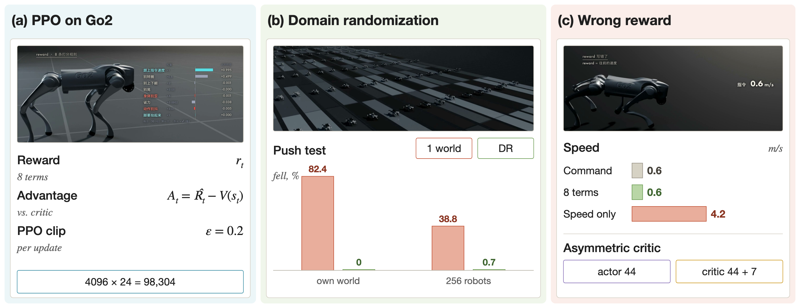
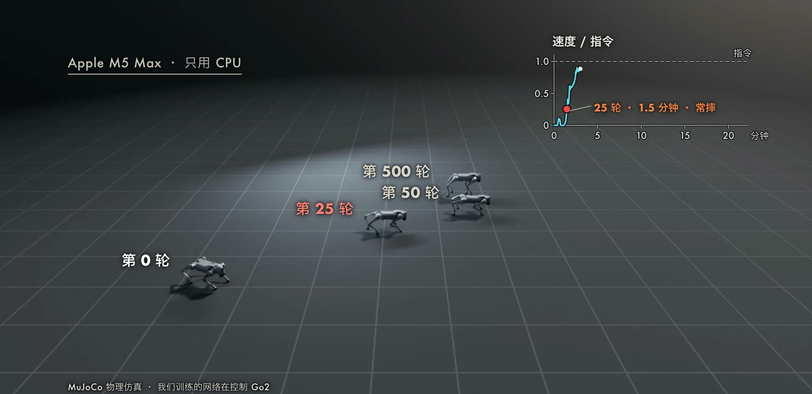
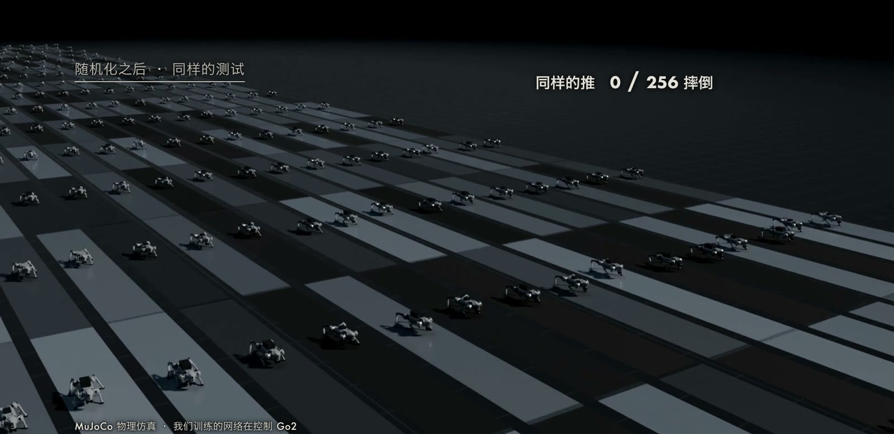

四足机器人的步态很难手工设计：接触在离散的时刻发生，动力学高维且非线性，地面、负载和电机的差异又会随时改变最优的落脚方式。
强化学习（Reinforcement Learning，RL）的做法是不指定步态，只定义一个标量奖励，让策略在大量试错中自己找到能得高分的动作。
本文以 Unitree Go2 为例，依次介绍问题形式化、策略梯度与近端策略优化（Proximal Policy Optimization，PPO）、广义优势估计（Generalized Advantage Estimation，GAE）、非对称 actor-critic、域随机化（domain randomization）以及大规模并行训练，最后给出我们在一台 Mac 的 CPU 上完成的实验。

## 问题设定

把控制问题写成马尔可夫决策过程（Markov Decision Process，MDP）$(\mathcal{S}, \mathcal{A}, P, r, \gamma)$。
状态 $s_t$ 包含机身姿态、速度与 12 个关节的角度和角速度；动作 $a_t\in\mathbb{R}^{12}$ 是关节目标角相对默认姿态的偏移，由位置伺服（PD 控制）执行；$P(s_{t+1}\mid s_t,a_t)$ 是物理仿真给出的转移；$r_t$ 是奖励；$\gamma$ 是折扣因子。
机器人实际能测到的只有部分状态，因此策略的输入是观测 $o_t$，这是一个部分可观测的 MDP。
优化目标是期望折扣回报：

$$
J(\theta)=\mathbb{E}_{\tau\sim\pi_\theta}\Big[\sum_{t=0}^{T-1}\gamma^{t} r_t\Big],
$$

其中 $\tau=(s_0,a_0,s_1,\dots)$ 是按策略 $\pi_\theta(a\mid o)$ 采样得到的轨迹。
我们的策略是对角高斯分布 $\pi_\theta(a\mid o)=\mathcal{N}\big(\mu_\theta(o),\operatorname{diag}(\sigma^2)\big)$，$\mu_\theta$ 为多层感知机，$\sigma$ 是与观测无关的可学习参数。
训练时从高斯分布采样，部署时直接取均值。
策略输出的目标角经位置伺服转成关节力矩：

$$
\boldsymbol{\tau}=k_p\,(\mathbf{q}^{\mathrm{des}}-\mathbf{q})-k_d\,\dot{\mathbf{q}},\qquad \mathbf{q}^{\mathrm{des}}=\mathbf{q}^{\mathrm{home}}+0.25\,a_t,
$$

其中 $\mathbf{q}^{\mathrm{home}}$ 是默认站姿，系数 $0.25$ rad 把策略的无量纲输出缩放到合理的关节范围。
这样网络输出为零时机器人处于默认站姿，策略只需学习相对站姿的偏移。
奖励函数负责告诉策略什么是“好”，因此它的每一项都需要对应可测量的物理量，具体各项见后面的实验设置。

## 方法

### 策略梯度

回报对策略参数的梯度可以写成似然比（score function）形式：

$$
\nabla_\theta J(\theta)=\mathbb{E}_{\tau\sim\pi_\theta}\Big[\sum_{t}\nabla_\theta\log\pi_\theta(a_t\mid o_t)\,\hat A_t\Big].
$$

$\hat A_t$ 是优势（advantage）的估计，表示在状态 $s_t$ 下选择动作 $a_t$ 比平均水平好多少。
优势为正，该动作的概率被提高；为负则被降低。
这个估计只依赖采样到的动作，不需要对仿真器求导，代价是方差较大。

### 广义优势估计

用价值函数 $V_\psi(s)$ 作为基线可以降低方差。
定义单步时间差分误差 $\delta_t=r_t+\gamma V_\psi(s_{t+1})-V_\psi(s_t)$，GAE（[Schulman et al., 2016](https://arxiv.org/abs/1506.02438)）把多步误差按指数加权求和：

$$
\hat A_t^{\mathrm{GAE}(\gamma,\lambda)}=\sum_{l=0}^{T-t-1}(\gamma\lambda)^{l}\,\delta_{t+l}.
$$

$\lambda=0$ 时只看一步，偏差大而方差小；$\lambda=1$ 时等价于蒙特卡洛回报减去基线，偏差小而方差大。
我们取 $\gamma=0.99$、$\lambda=0.95$。
价值目标取 $\hat R_t=\hat A_t+V_\psi(s_t)$。
对因超时而被截断的回合（并非真正失败），我们用 critic 的预测对终止状态做 bootstrap，避免把“时间到了”误当作失败。

### PPO 的裁剪目标

直接用同一批数据反复做梯度上升会使策略偏离采样策略太远，从而使估计失效。
PPO（[Schulman et al., 2017](https://arxiv.org/abs/1707.06347)）定义新旧策略的概率比

$$
\rho_t(\theta)=\frac{\pi_\theta(a_t\mid o_t)}{\pi_{\theta_{\mathrm{old}}}(a_t\mid o_t)},
$$

并最大化裁剪后的代理目标：

$$
L^{\mathrm{CLIP}}(\theta)=\mathbb{E}_t\Big[\min\big(\rho_t(\theta)\hat A_t,\ \operatorname{clip}(\rho_t(\theta),1-\epsilon,1+\epsilon)\hat A_t\big)\Big].
$$

当 $\hat A_t>0$ 时，$\rho_t$ 超过 $1+\epsilon$ 之后目标不再增大；当 $\hat A_t<0$ 时，$\rho_t$ 低于 $1-\epsilon$ 之后目标不再减小。
因此单个动作的概率在一次更新中几乎不会被推出 $[1-\epsilon,1+\epsilon]$ 之外，同一批数据可以安全地做多个 epoch 的小批量更新。
论文给出的示例取值是 $\epsilon=0.2$，我们沿用。

### 价值损失与总损失

critic 同样使用裁剪来限制单次更新幅度：

$$
L^{V}(\psi)=\mathbb{E}_t\Big[\max\big((V_\psi-\hat R_t)^2,\ (V_{\mathrm{old}}+\operatorname{clip}(V_\psi-V_{\mathrm{old}},-\epsilon,\epsilon)-\hat R_t)^2\big)\Big].
$$

总损失为

$$
L=-L^{\mathrm{CLIP}}+c_1L^{V}-c_2\,\mathcal{H}[\pi_\theta],
$$

$\mathcal{H}$ 是策略熵，用来维持探索。我们取 $c_1=1$、$c_2=0.01$，并对优势在批内做标准化。
学习率按采样策略与当前策略之间的 KL 散度自适应调整：KL 超过 $0.02$ 时学习率除以 1.5，低于 $0.005$ 时乘以 1.5。

### 非对称 actor-critic

actor 在部署时只能使用机器人自己测得到的量，critic 只在训练中使用，因此可以输入更多信息。
这种做法称为非对称 actor-critic（[Pinto et al., 2017](https://arxiv.org/abs/1710.06542)）：actor 的输入是观测 $o_t$，critic 的输入是 $(o_t,\,x_t)$，其中 $x_t$ 是特权信息。
我们的 $x_t$ 是 7 维：机身真实线速度，以及这只机器人的摩擦、负重、电机强度和延迟。
特权信息让价值估计更准，优势的方差更小；部署时 critic 被丢弃，策略不依赖这些量。

### 域随机化

仿真与真机在摩擦、质量、电机特性上总有差别。
域随机化把这些参数 $\xi$ 视为随机变量，训练目标改写为对动力学参数分布取期望：

$$
J_{\mathrm{DR}}(\theta)=\mathbb{E}_{\xi\sim p(\xi)}\ \mathbb{E}_{\tau\sim\pi_\theta,\,P_\xi}\Big[\sum_t\gamma^t r_t\Big].
$$

只有在分布 $p(\xi)$ 的大部分取值下都得分高的策略，才会得到高的 $J_{\mathrm{DR}}$。
[Tobin et al. (2017)](https://arxiv.org/abs/1703.06907) 在仿真中随机化渲染参数以迁移视觉模型，[Peng et al. (2018)](https://arxiv.org/abs/1710.06537) 把随机化对象扩展到机器人动力学参数。
我们随机化的参数及范围是：摩擦 $0.3$ 到 $1.2$，负重 $-1$ 到 $4$ kg，电机强度 $0.75$ 到 $1.15$，延迟 0 或 20 ms；另外每 5 秒施加一次随机方向的推力，并给传感器加噪声。

### 训练流程

综合以上，每一轮训练按如下步骤进行：

1. 用当前策略让 $N$ 只机器人并行运行 $H$ 步，记录观测、特权信息、动作、对数概率、奖励和终止标志。
2. 对超时截断的回合用 critic 做 bootstrap，按 GAE 从后向前计算 $\hat A_t$ 与 $\hat R_t$，并标准化优势。
3. 把 $N\times H$ 个样本打乱，分成若干小批量，做 $K$ 个 epoch 的更新：计算 $L$，梯度裁剪后用 Adam 更新参数，同时按 KL 调整学习率。
4. 失败或超时的机器人被重置，进入下一轮。

## 代表性工作

[Hwangbo et al. (2019)](https://arxiv.org/abs/1901.08652) 在 ANYmal 上用 RL 训练出敏捷的运动技能，并用真机数据训练的执行器网络（actuator network）缩小仿真与真机的电机差距。
该工作使用的算法是 TRPO，而非 PPO。
[Rudin et al. (2022)](https://arxiv.org/abs/2109.11978) 的贡献在于训练规模：整个流程（仿真、奖励、观测、策略推理与反向传播）都放在 GPU 上，基于 [Isaac Gym](https://arxiv.org/abs/2108.10470) 同时仿真数千只机器人。
论文报告平地策略训练用时不到 4 分钟，带地形的策略不到 20 分钟；部署用的策略采用 4096 只机器人、批量 $4096\times24=98304$、共 1500 次更新，在一块工作站显卡上完成。
论文还指出，并行规模过大时每只机器人的时间视野会变短，性能反而下降，2048 到 4096 只机器人是该任务上较好的折中。
它的代码发布为 [legged_gym](https://github.com/leggedrobotics/legged_gym)，我们把奖励总和截断为非负的做法也取自这套实现。
需要注意，论文也承认得到的步态常带有拖腿、机身过高或过低等伪影，需要调整奖励权重后才能上真机，因此“不到 20 分钟”指最终训练的墙钟时间，不含调参。

## 我们的实验

### 设置

实验在一台 M5 Max 的 CPU 上完成，没有使用 GPU。
物理引擎是 MuJoCo 3.3，机器人模型取自 MuJoCo Menagerie 的 Go2，位置伺服参数 $k_p=50$、$k_d=0.5$，只有脚与地面接触；通过 `mujoco.rollout` 用 16 个线程并行，控制频率 50 Hz，物理频率 250 Hz。
同时仿真 4096 只 Go2，每只每轮 24 步，一轮 98,304 个样本。
actor 的输入为陀螺仪、重力方向、12 个关节角与角速度、上一步动作和指令速度，共 44 维；critic 额外接收 7 维特权信息。
两个网络都是三隐层 MLP（512、256、128，ELU 激活）。
PPO 超参数：$\gamma=0.99$、$\lambda=0.95$、$\epsilon=0.2$、5 个 epoch、4 个小批量。
指令只含向前速度，训练时每回合在 $0.3$ 到 $1.0$ m/s 内随机，测试固定为 $0.6$ m/s。

奖励共 8 项，按权重求和并乘以控制周期 $\Delta t$，总和截断为不小于 0：

$$
r_t=\max\Big(0,\ \Delta t\sum_{i=1}^{8}w_i\,r_i\Big).
$$

| 项 | 形式 | 权重 $w_i$ |
| --- | --- | --- |
| 线速度跟踪 | $\exp(-\lVert \mathbf{v}^{\mathrm{cmd}}_{xy}-\mathbf{v}_{xy}\rVert^2/0.25)$ | 1.0 |
| 偏航角速度跟踪 | $\exp(-\omega_z^2/0.25)$ | 0.5 |
| 竖直速度 | $v_z^2$ | -2.0 |
| 横滚俯仰角速度 | $\lVert\boldsymbol{\omega}_{xy}\rVert^2$ | -0.05 |
| 机身倾斜 | $\lVert\mathbf{g}_{xy}\rVert^2$（重力在机身系的水平分量）| -5.0 |
| 力矩 | $\lVert\boldsymbol{\tau}\rVert^2$ | -2e-4 |
| 动作变化 | $\lVert a_t-a_{t-1}\rVert^2$ | -0.01 |
| 脚腾空时间 | $\sum_{\text{feet}}(t_{\mathrm{air}}-0.25)$，在脚落地的一步计入 | 1.0 |

### 结果

训练过程（单个种子 `nominal_s0`）如下。

| 训练轮数 | 墙钟时间 | 现象 |
| --- | --- | --- |
| 0 | 0 s | 原地抖动，不摔 |
| 15 到 25 | 46 到 84 s | 开始向前冲，经常摔倒 |
| 50 | 199 s | 能跟上指令，速度与指令之比 0.98 |
| 500 | 约 22 分钟 | 回报 28.2，速度与指令之比 1.00 |

奖励设计错误会带来明显的退化。
如果只奖励机身向前的速度，训练 200 轮后的策略完全不理会 $0.6$ m/s 的指令，测试平均速度为 $4.2$ m/s（指令的 7.0 倍），机身高度正常（$0.283$ m），步态是腿向前伸、整体向前蹿。

随机化的效果用 256 只测试机器人、20 秒、每 5 秒一次 $0.6$ m/s 的随机方向横推来衡量，传感器带噪声。
“模拟真机”的参数为摩擦 $0.25$ 到 $1.0$、负重 0 到 5 kg、电机强度 $0.7$ 到 $1.1$、延迟 0 或 20 ms，其中摩擦低于 $0.3$ 与负重高于 4 kg 的部分超出了训练范围。
下表是第 200 轮、3 个种子的结果。

| 测试 | 单一世界：各种子 | 平均 | 随机化：各种子 | 平均 |
| --- | --- | --- | --- | --- |
| 自己的世界加推：摔倒比例 | 94.5 / 71.1 / 81.6% | 82.4% | 0 / 0 / 0% | 0 |
| 256 只模拟真机加推：摔倒比例 | 27.0 / 60.9 / 28.5% | 38.8% | 0 / 1.6 / 0.4% | 约 1.7 只 |
| 256 只模拟真机，不推：速度与指令之比 | 0.96 / 0.90 / 0.60 | 0.82 | 0.98 / 0.94 / 0.97 | 0.96 |
| 自己的世界，不推不加噪声：速度与指令之比 | 1.01 / 1.00 / 1.01 | 1.01 | 0.99 / 1.00 / 0.97 | 0.99 |

### 解读与局限

单一世界训练的策略在被推时大量摔倒，摔倒集中在受推后 0.5 秒内，且多发生在电机偏硬的个体上；地面和负重的差异本身几乎不会使它摔倒。
随机化训练后，被推的摔倒数降为 0，在 256 只模拟真机上平均不到两只，同时在标准世界里没有变慢（$0.99$ 对 $1.01$）。
标准策略在电机偏软时反而更抗推，因为较软的关节会吸收冲击，所以它在混合真机测试中的摔倒比例低于在自己世界里的比例。

这一结果与前文的目标函数是一致的：单一世界训练优化的是 $\xi$ 取固定值时的回报，而随机化训练优化的是对 $p(\xi)$ 取期望的回报，后者迫使策略放弃只对某一组电机刚度才成立的步态。
同时，随机化没有以标准世界里的性能为代价，说明这一组范围对 Go2 的这个任务并不过宽。
范围的选取本身仍然是经验性的：过窄覆盖不到真实差异，过宽则会让策略趋于保守。

这些结果有明确的边界。
其一，“真机”是训练时未见过的仿真参数，并没有上实物，3 个种子的数字只对这个小设置成立。
其二，奖励仍需人工逐项调整，上表的训练时长不含调参。
其三，抬脚一项奖励在训练好的策略上从未触发：四只脚的球心高度在 $0.008$ 到 $0.023$ m 之间，离地最多约 $4.5$ mm，低于判定腾空的阈值，因此该策略实际是贴地小步前进，而不是明显抬腿。
其四，仿真里没有的地形（楼梯、草地）策略并没有学过。

## 小结

PPO 的裁剪目标限制了单次更新幅度，GAE 控制了优势估计的偏差与方差，大规模并行提供足够的样本；非对称 critic 与域随机化则分别利用训练期的额外信息和对动力学参数的期望，使策略在参数不确定时仍然稳定。
我们的 CPU 实验在约 22 分钟内得到可用步态，并在 3 个种子上复现了随机化带来的鲁棒性差异。
尚未解决的问题包括奖励的自动设计、从仿真参数到真实硬件差异的度量，以及复杂地形上的泛化。
