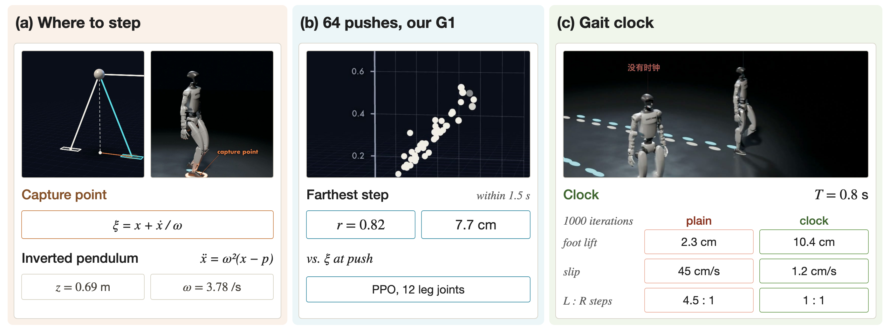
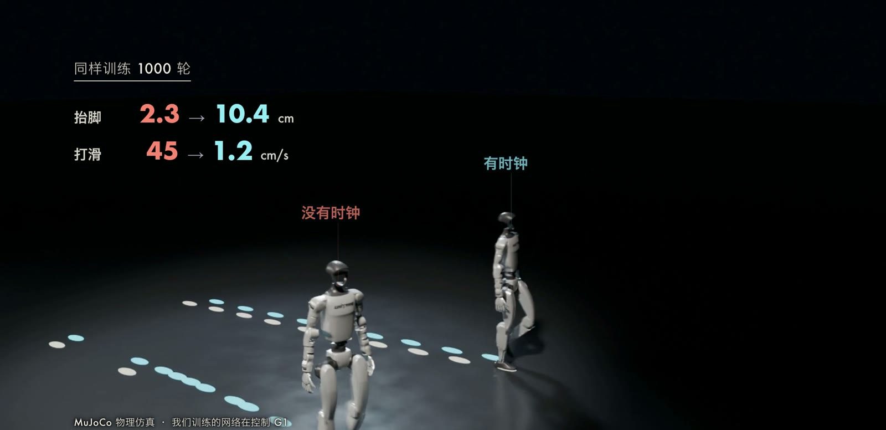
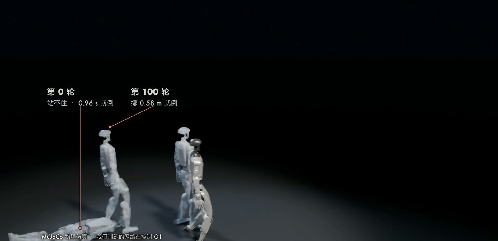

双足机器人的支撑面只有两只脚底，质心稍有偏离就会开始倾倒，而且偏离越大，倾倒越快。
遇到较大的外力时，只靠踝关节调整压力中心已经不够，必须迈出一步。
这就带来两个问题：这一步应当落在哪里，以及强化学习（Reinforcement Learning，RL）得到的策略能否自己学会这种落脚方式。
本文先用线性倒立摆模型（Linear Inverted Pendulum Model，LIPM）推导 capture point，再介绍 Siekmann 等人提出的周期性奖励，最后给出我们用近端策略优化（Proximal Policy Optimization，PPO）在 Unitree G1 上完成的实验。

## 问题设定

我们只考虑矢状面（前后方向）的一维情形，水平方向的推导相同。
设质心水平位置为 $x$，质心高度为常数 $z_0$，压力中心（Center of Pressure，CoP）位置为 $p$。
状态是 $(x,\dot x)$，控制量是 $p$，它被限制在脚底的支撑区域内。
RL 的设定中，策略 $\pi_\theta(a\mid o)$ 的观测 $o$ 是本体感觉与指令，动作 $a$ 是 12 个腿关节的目标角，优化的目标是期望折扣回报 $J(\theta)=\mathbb{E}\big[\sum_t\gamma^t r_t\big]$。
策略在训练时没有接触过 capture point 的公式，这一点在后面的实验中很关键。

## 方法

### 线性倒立摆

LIPM 假设整机角动量变化率为零，且质心高度保持不变。
此时质心的水平动力学为

$$
\ddot x=\omega^2\,(x-p),\qquad \omega=\sqrt{g/z_0}.
$$

当 $p=0$ 时，即 [Pratt et al. (2006)](http://www.ambarish.com/paper/Pratt_Goswami_Humanoids2006.pdf) 中的 $\ddot x=\tfrac{g}{z_0}x$。
这是一个以 $\omega$ 为发散速率的不稳定系统：偏差 $x$ 按 $e^{\omega t}$ 增长。
我们的 G1 在初始姿态下整机质心高度为 $0.687$ m，质量 $33.3$ kg，于是 $\omega=3.78\ \mathrm{s^{-1}}$，偏差每 $1/\omega\approx0.265$ s 放大 $e$ 倍，每 $\ln 2/\omega\approx0.183$ s 翻一倍。
这个时间尺度决定了机器人没有足够的时间等待，必须迅速迈步。

### Capture point 的推导

把 LIPM 写成关于 $(x,\dot x)$ 的二维系统，可以找到一个守恒量，即论文中的轨道能量（以支撑脚为原点）：

$$
E_{\mathrm{LIP}}=\tfrac12\dot x^2-\tfrac{\omega^2}{2}x^2 .
$$

当 $E_{\mathrm{LIP}}=0$ 且质心朝支撑点运动时，$\dot x=-\omega x$，质心会渐近地停在支撑点正上方。
因此要让质心最终停下，新支撑脚的位置 $p_f$ 应使得相对于新脚的状态满足 $\dot x=-\omega(x-p_f)$，解得

$$
\xi=p_f=x+\frac{\dot x}{\omega}.
$$

$\xi$ 称为瞬时 capture point（Instantaneous Capture Point，ICP）。
这是后续文献（例如 [Liu et al., 2021](https://arxiv.org/abs/2106.14741)）通行的写法；Pratt 等人的原文以支撑脚为原点，写作 $x_{\mathrm{capture}}=\dot x\sqrt{z_0/g}=\dot x/\omega$，二者等价。

另一种推导是直接看 $\xi$ 的动力学。对 $\xi=x+\dot x/\omega$ 求导，并代入 LIPM：

$$
\dot\xi=\dot x+\frac{\ddot x}{\omega}=\dot x+\omega(x-p)=\omega(\xi-p).
$$

因此 $\xi(t)=p+(\xi_0-p)e^{\omega t}$：只要 $p\neq\xi$，$\xi$ 就以速率 $\omega$ 指数发散；当压力中心恰好等于 $\xi$ 时，$\dot\xi=0$，$\xi$ 保持不变。
而质心满足 $\dot x=\omega(\xi-x)$，会指数收敛到 $\xi$。
所以 $\xi$ 是系统的“发散分量”，控制它就控制了整个系统。
如果 $\xi$ 仍在脚的支撑区内，调节压力中心即可恢复，无需迈步；否则必须把脚放到 $\xi$ 附近。
推得越快，$\dot x$ 越大，需要伸得越远。
Pratt 等人还讨论了带飞轮的模型：利用躯干角动量，可以把唯一的 capture point 扩展为一个 capture region。

### 周期性奖励与步态时钟

另一个问题是步态的节奏。
[Siekmann et al. (2021)](https://arxiv.org/abs/2011.01387) 在 Cassie 上提出，所有常见的双足步态都可以由每只脚的周期性相位来描述：摆动相（swing）脚不应受力，支撑相（stance）脚不应滑动。
设周期内的时间变量 $\phi\in[0,1)$，每个奖励分量写为

$$
R_i(s,\phi)=c_i\cdot I_i(\phi)\cdot q_i(s),
$$

其中 $c_i$ 是相位系数，$I_i(\phi)\in\{0,1\}$ 表示该相位是否激活，$q_i(s)$ 是可测量的量。
论文取脚的受力范数 $q_{\mathrm{frc}}$ 与速度范数 $q_{\mathrm{spd}}$，摆动相取 $c_{\mathrm{swing,frc}}=-1$、$c_{\mathrm{swing,spd}}=0$，支撑相取 $c_{\mathrm{stance,spd}}=-1$、$c_{\mathrm{stance,frc}}=0$。
摆动相占周期的比例为 $r$，左右脚的相位相差 $\theta_{\mathrm{left}}-\theta_{\mathrm{right}}$：行走约为半个周期，双脚同步跳跃则为 0。
论文用 Von Mises 分布对相位边界做平滑，并对奖励取期望。
由于奖励随时间周期变化，策略的观测里必须包含时钟，论文使用 $\sin\big(2\pi(\phi+\theta)/L\big)$ 形式的输入，否则环境对策略而言是非平稳的。

我们在 G1 上采用了这一思路的离散简化版本，与 [unitree_rl_gym](https://github.com/unitreerobotics/unitree_rl_gym) 中的 G1 示例相近（该仓库的 G1 策略同样只控制 12 个腿关节，周期 $0.8$ s）：

- 周期 $T=0.8$ s，左右脚相位差半个周期，每只脚在周期的前 $55\%$ 为支撑相。
- 观测加入时钟 $(\sin 2\pi\phi,\ \cos 2\pi\phi)$。
- 接触一致项：每只脚若“是否着地”与“是否处于支撑相”一致，奖励 $0.18$。
- 摆动高度项：摆动相的脚离地高度 $h$ 与目标 $h^\*=0.08$ m 之差的平方，权重 $-20$，即 $-20\,(h-h^\*)^2$。

没有时钟的对照组（plain）观测中时钟置零，并改用四足实验中的脚腾空时间奖励。
两组共有的奖励包括速度跟踪、偏航、竖直速度、倾斜、骨盆高度（目标 $0.75$ m）、力矩、动作变化、髋关节姿态和存活奖励。
PPO 的实现与上一期四足实验相同（[Schulman et al., 2017](https://arxiv.org/abs/1707.06347)）。

## 代表性工作

[Pratt et al. (2006)](http://www.ambarish.com/paper/Pratt_Goswami_Humanoids2006.pdf) 指出，双足行走的动力学是高维、非线性、混合（hybrid）的，人形机器人是欠驱动的，并且只有受摩擦限制的单向接触。
他们提出 capture point 与 capture region，回答了“何时迈步、迈到哪里”：若 capture point 落在支撑区内，调节压力中心即可恢复；否则必须迈步，使新的支撑区与 capture region 相交。
这类基于简化模型的方法给出了解析的落脚点，但需要人为设计状态机与接触序列。

强化学习路线则把接触序列交给策略自己发现。
[Siekmann et al. (2021)](https://arxiv.org/abs/2011.01387) 用周期性奖励在 Cassie 上训练出站立、行走、跳跃、奔跑和跨步等步态，并迁移到真机，训练不使用动捕数据或参考轨迹。
[Li et al. (2024)](https://arxiv.org/abs/2401.16889) 在 Cassie 上研究如何用单一框架学习多样、动态而稳健的双足运动控制。
[Radosavovic et al. (2023)](https://arxiv.org/abs/2303.03381) 在 Digit 上用因果 Transformer 处理观测与动作的历史，在随机化环境中大规模训练后零样本部署；论文报告一周户外测试中没有观察到跌倒。
这几项工作使用的机器人和控制接口各不相同，本文的实验并未与它们做数值比较。

## 我们的实验

### 设置

仿真器是 MuJoCo，模型取自 Menagerie 的 g1_mjx（29 个位置伺服关节，脚与地面用显式接触对），物理频率 $250$ Hz，策略频率 $50$ Hz，全部在一台 M5 Max 的 CPU 上完成。
策略只控制 12 个腿关节，目标角在初始姿态附近（动作乘 $0.25$ rad），腰和手臂锁定。
观测为 46 维：骨盆陀螺仪、重力方向、指令速度、时钟的 $\sin/\cos$（plain 组置零）、12 个腿关节角和角速度、上一步动作。
同时训练 4096 台，每台每轮 24 步；训练中每 4 秒沿随机方向推一次，速度 $0.5$ m/s，传感器带轻微噪声。
指令只向前，范围 $0$ 到 $0.8$ m/s，其中 $15\%$ 的回合要求站立。

### 步态对比

下表比较同样训练 1000 轮的两组策略（单个种子，16 台，$0.5$ m/s 指令测试，均未摔倒）。

| 指标 | plain（无时钟）| clock（有时钟）|
| --- | --- | --- |
| 最大抬脚高度 | 2.3 cm | 10.4 cm |
| 双脚同时着地的时间占比 | 94% | 14% |
| 支撑脚打滑速度 | 0.45 m/s | 1.2 cm/s |
| 左右脚步数之比 | 4.45 : 1 | 1 : 1 |
| 实测前进速度 | 0.54 m/s | 0.51 m/s |

没有时钟时，策略只用上一期的奖励，学到的是两脚几乎始终贴地的蹭行，主要靠一只脚迈步。
加入时钟后，步态变成左右交替的抬脚行走。
clock 组继续训练到 1500 轮时，抬脚 $9.4$ cm，双脚同时着地 $12\%$，每秒 $2.5$ 步（与时钟节奏一致），脚的着地状态与时钟安排一致的时间占 $93\%$，实测 $0.47$ m/s，测试中没有摔倒。
两组的前进速度几乎相同，差别全部体现在步态上，这说明速度跟踪类的奖励无法区分“蹭行”与“迈步”，需要额外的结构来规定脚何时着地、何时抬起。
时钟的作用正是把这种结构以相位的形式写进奖励，并通过观测告诉策略当前处于周期的哪个位置。
全程在 CPU 上训练 1500 轮用时约 102 分钟（期间有渲染和配音占用 CPU）。
训练阶段（带探索噪声，$0.5$ m/s）的表现为：第 0 轮 $0.96$ s 就摔倒；第 100 轮挪动 $0.58$ m 后在 $7.9$ s 摔倒；第 300 轮 $8$ s 内走了 $2.95$ m；第 1500 轮为 $3.69$ m。

### 落脚位置与 capture point

训练好的 clock 策略（1500 轮）没有在奖励中接触过 $\xi$ 的公式，我们用它测试落脚是否接近 $\xi$。
测试方法：64 台 G1 站立（指令为 0），在第 2 秒各被推一次，速度从 $0.2$ 到 $1.0$ m/s 等间隔，方向随机。
$\xi=c+\dot c/\omega$，其中 $c$ 是整机质心在地面的投影，$\omega$ 用当时的质心高度计算。
指标取“推完 1.5 秒内沿推方向迈得最远的一步”，结果如下。

| 量 | 结果 |
| --- | --- |
| 最远一步与 $\xi$ 的相关系数 | 0.82（前后推 0.82，侧推 0.82）|
| 拟合斜率 | 1.31 |
| 平均偏差 | 7.7 cm |
| 推完 0.5 s 内 $\xi$ 的最大值与推速的相关系数 | 0.90 |
| 推完 2.4 s 后质心停止位置与 $\xi$ 的相关系数 | 0.74 |
| 摔倒台数 | 1 / 64 |

开场的那一推为例：速度 $0.85$ m/s，方向前偏左 $53^\circ$，$\xi$ 最远为 $0.425$ m，推后 $0.25$ s 左脚落在 $0.385$ m 处，再迈两步站住。

选择“最远的一步”作为指标有原因。
最初的指标是“推完后第一个落地的脚”，它与 $\xi$ 几乎无关（相关系数 $0.12$），因为时钟使策略原地踏步，推后第一个落地的脚常常只是原本就排好的那一步，真正接住身体的是后面迈得最远的一步。
plain 组没有这个问题，它的第一步就是接住的那一步，相关系数 $0.69$，64 台中摔倒 2 台。

### 局限

以上结果只对这台 G1、这 64 次推和 seed 0 的一次训练成立，不能推广为所有 RL 策略都会迈到 capture point 附近。
拟合斜率为 $1.31$，即步长随 $\xi$ 增长得比 $\xi$ 本身更快，一种可能的解释是策略为落脚留有裕量，但我们没有对此做验证。
第 200 轮的 clock 策略受推就摔（64 台摔 36 台），推的测试只使用训练完成的策略。
前 300 轮日志中“速度与指令之比”为负，是因为它在回合结束那一刻统计，此时机器人往往正向后倒，实测是向前走的。
此外策略只控制腿，腰和手臂锁定，走起来不自然；手、腰、腿一起参与的全身控制（whole-body control）是下面两期的主题，涉及 [SONIC](https://arxiv.org/abs/2511.07820) 与 [SuperMimic](https://arxiv.org/abs/2610.28480)。

## 小结

LIPM 给出了 capture point 的解析形式 $\xi=x+\dot x/\omega$：它是系统的发散分量，把脚放在 $\xi$ 就能使质心停下。
在我们的实验里，策略没有被告知这个公式，但最远一步与 $\xi$ 的相关系数达到 $0.82$，原因是摔倒会使该回合失去后续回报，足够多的试错留下了这种迈法。
步态的节奏则需要由周期性奖励和观测中的时钟显式提供，加入时钟后抬脚高度从 $2.3$ cm 增至 $10.4$ cm。
尚未解决的问题包括：多个种子上的统计、真机验证，以及躯干和手臂参与平衡时 capture point 如何扩展为 capture region。
