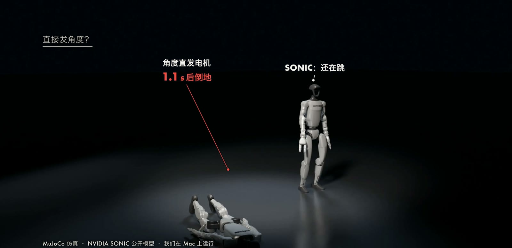
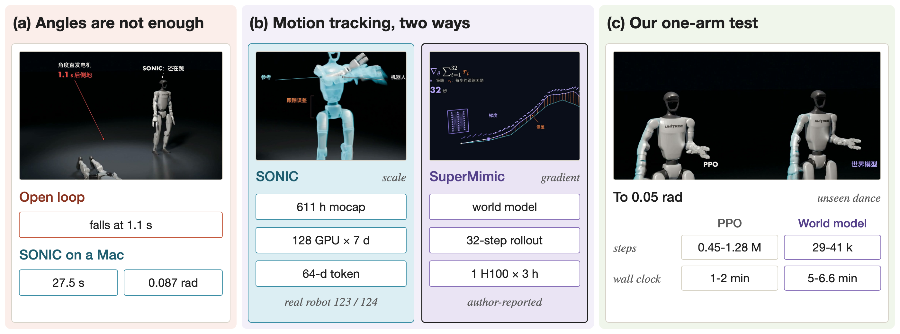
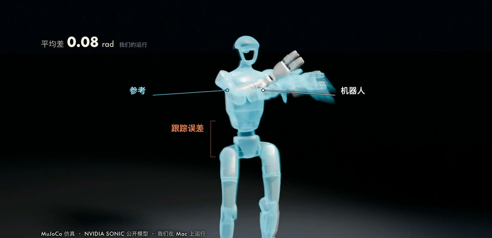
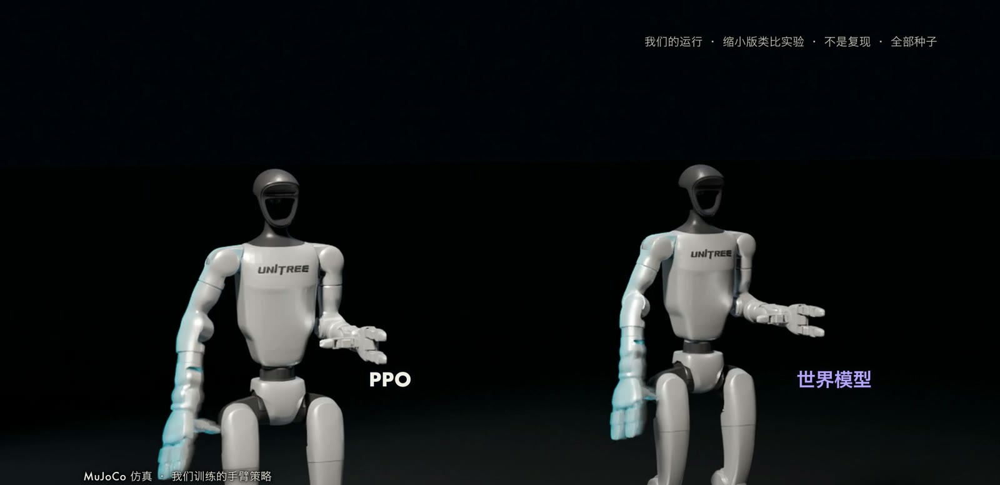
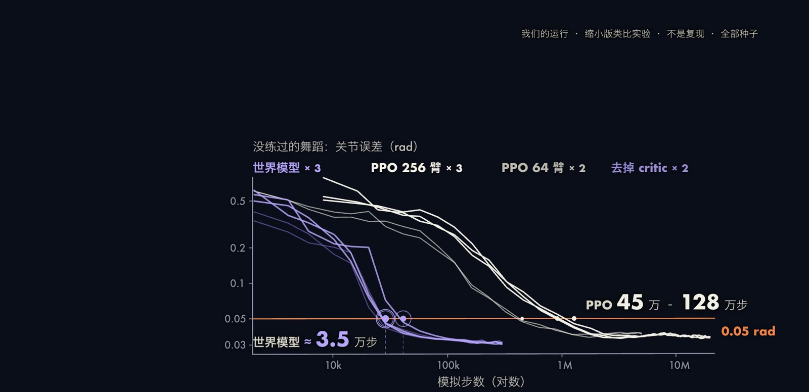

让人形机器人完成跳舞、下蹲、翻滚这类全身动作，传统做法是为每种行为分别设计奖励或控制器，工程量大且难以复用。
动作跟踪（motion tracking）提供了另一种思路：把人类动作捕捉数据作为参考轨迹，训练一个策略逐帧贴合参考，同时保持平衡，所有行为共用同一套目标函数。
本文介绍这一路线的问题形式化与跟踪奖励，然后比较两种代表性的扩展方式：NVIDIA 的 SONIC 依靠数据、模型与算力的规模，UC Berkeley 的 SuperMimic 则学习一个可微世界模型并对回报直接求梯度。
最后给出我们在 Mac 上运行 SONIC 公开模型的结果，以及一个用单条 G1 手臂做的缩小版对比实验。

## 问题设定

给定参考动作 $\{\hat{\mathbf{m}}_t\}_{t=1}^{T}$，它包含参考的根部位姿、各关节角 $\hat q_t$ 与速度，以及各身体连杆的位置、朝向和速度。
人体动作捕捉数据需要先重定向（retargeting）到机器人骨架上，使关节限位和肢体比例合理，重定向的误差会直接降低跟踪效果（[Araujo et al., 2025](https://arxiv.org/abs/2510.02252) 的 GMR 工具专门处理这一步）。
机器人在时刻 $t$ 的观测 $o_t$ 包含关节角 $q_t$、关节速度 $\dot q_t$、根部角速度 $\omega_t$、机身坐标系下的重力方向 $g_t$ 和上一步动作；指令 $g_t$ 取自参考的未来若干帧。
动作 $a_t$ 是关节目标角，由每个关节的 PD 控制器跟踪。
目标是最大化折扣回报

$$
J(\theta)=\mathbb{E}\Big[\sum_{t\ge0}\gamma^t r_t\Big],\qquad r_t=r^{\mathrm{track}}_t+r^{\mathrm{reg}}_t,
$$

其中 $r^{\mathrm{track}}_t$ 衡量与参考的接近程度，$r^{\mathrm{reg}}_t$ 是动作平滑等正则项。

## 方法

### 为什么不能直接发角度

把参考关节角 $\hat q_t$ 直接作为 PD 目标发给电机，只对齐了关节角，没有考虑重心如何转移、脚底如何受力。
我们用 SONIC 示例动作 macarena 做了这个测试：直接发角度，机器人 1.1 秒后倒地。
策略需要在每一帧根据当前状态修正关节目标，使整机动态可行，这正是学习的内容。

### 跟踪奖励

[DeepMimic](https://arxiv.org/abs/1804.02717) 提出用与参考的逐项匹配作为奖励，并引入参考状态初始化（从参考轨迹的随机帧开始回合）和提前终止。
[BeyondMimic](https://arxiv.org/abs/2508.08241) 把这一形式用于人形机器人，SONIC 与 SuperMimic 都沿用它的设置。
每一项奖励都是误差平方的指数核：

$$
r_k=\exp\!\Big(-\frac{e_k^2}{\sigma_k^2}\Big),\qquad r^{\mathrm{track}}=\sum_k w_k\,r_k .
$$

例如 SONIC 的论文（Table S3）采用的几项为：

- 根部位置与朝向，$w=0.5$，$\sigma=0.3$ 与 $0.4$；
- 连杆相对位置，$e^2=\frac{1}{|\mathcal{B}|}\sum_{b\in\mathcal{B}}\lVert p^{\mathrm{rel}}_b-\hat p^{\mathrm{rel}}_b\rVert^2$，$w=1.0$，$\sigma=0.3$；
- 连杆相对朝向、线速度、角速度，$w=1.0$，$\sigma$ 分别为 $0.4$、$1.0$、$3.14$；
- 末端（头、双腕、双踝）位置，$w=2.0$，$\sigma=0.1$。

指数核使奖励限制在 $(0,1]$，误差越小奖励越接近 1，并且对大误差不会产生过大的惩罚梯度。
惩罚项包括动作变化率（$-0.1$）和关节限位（SONIC 取 $-10$）等。
由于奖励只描述“与参考差多少”，跳舞、踢腿、下蹲使用的是同一套函数，不需要为每种动作单独设计。

### 统一跟踪器：SONIC

[SONIC](https://arxiv.org/abs/2511.07820) 的主张是把动作跟踪当作可以放大的训练任务，用动捕数据的稠密监督取代手工奖励。
策略用 PPO 在 Isaac Lab 中训练（[Schulman et al., 2017](https://arxiv.org/abs/1707.06347)）。
为了接受不同形式的指令，它设计了三个编码器：机器人动作编码器 $\mathcal{E}_r$（读未来 10 帧的关节位置与速度，帧间隔 $0.1$ s）、人体动作编码器 $\mathcal{E}_h$（读 3D 人体关节位置）和混合编码器 $\mathcal{E}_m$（读头与双手的稀疏关键点加下半身机器人动作）。
三者的输出经有限标量量化（Finite Scalar Quantization，FSQ）成为同一种通用 token $z$，再交给同一个控制解码器 $\mathcal{D}_c$：$a_t=\mathcal{D}_c(z,s^{\mathrm{p}}_t)$，其中 $s^{\mathrm{p}}_t$ 是带 10 步历史的本体感觉。
另有辅助的运动解码器 $\mathcal{D}_r$ 从 token 重建机器人动作指令 $\hat g_r=\mathcal{D}_r(z)$。
总损失为

$$
\mathcal{L}=\mathcal{L}_{\mathrm{ppo}}+\mathcal{L}_{\mathrm{recon}}+\mathcal{L}_{\mathrm{token}}+\mathcal{L}_{\mathrm{cycle}},
$$

其中

$$
\begin{aligned}
\mathcal{L}_{\mathrm{recon}}&=\textstyle\sum_{x\in\{r,h,m\}}\lVert\mathcal{D}_r(z_x)-g_r\rVert^2,\\
\mathcal{L}_{\mathrm{token}}&=\lVert z_r-z_h\rVert^2+\lVert z_r-z_m\rVert^2+\lVert z_m-z_h\rVert^2,\\
\mathcal{L}_{\mathrm{cycle}}&=\lVert\mathcal{E}_r(\mathcal{D}_r(z_h))-z_r\rVert^2 .
\end{aligned}
$$

$\mathcal{L}_{\mathrm{recon}}$ 让三种输入的 token 都能还原同一个机器人动作，对人体输入而言相当于隐式的人到机器人重定向；$\mathcal{L}_{\mathrm{token}}$ 要求同一段动作在三个编码器下得到相近的 token；$\mathcal{L}_{\mathrm{cycle}}$ 约束“人到机器人再编码”的往返一致。
PPO 的梯度通过 FSQ 的直通估计（straight-through estimator）回传到编码器。
critic 使用特权信息（基座线速度、全身连杆位姿和无噪声观测），actor 只使用部署时可得的观测，这是第 7 期介绍的非对称 actor-critic。

论文报告的规模为：动捕数据约 700 小时，重定向并过滤后用于训练的有 611 小时、317,189 个片段；模型最大 42M 参数；用 128 块 GPU 训练 7 天，约 21k GPU 小时；默认的 FSQ-32-32 配置输出 2 个 token，每个 32 维。
在 124 段真机动作上成功 123 段（每段只试一次），真机的 MPJPE-L 为 $25.7$ mm。
论文还把 SONIC 与 BeyondMimic 在 test-content 集上比较，成功率为 $98.5\%$ 对 $82.0\%$，并说明这一对比主要反映跨数据集的泛化与规模效应，并非数据匹配的基准。

### 对世界模型求梯度：SuperMimic

PPO 把动力学当作黑盒，用似然比估计梯度：

$$
\nabla_\theta J=\mathbb{E}\big[\nabla_\theta\log\pi_\theta(a_t\mid o_t)\,\hat A_t\big],
$$

这种估计的方差较大，需要大量采样。
[SuperMimic](https://arxiv.org/abs/2610.28480) 学习一个可微的世界模型，让回报沿着模型直接对每个动作求导。
世界模型是一个确定性的神经网络，输入当前状态、动作和仿真上下文 $\xi$（摩擦、关节标定偏移、躯干质心），输出下一状态以及奖励、观测和终止的预测：

$$
\hat s_{t+1}=f_\omega(\hat s_t,a_t,\xi),\quad \hat r_{t+1}=r_\omega(\hat s_t,a_t,g_t),\quad \hat d_t=d_\omega(\hat s_t,g_t).
$$

它在重放缓冲区上用 $k=8$ 步的自回归窗口拟合，使模型学会修正自己的预测误差：

$$
\mathcal{L}_{\mathrm{WM}}(\omega)=\mathbb{E}_{\mathcal{B}}\Big[\sum_{j=1}^{k}\lVert\hat s_j-s_j\rVert^2+(\hat r_j-r_j)^2+\lVert\hat{\bar o}_j-\bar o_j\rVert^2+\mathrm{BCE}(\hat d_j,d_j)\Big].
$$

策略更新时冻结 $\omega$，从缓冲区中的状态出发想象 $H=32$ 步，最大化

$$
\hat J(\theta)=\mathbb{E}\Big[\sum_{t=0}^{H-1}\gamma^t\,\hat c_t\,\hat r_{t+1}+\gamma^H\,\hat c_H\,V_\psi(\hat s_H,g_H,\xi)\Big],
$$

其中 $\hat c_t$ 是软存活权重（$c_0=1$，$c_{t+1}=c_t(1-d_{t+1})$），用预测的终止概率代替硬终止，使其可微；$V_\psi$ 估计第 $H$ 步之后的回报，使模型只需在 $H$ 步内准确。
由于每一步 $\hat s_{t+1}=f_\omega(\hat s_t,a_t,\xi)$ 且 $a_t=\pi_\theta(\cdot)$ 可微，链式法则给出

$$
\frac{\partial\hat s_{t+1}}{\partial\theta}=\frac{\partial f_\omega}{\partial\hat s_t}\frac{\partial\hat s_t}{\partial\theta}+\frac{\partial f_\omega}{\partial a_t}\frac{\partial a_t}{\partial\theta},
$$

对 $H$ 步反向传播就得到 $\nabla_\theta\hat J$（backpropagation through time，BPTT）。
critic 用 GAE 目标在想象的转移上拟合：

$$
L_V(\psi)=\mathbb{E}\Big[\sum_{t=0}^{H-1}\big(V_t-\hat R_t\big)^2\Big],\quad \hat R_t=\hat r_{t+1}+\gamma(1-\hat d_{t+1})\big[(1-\lambda)V_{t+1}+\lambda\hat R_{t+1}\big].
$$

整个训练是一个循环：策略在仿真器中采集转移写入缓冲区，拟合世界模型，再对想象轨迹做策略更新，三者一起迭代。
这里被求导的是学出来的模型，仿真器本身不需要提供梯度。
该结构与 [SHAC](https://arxiv.org/abs/2204.07137)（对可微仿真器做短视界 actor-critic）相近，区别是用软存活权重代替硬终止，并且 critic 不使用目标网络。

## 论文报告的对比

SuperMimic 报告，在一块 H100 上训练 3 小时，其归一化回报超过 SONIC 公开检查点；在包含 129,514 个动作的基准上，SONIC 公开检查点失败 179 个，SuperMimic 单卡 3 小时失败 25 个，两卡 9.8 小时失败 0 个。
作者自己指出了口径上的差异：SuperMimic 使用 BONES-SEED 的 264.56 小时数据，约为 SONIC 训练数据的 $1/2.3$；GPU 型号不同；基准中的动作对两种方法都属于训练集，失败数衡量的是对训练动作的覆盖，不是泛化。
论文还报告世界模型的 8 步预测误差在数据量从 1 小时增至 264 小时时保持稳定，世界模型的 rollout 在常用批量下比 MuJoCo Warp 快 10 倍以上。
真机上，SuperMimic 演示了跳步、侧滚、90 度翻转和 360 度翻转四个动作，没有展示舞蹈的真机视频。
截至我们核查时（2026-11-04），项目页上只有论文和浏览器演示，没有代码。

## 我们的实验

### 在 Mac 上运行 SONIC

我们把官方 C++ 部署中的观测构造和动作映射逐行移植到 Python 与 onnxruntime，模型使用公开发布的编码器与解码器 ONNX 文件，不做任何修改，也不重新训练，物理引擎为 MuJoCo（仿真步长 $5$ ms，控制频率 $50$ Hz，PD 增益取自官方部署参数）。
下表是仓库示例动作的结果，误差在每个控制周期上取机器人状态与该周期应跟踪的参考帧之差。

| 动作 | 帧数 | 摔倒 | 关节误差均值 (rad) | 根部位置误差均值 (m) |
| --- | --- | --- | --- | --- |
| macarena | 1375 (27.5 s) | 否 | 0.087 | 0.054 |
| dance_in_da_party | 497 (9.9 s) | 否 | 0.126 | 0.199 |
| neutral_kick_R | 165 | 否 | 0.088 | 0.072 |
| squat | 424 | 否 | 0.086 | 0.063 |
| tired_one_leg_jumping_R | 500 | 否 | 0.128 | 0.351 |
| walking_quip_360_R | 455 | 否 | 0.079 | 0.069 |
| forward_lunge_R | 399 | 否 | 0.100 | 0.066 |

七段动作均未摔倒，运行结果逐位确定。
根部位置误差随时间缓慢增大，这是预期行为：策略的观测里没有根部位置，只有关节目标、关节速度和根部朝向，全局漂移不属于跟踪失败。
关节误差中最大的部分来自力矩较弱的腕关节（$5$ N·m 电机）和快速摆臂的瞬间。

移植时我们逐个改动一个约定并重新运行，以确认实现是否忠实，结果如下（macarena 的关节误差均值）。

| 变体 | 结果 |
| --- | --- |
| 忠实移植 | 0.087，未摔倒 |
| 朝向 6D 表示改按列展开 | 0.6 s 摔倒 |
| 历史改为最新在前 | 1.2 s 摔倒 |
| 参考关节角减去默认角 | 0.155 |

这说明观测的排列顺序和表示方式对策略至关重要，一个约定错误就足以让策略失效。
另一个遗留现象是机器人的腰部比参考少前倾约 $0.16$ 到 $0.18$ rad，并以略多的髋屈曲补偿，在两种 MuJoCo 模型下都存在，应当是策略在 MuJoCo 中自身的行为。

### 一条手臂上的缩小版对比

为了在 CPU 上比较“PPO”与“世界模型加 BPTT”，我们做了 SuperMimic 思路的缩小版类比。
这不是复现：只保留 G1 的右臂 7 个关节，骨盆焊死，策略直接输出力矩（不经过 PD），没有平衡也没有摔倒。
训练片段是 macarena 的前 1000 帧（20 s），测试片段是同一支舞的后 375 帧，以及另一支舞 dance_in_da_party 的整段（最高角速度 $20$ rad/s）。
指标是真实 MuJoCo 中确定性策略、从参考第一帧出发，7 个关节在所有帧上的平均绝对角度误差，两个测试片段取平均。
奖励是 BeyondMimic 形式缩到一条手臂：肘、腕、腕偏航、掌心四个关键点相对肩部的位置（$\sigma=0.05$ m）、手的朝向（$\sigma=0.4$ rad）、关节角（$\sigma=0.15$ rad）、关节角速度（$\sigma=2$ rad/s，权重 $0.5$），再减动作变化率与关节限位惩罚。
所有方法使用同一个策略网络（tanh 输出的 $2\times256$ MLP，输入 56 维，含未来第 1、2、4、8、16 帧的参考）。
PPO 在真实 MuJoCo 中并行 256 条手臂，预算 2000 万步，3 个种子；另有 64 条手臂的小批量 PPO（500 万步，2 个种子）。
世界模型方法使用 $3\times512$ 的 MLP，$k=8$，$H=32$，每轮 64 条手臂采样，预算 30 万步，3 个种子。

不学习的基线误差为：零力矩 $0.437$ rad，重力补偿 $0.498$ rad，用 SONIC 增益的 PD 跟踪 $0.087$ rad。
下表给出首次评估点达到 $0.05$ rad 所需的仿真步数与训练墙钟时间（各种子的范围）。

| 方法 | 仿真步数 | 训练墙钟 |
| --- | --- | --- |
| PPO，256 条 | 91 万到 128 万 | 76 到 106 s |
| PPO，64 条 | 45 万 | 约 60 s |
| 世界模型 + BPTT | 2.9 万到 4.1 万 | 292 到 395 s |

最终策略（训练结束后重跑，held-out 误差为各种子）：

| 方法 | 训练步数 | 训练墙钟 | held-out 误差 (rad) |
| --- | --- | --- | --- |
| PPO，256 条 | 2000 万 | 27.7 min | 0.0345 / 0.0350 / 0.0340 |
| PPO，64 条 | 500 万 | 10.5 min | 0.0375 / 0.0367 |
| 世界模型 + BPTT | 30.1 万 | 36.7 min | 0.0313 / 0.0308 / 0.0301 |

在样本效率上，世界模型方法到达 $0.05$ rad 所需的仿真步数比 PPO 少一个数量级以上；最终精度两者接近，世界模型方法略好。
但按墙钟时间，PPO 反而更快（1 到 2 分钟对 5 到 6.6 分钟）。
原因在于一条 7 自由度手臂的 MuJoCo 仿真很便宜（每个进程约每秒 1.3 万控制步），而世界模型方法的时间花在 CPU 上训练 MLP。
SuperMimic 论文中依靠“世界模型 rollout 比仿真器快”得到的墙钟优势，在这个设置里并不存在。

### 局限

世界模型预测的开环误差相当大：结束时在测试片段上 32 步的关节误差为 $0.24$ 到 $0.26$ rad（macarena 测试段）和 $0.79$ 到 $0.84$ rad（另一支舞），但策略仍然学得很好，原因我们没有专门研究，不作推测。
我们去掉了 critic 做消融，在这个小任务上没有可测的差别；论文称没有 critic 时视界小于等于 16 才会失败，我们只测了 $H=32$。
此外，参考动作在腿和腰冻结后让手穿入躯干，最深 $5.6$ cm，所以关闭了碰撞；世界模型较小，不含奖励、观测和终止头；数据只有一支舞的 20 秒；PPO 没有做大规模调参；两个学习方法的超参数各自一次定下。
各方法的墙钟是多个进程同时跑在 18 核 CPU 上测得，小批量 PPO 与去 critic 版后来与更少的进程一起运行，墙钟偏快，不完全可比。
因此这些数字只对这个小任务成立，不能外推到整机和 GPU。

## 小结

动作跟踪把“做什么”交给参考轨迹，把“怎么做”交给指数核奖励下的强化学习，因此同一套目标可以覆盖舞蹈、踢腿、下蹲等多种行为。
SONIC 通过数据、模型和算力的规模，得到一个能处理多种输入的统一跟踪器；SuperMimic 通过可微世界模型获得低方差的一阶梯度，用少得多的算力达到论文所报告的水平。
我们的小实验在样本效率上印证了后者的方向，但在 CPU 墙钟上没有体现优势。
尚待回答的问题是：世界模型方法放到整机和 GPU 上后，步数上的优势能否稳定地转化为时间上的优势，以及在存在接触、平衡与摔倒时世界模型的 H 步预测还能否足够准确。
