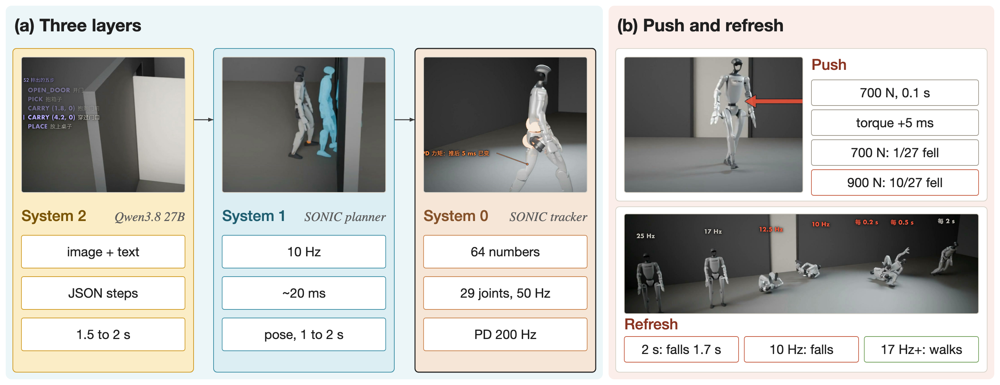
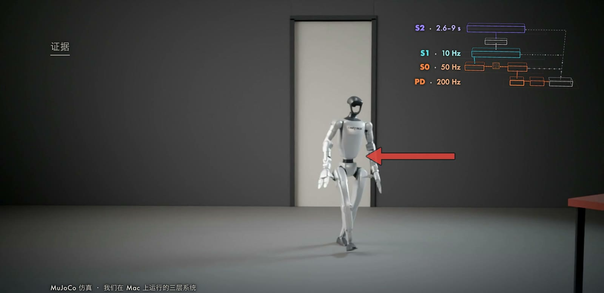
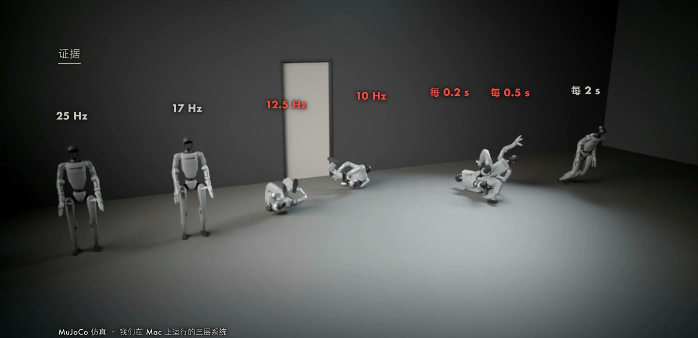
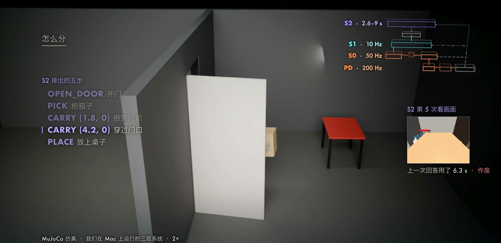

人形机器人需要在同一个系统里完成两类性质相反的计算。
一类是理解“去红色桌子那边，然后蹲下”这样的语言指令，需要大型视觉语言模型（Vision-Language Model，VLM），一次回答要一到数秒。
另一类是在行走中保持平衡，需要以几十到上千赫兹更新的闭环控制，延迟超过几十毫秒就可能失稳。
把两者放进同一个网络、以同一个频率运行，在算力上不现实，在稳定性上也没有保证。
因此近年的人形机器人系统普遍采用分层结构，常被称为“快慢脑”。
本文先给出分层的形式化描述，说明各层频率与层间接口由什么约束决定，再介绍 Figure Helix、GR00T N1、π0.5 等系统的分法，最后报告我们在一台 Mac 上实现的三层系统，以及推力扰动和关节目标刷新率两组仿真实验。

## 问题设定与符号

设机器人在控制周期 $k$ 的本体状态为 $s_k$（关节角、关节速度、骨盆姿态与角速度），相机图像为 $I_k$，用户指令为自然语言 $g$。
最终的执行量是各关节的力矩 $\tau_k$，物理仿真或真实电机以 $f_\tau$ 的频率消费它。
一个端到端策略需要学习映射 $(g, I_k, s_k)\mapsto\tau_k$，而分层系统把它分解为三个在不同时间尺度上运行的映射：

$$
\begin{aligned}
z_{i} &\sim \pi_{2}\left(\cdot \mid g,\, I_{t_i},\, s_{t_i}\right) && \text{System 2，频率 } f_2,\\
\mathbf{x}^{\mathrm{ref}}_{j} &\sim \pi_{1}\left(\cdot \mid z_{i},\, s_{t_j}\right) && \text{System 1，频率 } f_1,\\
q^{*}_{k} &= \pi_{0}\left(\mathbf{x}^{\mathrm{ref}}_{j},\, s_k\right) && \text{System 0，频率 } f_0,\\
\tau_{l} &= K_p\,(q^{*}_{k}-q_l) - K_d\,\dot q_l && \text{PD，频率 } f_{\mathrm{PD}} .
\end{aligned}
$$

其中 $z$ 是 System 2 输出的任务表示（我们的系统里是 JSON 子任务，Helix 里是连续隐向量），$\mathbf{x}^{\mathrm{ref}}$ 是 System 1 输出的一段参考全身动作，$q^*$ 是关节目标角。
各层频率满足 $f_2 \ll f_1 \lesssim f_0 \ll f_{\mathrm{PD}}$。
在我们的系统中它们依次约为 0.5 Hz、10 Hz、50 Hz 和 200 Hz。

## 为什么每一层是这个频率

### 频率由被控对象与计算代价共同决定

每一层的频率可以从两个约束推出：该层所关心的物理过程的时间尺度，以及该层模型一次前向的耗时。

**System 2** 面对的是任务级过程。
“走到桌子”需要若干秒，任务进度的变化以秒计，所以它不需要更高的刷新率。
同时一个 27B 参数的语言模型逐 token 生成一份 140 个字符的 JSON，在我们的设备上需要 1.54 至 2.05 s，频率上限自然落在 0.5 Hz 附近。
GR00T N1 的视觉语言模块在 NVIDIA L40 上运行于 10 Hz，参数量小得多，且只需做一次前向取中间层特征，不必自回归生成文本（[NVIDIA, 2025](https://arxiv.org/abs/2503.14734)）。

**System 1** 面对的是“接下来一两秒怎样移动全身”。
这一层要预测的是一段动作而非一个姿态，因为单个姿态不足以确定速度和落脚的节奏。
SONIC 的运动学规划器一次输出最多 64 帧、30 Hz 的全身姿态，约覆盖 2 s，一次推理约 20 ms，因此可以每 0.1 s 检查一次是否需要重新规划。
GR00T N1 的扩散 Transformer 一次生成长度 $H=16$ 的动作块，在 L40 上耗时 63.9 ms，闭环频率为 120 Hz。

**System 0** 面对的是平衡与接触。
以最简单的倒立摆模型为例，质心高度为 $\ell$ 时，线性化后的倾角动力学为

$$
\ddot\theta = \frac{g}{\ell}\,\theta + \frac{1}{m\ell^{2}}\,u ,
$$

其中 $u$ 是控制力矩。
系统存在一个正实部极点 $\lambda=\sqrt{g/\ell}$，对 $\ell\approx 0.9\ \mathrm{m}$ 约为 3.3 rad/s，即扰动以约 0.3 s 的时间常数发散。
闭环必须在远小于该时间常数的时间内做出修正，并且感知、计算与执行的总延迟要显著小于它。
这只是数量级论证，不能直接推出具体阈值，因为人形机器人的步态含有更快的接触切换，但它解释了为什么平衡层需要几十赫兹以上，而不能与秒级的语言模型同频。

### 低层必须在高层回答之前独立运行

层间的频率比决定了一个事实：高层的每一次更新之间，低层已经执行了很多次。
在我们的一次实测中，System 2 的第二次回答耗时 1.56 s，期间 System 0 输出了 78 次关节目标，PD 层计算了 312 次力矩，恰好对应 $1.56\times 50$ 与 $1.56\times 200$。
这意味着低层不能等待高层，高层的输出只能作为低层的“条件”，低层始终保有自己的闭环。

## 层间接口

分层之所以成立，关键在于相邻两层之间的接口既要足够紧凑，使上层容易生成，又要足够具体，使下层可以执行。
目前常见的接口有三类。

**自然语言。**
[Hi Robot](https://arxiv.org/abs/2502.19417)（Shi et al., 2025）用高层视觉语言模型把复杂指令与实时反馈转换成当前子任务的文本，再交给低层视觉语言动作（Vision-Language-Action，VLA）模型执行。
[Gemini Robotics 1.5](https://arxiv.org/abs/2510.03342) 由 ER 模型担任编排者，用自然语言给出每一步指令，VLA 在执行动作之前还会生成自然语言推理。
文本接口可读、可调试，代价是带宽低，细粒度的空间信息要靠坐标或描述来承载。

**连续隐向量。**
[Helix](https://www.figure.ai/news/helix) 的 System 2 是在互联网数据上预训练的视觉语言模型，以 7 至 9 Hz 运行，把场景与指令压缩成一个连续隐向量，System 1 以 200 Hz 的视觉运动策略读取该向量并输出连续动作。
梯度可以经由该向量从 System 1 回传到 System 2，两者联合优化。
隐向量带宽高，但不可直接阅读。

**点、轨迹与参考动作。**
我们的系统在 System 2 与 System 1 之间使用结构化 JSON（目标点与模式），在 System 1 与 System 0 之间使用参考全身姿态，System 0 再把它编码成 64 维的运动 token，解码为 29 个关节目标。
下层的接口以物理量表示，因而可以用仿真数据单独训练与验证。

最后一个接口是关节目标到力矩的映射，通常由比例微分（Proportional-Derivative，PD）控制律承担：

$$
\tau = K_p\,(q^{*} - q) - K_d\,\dot q ,
$$

其中 $q^*$ 为目标关节角，$q$ 与 $\dot q$ 为当前关节角与角速度，$K_p$、$K_d$ 为刚度与阻尼增益。
它等价于在每个关节上放置一个以 $q^*$ 为平衡点的虚拟弹簧阻尼器，策略只需输出目标角，由 PD 在更高的频率上把误差转成力矩。

## 延迟与刷新率

设某一层的输出以周期 $h$ 刷新，下游在两次刷新之间保持上一个值（零阶保持）：

$$
q^{*}(t) = q^{*}_{n}, \qquad t\in[nh,\,(n+1)h) .
$$

零阶保持等价于在信号中引入平均 $h/2$ 的延迟，最坏情形下延迟接近 $h$。
再加上计算本身的耗时 $T_{\mathrm{inf}}$，下游看到的目标相对于“此刻应有的目标”总滞后约为

$$
\Delta t \approx T_{\mathrm{inf}} + \frac{h}{2}\ \text{（平均）},\qquad T_{\mathrm{inf}} + h\ \text{（最坏）}.
$$

对于不稳定的被控对象，闭环对 $\Delta t$ 的容忍度有限，这正是上一节极点估计所给出的直觉。
把这一点转到分层结构上，就得到设计准则：与平衡直接相关的目标必须由快层产生，慢层只能提供变化缓慢的条件。
同一思路也适用于扰动。
一次推力的冲量 $F\,\Delta t_F$ 使质量为 $m$ 的机器人获得速度增量

$$
\Delta v = \frac{F\,\Delta t_F}{m} .
$$

代入我们的实验（$F=700\ \mathrm{N}$，$\Delta t_F=0.1\ \mathrm{s}$，$m=36.2\ \mathrm{kg}$）得到约 $1.9\ \mathrm{m/s}$，与仿真中测得的整体侧向速度变化一致。
这个速度必须在语言模型尚未写出几个字符时就被下层吸收。

## 代表性系统

[Figure Helix](https://www.figure.ai/news/helix) 是较早公开的双系统人形控制模型，System 2 为 7 至 9 Hz 的视觉语言模型，System 1 为 200 Hz 的视觉运动策略，二者通过隐向量通信。
[Helix 02](https://www.figure.ai/news/helix-02) 在其下增加了 System 0：官方介绍中 System 1 以 200 Hz 输出全身关节目标，System 0 以 1 kHz 负责平衡与接触，System 2 未给出频率。
官方称 System 0 是一个约 1000 万参数的网络，用 1000 小时以上经重定向的人体动作数据在大量并行仿真环境中训练，并替换了 109,504 行手写 C++ 控制代码，这些均为公司自述。

[GR00T N1](https://arxiv.org/abs/2503.14734)（NVIDIA, 2025）把双系统写成同一个可联合训练的模型：System 2 是 Eagle-2 视觉语言模型，取其第 12 层特征，System 1 是扩散 Transformer，用流匹配（flow matching）生成动作块。
设动作块为 $A_t$，$\epsilon\sim\mathcal N(0,I)$，$\tau\in[0,1]$，加噪动作块 $A_t^{\tau}=\tau A_t+(1-\tau)\epsilon$，训练损失为

$$
\mathcal L_{\mathrm{fm}}(\theta)=\mathbb E_{\tau}\Big[\big\lVert V_\theta(\phi_t,\,A_t^{\tau},\,q_t)-(\epsilon-A_t)\big\rVert^{2}\Big],
$$

其中 $\phi_t$ 为视觉语言模型的特征，$q_t$ 为机器人状态，$V_\theta$ 为预测向量场的扩散 Transformer。
推理时用 $K=4$ 步欧拉更新 $A_t^{\tau+1/K}=A_t^{\tau}+\frac1K V_\theta(\phi_t,A_t^{\tau},q_t)$ 得到动作块。

[π0.5](https://arxiv.org/abs/2504.16054)（Physical Intelligence, 2025）把分层放进同一个模型的两种推理模式。
它先预测子任务文本 $\hat\ell$，再以 $\hat\ell$ 为条件预测动作块：

$$
\pi_\theta(\mathbf a_{t:t+H},\hat\ell\mid \mathbf o_t,\ell)=\pi_\theta(\mathbf a_{t:t+H}\mid \mathbf o_t,\hat\ell)\;\pi_\theta(\hat\ell\mid \mathbf o_t,\ell),
$$

其中 $\ell$ 是整体任务指令，$\mathbf o_t$ 是观测。
论文报告动作以 50 Hz 输出，高层子任务预测的频率低于低层动作推理，但未给出具体数值。

这三个系统在“慢层输出什么”上不同：Helix 用隐向量，GR00T N1 用中间层特征，π0.5 用文本。
共同点是慢层不直接产生关节指令。

## 我们的实现：Mac 上的三层系统

### 结构

整个系统在一台 M5 Max 的 Mac 上本地运行，不含训练。

| 层 | 模型 | 频率（实测）| 输出 |
| --- | --- | --- | --- |
| System 2 | Qwen3.8 27B 6-bit，oMLX，本地 GPU，temperature 0 | 每次回答 1.54 / 1.74 / 2.05 s，首字 0.56 至 1.02 s | JSON 子任务，如 `WALK` 到 (2.5, 2.0) 再 `SQUAT` |
| System 1 | NVIDIA SONIC 运动学规划器（未修改），CPU 上的 onnxruntime | 10 Hz 检查并按官方规则重规划，单次推理中位数 18 至 23 ms | 30 Hz 全身姿态，最多 64 帧，重采样到 50 Hz |
| System 0 | SONIC 编码器与解码器，CPU | 策略 50 Hz，PD 200 Hz | 64 维 token，29 个关节目标，关节力矩 |

System 0 采用 [SONIC](https://arxiv.org/abs/2511.07820) 的运动跟踪器：该工作把运动跟踪视为可扩展的训练任务，不依赖手工设计的奖励，并支持实时运动学规划器、虚拟现实遥操作和 VLA 作为上层。
System 2 是纯文本模型，输入是场景的文字描述（机器人位置、朝向、桌子与门的坐标、已完成步骤）。
它持续运行：每一次回答到达后，立即带着机器人的新位置再提问一次，直到发出蹲下。
对照实验采用回放方式：把一次实时运行中记录的 System 2 回答，按原到达时刻注入仿真，因此结果可以逐帧比较。

与 Helix 02 相比有三处差别需要说明：我们的 System 0 是 50 Hz 的策略加 200 Hz 的 PD，而不是 1 kHz；System 1 是运动学规划器，不读图像；System 2 在这两组实验中只读文字。

### 实验一：推力扰动

在机器人行走时对骨盆施加沿 $-y$ 方向、持续 0.1 s 的推力，机器人当时朝约 40 度方向行走。
每组条件取 3 个推力时刻（3.0、3.3、3.6 s）和 3 个随机种子，共 9 次。

| 推力 | 冲量 | 倒地次数 |
| --- | --- | --- |
| 700 N | 70 N·s | 0 / 9 |
| 900 N | 90 N·s | 4 / 9 |
| 1200 N | 120 N·s | 7 / 9 |

以 700 N、$t=3.3\ \mathrm{s}$、种子 1234 的一次为例（机器人质量 36.2 kg）：骨盆相对不受推的运行多出的速度峰值为 2.61 m/s。
PD 力矩在推后 5 ms 即发生变化，即第一个 200 Hz 步；策略的关节目标在推后 20 ms 变化，即下一个 50 Hz 周期；推后 1 s 内腿部力矩与不受推时相比最大相差 141.9 N·m。
受推的那一刻 System 2 正处于第二次回答中，已经过去 0.74 s，140 个字符才生成了 15 个。
三个种子都没有倒地，并都走到桌边蹲下。

第一组结果中规划器延迟取实测值。
为了检验结论对延迟是否敏感，我们把规划结果的生效延迟固定为 1、2、3 个控制周期（20、40、60 ms），每种各跑 9 次：

| 推力 | 延迟 20 ms | 40 ms | 60 ms | 合计 |
| --- | --- | --- | --- | --- |
| 不推 | 0/3 | 0/3 | 0/3 | 0/9 |
| 400 N | 0/9 | 0/9 | 0/9 | 0/27 |
| 550 N | 0/9 | 0/9 | 0/9 | 0/27 |
| 700 N | 0/9 | 1/9 | 0/9 | 1/27 |
| 900 N | 4/9 | 3/9 | 3/9 | 10/27 |

700 N 共 27 次倒地 1 次，900 N 倒地 10 次。
倒地与延迟之间不是单调关系（60 ms 时 700 N 反而是 0/9），700 N 位于稳定边界附近，单次结果对时序敏感，所以这张表不支持“延迟越大越容易倒”的结论。

### 实验二：只降低关节目标的刷新率

保持系统其余部分不变，仅让 System 0 的关节目标每隔 $h$ 秒才刷新一次，期间按零阶保持不变，对应前文的 $q^*(t)$。
每个 $h$ 用 3 个种子（1234、1、2）。

| 刷新间隔 $h$ | 对应频率 | 倒地时间 (s) |
| --- | --- | --- |
| 0.02 | 50 Hz（基线）| 不倒 |
| 0.04 | 25 Hz | 不倒 x3 |
| 0.06 | 约 17 Hz | 不倒 x3 |
| 0.08 | 12.5 Hz | 1.02 / 1.06 / 1.30 |
| 0.1 | 10 Hz（System 1 的节奏）| 0.62 x3 |
| 0.2 | 5 Hz | 0.66 / 1.00 / 0.68 |
| 0.5 | 2 Hz | 1.28 / 1.26 / 1.26 |
| 1.0 | 1 Hz | 1.92 / 2.18 / 1.92 |
| 2.0 | System 2 的节奏 | 1.66 / 1.68 / 1.66 |

阈值落在 12.5 至 17 Hz 之间，即刷新间隔约 0.06 至 0.08 s。
按 System 2 的节奏刷新时，机器人在约 1.7 s 倒地，早于 System 2 第一次回答到达的时刻（2.56 s）。
这与前文的数量级论证在方向上一致，但不能用倒立摆的极点直接推出 0.07 s，真实阈值还取决于步态、增益与跟踪器本身。
需要强调，这是“刷新慢”的对照，不是“让语言模型直接输出关节角”的实验。

### 一个长任务

我们还让系统完成“去把门打开，再回来把箱子抱起来，送到隔壁房间的桌子上”。
此时 System 2 每次调用附带一张头部相机图像（448 x 336）和场景文字，输出 `OPEN_DOOR`、`PICK`、`CARRY`、`PLACE` 等步骤。
门是真实的铰链门，由机器人通过接触推开；箱子的抓取用焊接约束模拟，因此不能算作接触抱起。
任务在 39.72 s 完成，机器人没有倒地，规划器共调用 127 次。
System 2 共调用 8 次，带图像后一次完整回答需要 2.6 至 9.0 s，其中有 3 次回答到达时世界已经变化（例如机器人已经抱起了箱子），被执行器作废后重新提问。
这说明 System 2 的输出到达时，所依据的状态已经过时，是分层结构必须处理的另一类延迟。

## 局限

- 分层只保证“稳定地执行”，不保证“执行的是对的”。我们把 System 2 的回答人为改成门的坐标 $(-2, 0)$，机器人便原地转身，稳定地走到门前 0.6 m 处蹲下，没有倒地。
- 实验全部在 MuJoCo 仿真中完成，没有真机；推力和刷新率两组实验的 System 2 只读文字，不读图像。
- 执行器读取仿真真值（箱子、桌子、门的位置），等于假设感知完美。
- 抓取箱子用焊接约束，不是接触。
- 蹲下高度取 $-1$ 时只有部分种子能蹲，改为 0.3 后 5 个种子都蹲下，说明接口参数的取值范围需要和规划器的训练分布对齐。
- System 2 的回答时间在同一天内波动较大：上午纯文字提示为 1.5 至 2.05 s，下午相同提示曾测到 7.7 至 9.5 s，原因没有查清，因此本文只报告每次实测的数值。
- 模型只有一个实现，种子数为 3，刷新率阈值的精确位置没有做更细的扫描。

## 结论

分层的依据是时间尺度：语言与任务以秒计，动作规划以十分之一秒计，平衡与接触以百分之一秒以下计，每一层的频率由其物理过程和模型耗时共同决定。
层间接口可以是文本、隐向量或物理量，选择取决于需要多大带宽以及是否需要人能读懂。
在我们的仿真里，关节目标刷新率低于约 17 Hz 就无法维持行走，而语言模型的回答周期长达秒级，两者相差两个数量级，这就是低层必须独立闭环的实验依据。
尚未解决的问题包括：慢层的输出过时后如何安全地更新，隐向量接口如何评估和调试，以及低层如何在不依赖上层的情况下检测并拒绝明显错误的子任务。
下一个问题是顶层模型所需的机器人数据从哪里来。
