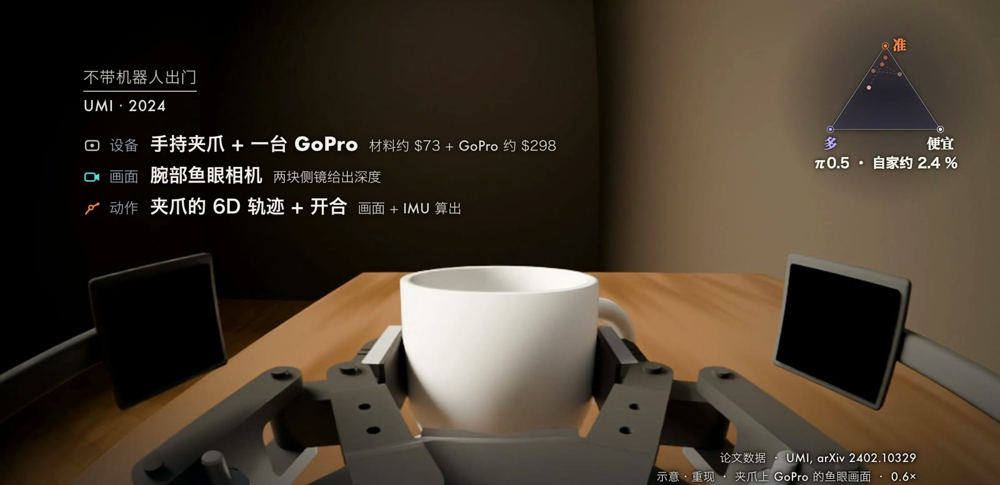
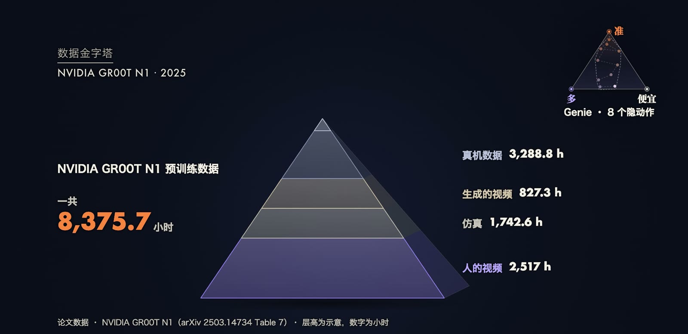
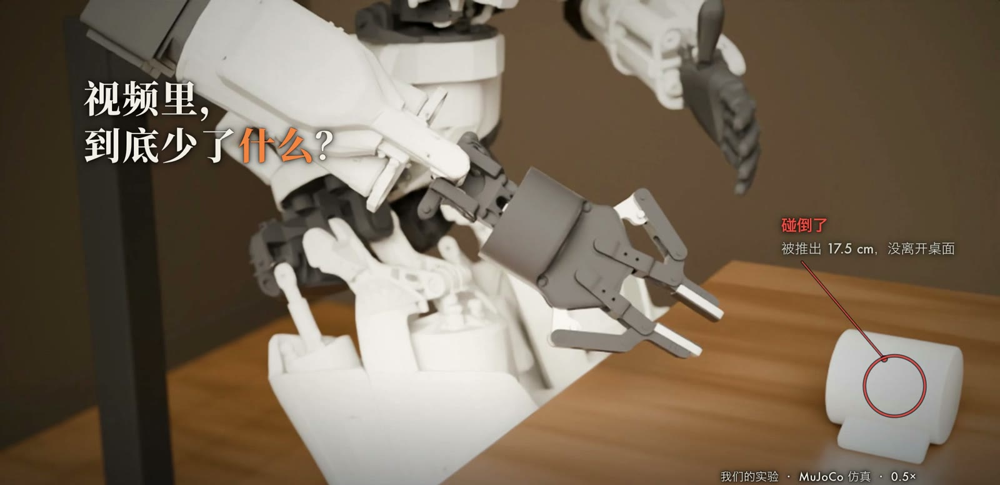

大语言模型的训练数据来自整个互联网，机器人学习没有与之对应的现成语料。
一条机器人数据不只是图像或文本，而是观测与动作成对的时间序列，其中动作必须由传感器或标注方法额外得到。
这使得“数据从哪里来”成为机器人学习中与模型结构同等重要的问题。
本文先把示范和行为克隆写成形式化的目标，说明它的误差为何会累积；再按“离目标机器人有多近、采集成本有多高”梳理遥操作、手持采集、第一人称视频和无标签视频；接着介绍本体差异下的动作重定向、VPT 的逆动力学标注，以及混合训练与数据金字塔；最后报告我们把人的视频重定向到 Apollo 人形机器人的仿真实验，并说明它没有证明什么。

## 问题设定：示范与行为克隆

### 示范的定义

一条示范（demonstration）是一段由观测与动作交替组成的轨迹：

$$
\xi=\left(o_1,a_1,\,o_2,a_2,\,\dots,\,o_T,a_T\right),
$$

其中 $o_t$ 是第 $t$ 步的观测（相机图像，常加上本体状态），$a_t$ 是同一时刻执行的动作（关节目标角、末端位姿增量或夹爪开合）。
数据集 $\mathcal D=\{\xi^{(n)}\}_{n=1}^{N}$ 由 $N$ 条示范组成。
Google 的 [RT-1](https://arxiv.org/abs/2212.06817)（Brohan et al., 2022）就是这种形式：13 台机器人在模拟厨房中采集了 17 个月，约 13 万条示范，操作员用 VR 手柄遥操作。

### 行为克隆

行为克隆（Behavior Cloning，BC）把示范当成监督学习样本，最大化专家动作的对数似然：

$$
\theta^{*}=\arg\min_{\theta}\;\mathbb E_{(o,a)\sim\mathcal D}\left[-\log\pi_\theta(a\mid o)\right].
$$

若策略是确定性的，常用 $\ell_1$ 或 $\ell_2$ 回归损失替代，即 $\lVert\pi_\theta(o)-a\rVert$。
这个目标看似简单，但存在已知的分布偏移问题：训练时观测来自专家的状态分布，部署时观测来自策略自己诱导的分布。
[Ross et al. (2011)](https://arxiv.org/abs/1011.0686) 证明，设策略在专家状态分布上的单步误差为 $\epsilon$，任务长度为 $T$，则行为克隆的累积代价满足

$$
J(\pi)\le J(\pi^{*})+T^{2}\epsilon ,
$$

误差随任务长度二次增长。
他们提出的 DAgger 让策略自己运行、再由专家标注，从而缓解分布偏移。
这一结论说明，示范数据不仅要多，还要覆盖策略可能进入的状态，这也是后来数据采集强调多样性的理论动机之一。

### 动作分块

[ALOHA 与 ACT](https://arxiv.org/abs/2304.13705)（Zhao et al., 2023）采用动作分块（action chunking）降低有效时间长度：策略每步预测未来 $k$ 个动作 $\hat a_{t:t+k}$，使需要连续决策的次数缩小为 $T/k$。
ACT 把策略训练成条件变分自编码器（CVAE），目标为

$$
\mathcal L=\mathcal L_{\mathrm{reconst}}+\beta\,\mathcal L_{\mathrm{reg}},\quad
\mathcal L_{\mathrm{reconst}}=\left\lVert\hat a_{t:t+k}-a_{t:t+k}\right\rVert_{1},\quad
\mathcal L_{\mathrm{reg}}=D_{\mathrm{KL}}\!\left(q_\phi(z\mid a_{t:t+k},\bar o_t)\,\middle\|\,\mathcal N(0,I)\right),
$$

其中 $z$ 是风格隐变量，$\beta$ 控制隐变量传递的信息量，重建项用 $\ell_1$ 而非 $\ell_2$，论文指出这样得到的动作更精确。
推理时使用时间集成（temporal ensembling）：对同一时刻的多个重叠预测按 $w_i=\exp(-m\,i)$ 加权平均，使输出更平滑。
ALOHA 的采集方式是操作员拖动小型主臂，大型从臂一比一跟随，数据以 50 Hz 记录；整套硬件不到 2 万美元。

## 采集方式的几种取舍

不同采集方式在三个量之间取舍：与目标机器人的接近程度、数据量、单位成本。

**遥操作。**
数据与目标机器人完全一致，但人工一小时只能采集一小时。
硬件成本在持续下降：ALOHA 整套不到 2 万美元，GELLO 与 Quest 2 都在 300 美元量级。
跨机构的数据汇集也随之出现，[Open X-Embodiment](https://arxiv.org/abs/2310.08864) 汇集了 60 个数据集、22 种机器人本体、超过 100 万条轨迹；[DROID](https://arxiv.org/abs/2403.12945) 用同一套硬件在 564 个场景、52 栋建筑中采集了约 7.6 万条、约 350 小时示范。

**手持采集。**
[UMI](https://arxiv.org/abs/2402.10329)（Chi et al., 2024）把夹爪做成手持工具，只在上面装一台 GoPro 作为腕部相机，手的轨迹由相机画面和惯性测量单元（IMU）恢复。
夹爪部分材料约 73 美元，GoPro 套件约 298 美元，3 人用 12 人·小时在 30 个地点采集了 1,400 条示范。
论文报告，用这些数据训练的策略在没见过的咖啡馆等环境里达到 71.7%，同一个模型只用实验室数据训练时是 0%。
UMI 不需要机器人在场，但要求夹爪形态与目标机器人兼容。

**第一人称人类数据。**
[Ego4D](https://arxiv.org/abs/2110.07058) 提供 3,670 小时、931 名佩戴者的第一人称视频，但没有手的三维姿态。
[EgoMimic](https://arxiv.org/abs/2410.24221)（Kareer et al., 2024）用 Project Aria 眼镜采集带三维手部追踪的第一人称数据，与机器人示范联合训练。
在“把物体放进碗里”这一个任务上，佩戴眼镜一小时可采集 1,400 条，遥操作一小时仅 135 条；其他任务上的倍数小得多，所以这个比例不能推广。
[EgoDex](https://arxiv.org/abs/2505.11709)（Hoque et al., 2025）用 Apple Vision Pro 记录了 829 小时数据，每一帧带双手各 25 个关节的姿态，但论文没有真机实验。

**无标签的网络视频。**
量最大，但只有画面，没有动作。下一节说明怎样补全。

 一条数据是同一时刻的画面和动作，图中 Apollo 的动作是 32 个关节角。(b) 各类采集方式的设备、画面来源和量：RT-1 的两个 VR 手柄，ALOHA 的主从臂和四个摄像头，UMI 的腕部 GoPro，Aria 眼镜的第一人称画面，以及只有画面没有动作的网络视频。采集设备是在 MuJoCo 里重现的示意，不是原始数据。(c) 数据三角的三个角，以及 GR00T N1 预训练的 8,375.7 小时中自家遥操作约占 1%。(d) 我们的实验，骨盆固定在支架上，只比较动作、不比较平衡：跳舞关节 RMS 4.3 度；直接照搬视频拿杯子，杯子被推出 17.5 cm；手动补齐手的朝向、最后几厘米的接近和握紧时机后，杯子被举起 48 cm。")

## 从人到机器人：本体差异与重定向

### 本体差异

人的视频给出的是人的手腕位姿 $T^{h}_t\in SE(3)$ 与手指关节，机器人需要的是自己的关节角 $q_t$。
两者在自由度、肢长、关节限位和末端执行器形状上都不相同，这称为本体差异（embodiment gap）。
常用的处理是动作重定向（retargeting）：把人的关键点作为目标，通过逆运动学求机器人关节角。
对每一帧求解

$$
q_t=\arg\min_{q\in[q_{\min},q_{\max}]}\;\sum_{i}w_i\left\lVert \mathrm{FK}_i(q)-p^{h}_{i,t}\right\rVert^{2}+\lambda\left\lVert q-q_{t-1}\right\rVert^{2},
$$

其中 $\mathrm{FK}_i$ 是机器人第 $i$ 个关键点的正运动学，$p^h_{i,t}$ 是对应的人体目标点（按机器人肢长缩放），$\lambda$ 项抑制帧间跳变。
数值上常用阻尼最小二乘迭代：设位置误差为 $e$，雅可比为 $J$，则

$$
\Delta q=J^{\top}\left(JJ^{\top}+\mu^{2}I\right)^{-1}e ,
$$

$\mu$ 是阻尼系数，用来避免接近奇异构型时 $\Delta q$ 过大。
重定向只匹配几何，不匹配接触、力和手形，这正是后面实验中杯子被碰倒的根源。

### 逆动力学标注：VPT

如果视频里没有动作，可以先用少量带动作的数据训练一个逆动力学模型（Inverse Dynamics Model，IDM），再给大量无标签视频补上动作。
[VPT](https://arxiv.org/abs/2206.11795)（Baker et al., 2022）在《我的世界》中实现了这条路线。
IDM 的关键是非因果：它可以同时看到动作发生前后的观测，因此比只能看过去的策略更容易训练。
设一段观测序列为 $o_{1:T}$，IDM 的训练目标是最小化标注数据上的负对数似然：

$$
\mathcal L_{\mathrm{IDM}}=-\sum_{t=1}^{T}\log p_{\mathrm{IDM}}\left(a_t\mid o_{1:T}\right).
$$

得到 IDM 后，对无标签视频的每一步取其预测动作 $\hat a_t$，再用因果策略做行为克隆：

$$
\mathcal L_{\mathrm{BC}}=-\sum_{t}\log\pi_\theta\left(\hat a_t\mid o_{1:t}\right).
$$

VPT 的数据规模是：约 2,000 小时带键盘鼠标记录的数据训练 IDM，再给约 7 万小时网络视频补标签。
最终智能体经强化学习微调后，能在约 2.5% 的情形中做出钻石镐；熟练玩家完成这一步约需 20 分钟、24,000 个操作。
IDM 在机器人上的应用受限于动作空间：键盘鼠标是离散且可观测的，而机械臂的力和接触在视频里往往看不见。
[Genie](https://arxiv.org/abs/2402.15391)（Bruce et al., 2024）走另一条路线，在约 3 万小时、没有任何动作标签的游戏视频上，让模型自行归纳出 8 个隐动作。
GR00T N1 的消融比较了两种标注，数据较少时隐动作标签略好，数据较多时逆动力学补出的标签更好。

### 混合训练与数据金字塔

不同来源的数据可以放进同一个训练目标。
设有 $K$ 个数据源 $\mathcal D_1,\dots,\mathcal D_K$（遥操作、人类视频、仿真、生成视频），混合训练可以写成加权形式

$$
\mathcal L(\theta)=\sum_{k=1}^{K}w_k\,\mathbb E_{(o,a)\sim\mathcal D_k}\left[\ell_k(\pi_\theta;o,a)\right],\qquad \sum_k w_k=1 ,
$$

其中 $w_k$ 是采样权重，$\ell_k$ 可以因数据源而异，例如对只有标签化动作的数据使用动作损失，对网络数据使用文本损失。
这是一个概括性写法，不是某篇论文的公式。具体实现各不相同：[π0.5](https://arxiv.org/abs/2504.16054) 用同一个模型联合训练文本 token 的交叉熵与动作专家的流匹配损失，并用权重 $\alpha$ 平衡二者（预训练中 $\alpha=0$，后训练中 $\alpha=10$）。

[GR00T N1](https://arxiv.org/abs/2503.14734) 把数据来源画成一座金字塔：越靠上越接近目标机器人但量越少，越靠下量越大但离机器人越远。
其预训练共 8,375.7 小时，其中真机数据 3,288.8 小时（自家 GR-1 人形机器人的遥操作仅 88.4 小时，约占 1%，其余是别家机器人的数据），人类视频 2,517 小时（其中 Ego4D 为 2,144.7 小时），仿真 1,742.6 小时，生成视频 827.3 小时。

π0.5 的结果说明了混合训练何时有效：目标移动机器人自己的数据约 400 小时，按论文的数字换算，第一阶段样本里只有约 2.4% 来自它，其余来自其他机器人与网络数据。
后续工作 [Kareer et al. (2025)](https://arxiv.org/abs/2512.22414) 在机器人数据里只有“把鸡蛋放进盒子”的情况下，加入约 5 小时人按颜色分拣鸡蛋的视频，分拣准确率从 57% 提高到 78%；但只有机器人预训练足够多样时才出现这种迁移，预训练太少时人的数据没有作用。

## 我们的实验：人的视频能否直接教会 Apollo

### 设置

全部在一台 Mac 上完成的 MuJoCo 仿真，没有下载任何模型，Vision、逆运动学和物理都没有随机性，所有数字可以重跑。

- **机器人**：Apptronik Apollo（mujoco_menagerie，32 个关节执行器），右手腕换成 Robotiq 2F-85 两指夹爪。没有平衡控制器，骨盆固定在支架上，因此只比较动作，不比较平衡。控制 50 Hz，物理 500 Hz，使用模型自带的 PD 位置执行器并对各连杆做重力补偿。
- **素材**：三段网络上的免费视频（Pexels License）：一段卧室里的轻跳舞（10.4 s），一段坐在桌前拿起杯子再放回，一段站在床边叠衣服。杯子视频的机位在缓慢漂移、画面偏暗，是约 55 个候选中最接近“从桌上拿起杯子”的一个。
- **管线**：
  1. Apple Vision 的 [VNDetectHumanBodyPose3DRequest](https://developer.apple.com/documentation/vision/vndetecthumanbodypose3drequest) 逐帧给出 17 个关节的三维位置（相对骨盆中心，单位米），另有 2D 姿态与每只手 21 个点的 2D 手部姿态。
  2. 坐标系转换到机器人骨盆系，Savitzky-Golay 平滑（0.3 s 窗口）。
  3. 用 MuJoCo 雅可比做阻尼最小二乘逆运动学，多个初值取最优，关节限位截断；手腕与脖子保持中立，因为 Vision 的三维人体姿态不含手掌与头的朝向。
  4. 夹爪开合由右手拇指尖到食指尖的 2D 距离决定。记该距离与“手腕到中指根部距离”之比为 $r$，则夹爪指令（0 为全开，255 为全闭）为
     $$c=255\cdot\operatorname{clip}\!\left(\frac{0.90-r}{0.60},\,0,\,1\right),$$
     即 $r\le0.30$ 全闭，$r\ge0.90$ 全开，其间线性映射，看不到手的帧沿用上一个值。
  5. 在 MuJoCo 中用 PD 跟踪重定向角度；杯子段放置真实的桌子和杯子（直径 7 cm、高 8 cm、0.30 kg）。

### 结果一：整段身体动作

| 指标（01 段，跳舞，10.4 s）| 数值 |
| --- | --- |
| Vision 3D 姿态有结果的帧 | 261 帧中的 99% |
| 关节误差 RMS | 4.3 度（躯干 2.2，手臂 7.0，手腕 2.5，腿 3.3）|
| 关节误差 95 分位 | 8.5 度 |
| 手腕位置比重定向参考的平均差 | 72 mm（95 分位 190 mm）|
| IK 几何误差（平均，膝 / 踝 / 肘 / 右腕）| 4 至 6 / 2 至 4 / 15 至 23 / 47 mm |

手臂误差大部分来自延迟：手臂整体比参考慢约 80 ms，平移 80 ms 后手臂误差从 7.0 度降到 3.0 度。
需要注意，IK 的几毫米是关节点到目标点的几何误差，经过物理跟踪后手腕平均差到 72 mm，两者不能混淆。
骨盆固定后，伸直的腿会向地面施力，46% 的时间脚有接触，地面反力 95 分位 1,811 N，这些力由支架承担，真机没有支架时这里就是需要迈步或可能摔倒的地方。

### 结果二：拿起杯子

人手握住杯柄的时刻（视频约 3.4 s）被用来放置桌子和杯子，桌面在重定向后夹爪两指中点下方 5.5 cm。
我们比较了四种设置：

| 设置 | 路径 | 合上 / 松开的依据 | 第一次碰杯 | 最高离桌 | 杯子最后 |
| --- | --- | --- | --- | --- | --- |
| 直接照搬（02_cup_pick）| 视频的 | 人手信号 | 0.88 s | 14 mm | 倒了，移动 175 mm |
| 只补时刻 | 视频的 | 人工读出的时刻 | 2.40 s | 14 mm | 倒了，移动 82 mm |
| 只补路径 | 补齐的 | 人手信号 | 3.24 s | 13 mm | 倒了，移动 94 mm |
| 两样都补（02_cup_fix）| 补齐的 | 人工读出的时刻 | 3.40 s | 478 mm | 立着，离原位 14 mm |

直接照搬时，夹爪在 0.88 s 就碰到杯子，比人手握住杯子早 2.5 s：视频里人的手先在杯碟边摆弄了两秒，这段路径对人手没有问题，对约 20 cm 长、朝下斜着的夹爪则一路扫过杯子。
右手只在 52% 的帧里可见，平均置信度 0.36；人握住杯柄时拇指与食指距离约 0.36 倍手长，按上式映射为约 230/255，即几乎闭合。

“补齐”指我们手动加入了视频里没有的四项信息：
1. 手的朝向：让夹爪保持水平，沿肩膀指向杯子的方向接近；
2. 最后几厘米：握住前 1.4 s 离开人手轨迹，先到杯子后方 10 cm、上方 4 cm，再沿直线推进；
3. 手停在杯子上：视频里人手握着桌上的杯子不动，但 Vision 估计的右手腕在这 2.8 s 内相对骨盆漂移了 14 至 16 cm，照搬会使手自己走开；
4. 合上与松开的时刻：用人工读出的 3.4 s 和 12.5 s，不用手势信号。

补齐后杯子离开桌面 5.2 s，最高举起 478 mm，放回后离原位 14 mm。
但杯子在夹爪里滑动了 24 mm，最大倾斜 49 度，夹爪对杯子的最大力为 219 N。
圆杯身被两指夹住时会绕夹持线转动，真实杯中的液体会洒出。
消融显示，单补路径或单补时刻都失败，两者缺一不可。

### 结果三：叠衣服

Vision 3D 姿态在 96% 的帧有结果，弯腰时骨盆前倾平均 31 度、最大 70 度，被转换到机器人躯干俯仰上。
物理跟踪（不含布）的关节误差 RMS 为 3.2 度。
加入一块 45 x 60 cm、0.20 kg 的布（MuJoCo flex）后，夹爪抓布、拖动，到 7.5 s 时布占的桌面面积为原来的 48%，最高处离桌面 6 cm，而叠成两层应只有约 1 cm，即布被揉成一团而不是叠好。
最后布挂在机器人的左手上被带离桌面。
布料结果对接触参数敏感，只把接触参数调硬一点，抓放次数就从 2 次变成 16 次，所以这里只报告定性结论，不报告面积比例一类的数字。
仿真中的“抓住”是把最近的布顶点连到指垫上的连接约束，不是摩擦夹持。
跟踪误差只有约 3 度，失败的原因在信息上：视频给出手大致在哪里，没有给出每根手指在布上的位置、何时捏紧、捏多紧，也没有布此刻的形状。

### Vision 姿态的抖动

在没有动捕真值的情况下，我们只测得帧间抖动，不是绝对误差。
右手腕原始估计相对 0.3 s 平滑曲线的残差（RMS）如下：

| 段 | 沿相机视线（深度）| 画面平面内（每个轴）| 估计的相机距离 |
| --- | --- | --- | --- |
| 跳舞 | 24 mm | 14 mm | 1.95 m |
| 拿杯子 | 13 mm | 9 mm | 0.89 m |
| 叠衣服 | 45 mm | 40 mm | 1.60 m |

三段的深度方向抖动都比画面内大，为后者的 1.1 至 1.7 倍。
Vision 的身高三段都是 1.80 m，且标记为“参考值”而非测量值，单目视频没有深度时所有长度按这个比例换算。

### 局限与不能得出的结论

- 成功的那一次，路径、朝向和时刻都是我们补的，不能说机器人从视频中学会了拿杯子。
- 骨盆固定，没有平衡，不能说完整复刻了全身动作。
- 只有三段网络素材，机位和遮挡都不理想，不代表其他方法（如 π0.5、EgoMimic）的水平。
- 夹爪握的是杯身而不是杯柄，2F-85 握杯柄需要更精确的朝向和位置，我们没有尝试。
- 补齐版的杯子倾斜 49 度没有修复，需要更宽的指垫、多指手，或杯子重心与握力的信息，而这些恰好是视频中没有的。
- 第一版逆运动学曾把 Vision 的前后方向弄反，手跑到身后，对照视频帧才发现；同时单一初值会卡在肩关节限位上。右手腕平均 IK 误差因此从 350 mm 降到 47 mm。
- 叠衣服只有一只两指夹爪加一只不能动的手，做不了人那样的双手叠法。

## 数据范式尚未收敛

同一年里存在彼此冲突的一手立场与实验。
Sergey Levine 认为仿真、人类视频、手持夹爪都是“叉勺”（spork），真实机器人数据不可替代；Ken Goldberg 估算大模型训练数据相当于人类阅读约十万年，最大的遥操作数据集约一年，YouTube 约 3.5 万年的视频，但近期难以精确恢复手和物体的三维运动；Rodney Brooks 则指出只收集视觉数据缺少触觉，不是对的数据。
另一方面，π0.5 一类结果表明，人类视频只有在足够多样的机器人预训练之上才产生迁移。
公司的下注各不相同（均为自述）：Figure 押人的第一人称视频，Generalist 押 27 万小时真实操作数据，NVIDIA 同时使用金字塔的各层。
“尚未收敛”是我们对这些立场的归纳，并非某一份资料的原话。

## 结论

示范是观测与动作的配对，行为克隆的目标简单，但误差会随任务长度二次累积，所以数据的覆盖范围与多样性和数量同样重要。
各类采集方式是在“像目标机器人、量大、便宜”之间的取舍；视频中缺少的动作可以用逆动力学模型补全，或者用隐动作绕开，混合训练再把它们放进同一个模型。
我们的实验显示，几何重定向足以让身体动作形状对上，但不足以完成需要接触的任务：手的朝向、接近方式、开合时刻和物体的实时状态，都需要额外的信息。
开放的问题包括：从视频恢复手的三维姿态与接触的精度，隐动作与真实电机指令之间的对应，以及各类数据在混合训练中的最优比例。
