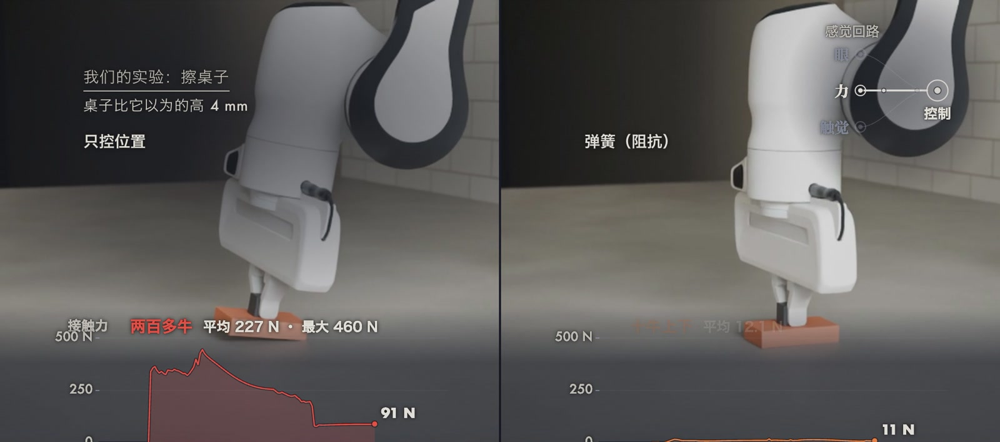

视觉可以告诉机器人鸡蛋在哪里，却不能告诉它手指捏得有多用力，也不能告诉它蛋壳与指垫之间是否已经开始滑动。
抓取的成败由接触决定：法向力过大会压碎物体，过小则会在加速度下滑脱，而安全区间往往只有几牛顿。
本文先从阻抗控制出发，说明为什么只控制位置的机械臂在接触中会失效；随后用库仑摩擦锥给出抓握力的约束；再讨论凝胶加相机式触觉传感器如何把接触变成图像，以及基于这类信号的滑动反射需要多快；最后介绍触觉与力信号进入学习系统的代表性工作，并给出我们在 MuJoCo 中完成的两组仿真实验。

## 问题设定与记号

设末端位姿为 $x \in \mathbb{R}^6$，期望轨迹为 $x_d(t)$，机械臂与环境之间的接触力为 $F_c$。
对一次两指抓取，设两根手指各施加法向力 $f_n$，物体质量为 $m$，与指垫的摩擦系数为 $\mu$，手掌竖直方向的加速度为 $a$。
任务的目标可以写成一个带约束的问题：在不超过物体承受极限 $F_{\max}$ 的前提下，保证物体不相对手指滑动。

$$
\text{find } f_n \quad \text{s.t.} \quad 
\underbrace{m(g + a) \le 2\mu f_n}_{\text{不滑脱}}, \qquad 
\underbrace{2 f_n \le F_{\max}}_{\text{不压碎}}
$$

其中 $g$ 为重力加速度，两侧各一根手指，所以摩擦力上限是 $2\mu f_n$。
这个不等式说明两点：可行区间的下界取决于 $\mu$ 与 $a$，这两个量事先并不精确可知；上界取决于物体本身。
因此一个固定的抓握力要么偏大，要么偏小，需要在线感知接触状态来调节。

 力控制：同样是桌子比以为的高4mm，只控位置擦桌子平均压出227N，阻抗控制（把手臂当弹簧，K是刚度，D是阻尼）约12N，仿真，我们的设定。(b) 触觉：软胶后面放一个小相机，压下去就变形，接触成了图；仿真里每块指垫是16×16个触点，读数来自MuJoCo的触觉传感器，滑动超过10mm/s就加力。(c) 60个随机鸡蛋，超过10N算碎；触觉反射晚到35毫秒以内一个不掉，70毫秒掉20个。画面来自本期视频，传感器剖面是示意。")

## 方法一：阻抗控制

### 控制律

位置控制把末端伺服到 $x_d$，其闭环等效于一根刚度极大的弹簧。
阻抗控制（经典工作为 Hogan 于 1985 年发表的 *Impedance Control: An Approach to Manipulation*）则显式地规定末端与环境之间的动力学关系，使机械臂表现为质量、弹簧、阻尼系统。
在笛卡尔空间中，常用的形式为

$$
F = K\,(x_d - x) + D\,(\dot x_d - \dot x)
$$

式中 $K$ 为刚度矩阵，$D$ 为阻尼矩阵，$F$ 为末端应施加的力，再通过雅可比转置 $\tau = J^\top F$（加上重力和动力学补偿）变为关节力矩。
阻尼通常取临界阻尼，$D = 2\sqrt{K M}$，其中 $M$ 为等效质量；本文实验取 $M = 3\,\mathrm{kg}$。

### 位置误差对接触力的影响

设控制器假设的桌面高度与真实桌面之间相差 $\delta$（桌面比假设的高时 $\delta > 0$），并且目标位置设为压入假设桌面以下 $F_0/K$，即计划接触力为 $F_0$。
在准静态近似下，稳态接触力约为

$$
F_c \approx F_0 + K\,\delta
$$

接触力对高度误差的灵敏度恰好是刚度 $K$。
位置伺服的等效刚度很大（在我们的仿真里，多压 1 mm 就产生约 137 N 的平均接触力，相当于 $10^5\,\mathrm{N/m}$ 量级），所以毫米级误差即可造成数百牛顿的力；而把 $K$ 调到几百 N/m，同样的误差只引起几牛顿的变化。
代价同样来自 $K$：刚度越低，末端对期望轨迹的跟踪越松弛，沿路径的滞后越大。
刚度因此是需要按任务选择的参数，而不是越软越好。

## 方法二：摩擦锥与抓握力

在接触点处，切向力 $f_t$ 与法向力 $f_n$ 满足库仑摩擦约束

$$
\lVert f_t \rVert \le \mu f_n
$$

它定义了一个以法线为轴的圆锥，即摩擦锥。
接触力落在锥内时不发生滑动，到达锥面时进入滑动。
对前面的两指抓取，重力与惯性力构成的切向负载为 $m(g+a)$，由两个接触平分，每个接触的切向力为 $m(g+a)/2$，所以每指所需的最小法向力为

$$
f_n \ge \frac{m\,(g + a)}{2\mu}
$$

这与前一节的不等式一致。
将我们实验中的数字代入：摇晃为振幅 30 mm、频率 3 Hz 的正弦，峰值加速度 $a = A\omega^2 \approx 10.7\,\mathrm{m/s^2}$。
质量 60 g 的蛋在 $\mu = 0.36$ 时需要每指约 1.7 N，在 $\mu = 0.84$ 时只需约 0.7 N。
固定 1 N 的小力对应的临界摩擦系数为 $\mu_c = m(g+a)/(2 f_n)$，对 60 g 的蛋约为 0.6，与实验里的分界（$\mu$ 约 0.62）一致。
这是粗略估算，没有计入指垫的弹性和动态冲击，但它说明了需要的力随 $\mu$ 变化很大，而 $\mu$ 在抓取前通常是未知的。

## 方法三：凝胶加相机式触觉传感器

### 工作原理

视触觉传感器（vision-based tactile sensor）在一块软凝胶后面放置相机和照明。
物体压入凝胶时，凝胶表面形变，相机拍到的图像随之变化，接触就变成了一张可以用图像算法处理的图。
代表性的紧凑设计有 [GelSlim（Donlon et al., 2018）](https://arxiv.org/abs/1803.00628) 和 [DIGIT（Lambeta et al., 2020）](https://arxiv.org/abs/2005.14679)。
DIGIT 的图像分辨率为 640 × 480，帧率 60 fps，批量元件成本约 15 美元；这些数字取自该论文。
若在凝胶表面印上标记点，则标记点的位移场同时包含法向压入和切向剪切的信息。

### 从图像到接触量

在小形变范围内可以用线性弹性近似：局部压入深度 $d$ 与接触压强 $p$ 近似成正比，$p \approx k\,d$；切向位移 $u$ 与切向应力近似成正比。
实际系统不依赖这个解析关系，而是标定一个映射 $\hat{F} = g_\phi(I)$，从图像 $I$ 回归接触力。
例如 [9DTact（Lin et al., 2023）](https://arxiv.org/abs/2308.14277) 用约 10 万组图像与力的数据对、175 种物体训练网络，用于估计 6 维力。
需要注意，力是由形变推断出来的，而不是直接测量，因此凝胶的磨损、个体差异和标定漂移都会影响估计。

### 仿真中的触觉信号

我们的仿真使用 MuJoCo 4.0.0 的 `tactile` 传感器：每根手指上放置 16 × 16 的触点网格（taxel），覆盖 17 mm × 17 mm 的指垫，网格铺在凸点前 0.3 mm，相当于一层虚拟皮肤。
每个触点每步输出三个量：压入深度 $d_{ij}$ 和两个切向滑动速度 $\mathbf{v}_{ij}$。
由此定义逐触点的力图和整体滑动信号

$$
F_{ij} = \frac{d_{ij}}{\sum_{kl} d_{kl}}\, f_n, \qquad 
s = \frac{\sum_{ij} d_{ij}\,\lVert \mathbf{v}_{ij} \rVert}{\sum_{ij} d_{ij}}
$$

其中 $f_n$ 是该手指的接触法向力，来自 MuJoCo 的接触求解；滑动信号 $s$ 是被压到的触点滑动速度按深度加权的平均，两块指垫合并计算。
当 $s$ 超过阈值 $s_0 = 10\,\mathrm{mm/s}$ 时判定为正在滑动。
阈值的选择有实验依据：阈值取 3 mm/s 时，指垫在摇晃中的弹性蠕动（最大 3.6 mm/s）会反复触发反射；真正滑脱的蛋，其滑动信号的 90% 分位在 40 mm/s 以上。

## 滑动反射与延迟预算

### 反射律

滑动反射的作用是把抓握力从一个偏低的初值开始，仅在检测到滑动时才增加。
设每指指令力为 $f(t)$，$\tau$ 为触觉信号到达控制器的延迟，则

$$
f(0) = f_0, \qquad 
\dot f(t) = \begin{cases} r, & s(t-\tau) > s_0 \\ 0, & \text{否则} \end{cases}, \qquad 
f(t) \le f_{\max}
$$

并在每次滑动开始的瞬间额外加 $\Delta f = 0.5\,\mathrm{N}$。
实验取 $f_0 = 1.0\,\mathrm{N}$，$r = 40\,\mathrm{N/s}$，$f_{\max} = 3.5\,\mathrm{N}$（两指合计 7 N，为碎点的 70%），只加不减。
上限 $f_{\max}$ 保证了反射本身不会把蛋压碎。

### 延迟预算

总延迟由三部分叠加：$\tau = \tau_{\text{sense}} + \tau_{\text{compute}} + \tau_{\text{act}}$，分别对应相机曝光与读出、图像处理或网络推理、以及手指力执行器的响应。
这笔预算必须小于物体从“开始滑”到“滑出摩擦接触”的时间。
作为参照，人类在滑移发生后约 0.06 到 0.08 秒内自动提高抓握力（Johansson 与 Westling 1984 年的研究）；[OpenAI 的灵巧手工作](https://arxiv.org/abs/1808.00177)中策略步长为 12 Hz，一步约 83 ms，与这个量级相当。
因此，一个每帧都要经过大模型推理的触觉闭环，如果延迟落在几十毫秒之上，就无法承担滑动反射，需要把反射放在低层、快速的回路中。

## 学习中的触觉与力

触觉与力信号进入学习系统的方式大致有三类。

第一类是预测抓取结果。[Calandra et al. (2017)](https://arxiv.org/abs/1710.05512) 在抓紧但尚未抬起时，用相机图加两个手指上的 GelSight 图预测这次抓取能否成功；在 12 个未见过的物体上，每个物体 10 次，仅用视觉的成功率为 80%，视觉加触觉为 94%。后续的 [More Than a Feeling（Calandra et al., 2018）](https://arxiv.org/abs/1805.11085) 进一步用这种预测来决定是否重新抓取。

第二类是把触觉作为策略观测。[Rotating without Seeing（Yin et al., 2023）](https://arxiv.org/abs/2303.10880) 在 Allegro 手上铺设 16 个力敏电阻，每个只输出“接触或未接触”一个比特，用于手内旋转。[3D-ViTac（Huang et al., 2024）](https://arxiv.org/abs/2410.24091) 把触觉点放进三维表示，在蒸蛋任务上全模型成功率为 85%，仅用 RGB 为 50%（每任务评估 20 个回合）。

第三类是在模仿学习和视觉语言动作模型中引入力。[FACTR（Liu et al., 2025）](https://arxiv.org/abs/2502.17432) 用课程训练让策略逐步依赖力反馈；[ForceMimic（Liu et al., 2024）](https://arxiv.org/abs/2410.07554) 在削皮任务的严格判据下，把成功率从 55% 提高到 85%，但把力直接作为扩散策略输入的版本只有 10%；[ForceVLA（Yu et al., 2025）](https://arxiv.org/abs/2505.22159) 在五个任务上平均 60.5%，不带力的 π0 为 37.3%；[Tactile-VLA（Huang et al., 2025）](https://arxiv.org/abs/2507.09160) 训练时只见过“轻”和“重”两种指令，在 USB 插入任务中夹力分别为 0.51 N 和 2.57 N，而基线 π0 为 2.41 N 和 2.68 N，几乎不能区分。
这些结果说明，力信号能否带来提升取决于输入方式：直接拼接力有时反而使性能下降。
另外，触觉也并非总是必要，[OpenAI 的灵巧手](https://arxiv.org/abs/1808.00177)虽然手内带有触觉传感器，论文说明只使用了关节感知，没有使用这些传感器。

## 我们的实验

### 实验设置

仿真器为 MuJoCo 4.0.0，物理与控制均为 1 kHz。
机器人为 Franka Emika Panda 加 Franka Hand（mujoco_menagerie 模型，未改动），手臂改为力矩控制，上限取 Panda 自身的 87 Nm（关节 1 到 4）和 12 Nm（关节 5 到 7）。
手指力执行器上限 70 N，指垫接触时间常数 0.012 s。
所有“会碎”的阈值和随机范围都是我们的设定，不是实测的蛋壳强度或真机数据。

实验一与二（抓蛋）：每个蛋为椭球，在以下范围内均匀随机：直径 42.5 到 45.5 mm，质量 50 到 70 g，滑动摩擦系数 0.35 到 0.85。
两根手指法向力之和（3 ms 平均）超过 10 N 判定为碎。
动作序列为下降、合指、抬高 10 cm，再做 2 s 的上下摇晃（振幅 30 mm，3 Hz，峰值加速度 10.7 m/s²，约 1.1 g）。
结束时手指仍接触蛋且蛋相对手掌下滑不足 20 mm，记为拿住。
同一批 60 个蛋（种子 0 到 59）对每种夹法各试一次，属于配对比较。

### 结果：三种夹法

| 夹法 | 碎 | 掉 | 拿住 | 峰值总捏力（中位）|
|---|---|---|---|---|
| (a) 只控位置，目标开口 42 mm | 51 | 0 | 9 | 碎点 10 N 时判碎 |
| (b) 固定小力，每指 1.0 N | 0 | 37 | 23 | 3.55 N |
| (c) 触觉滑动反射 | 0 | 0 | 60 | 3.51 N |

只控位置的夹法在合指阶段（1.18 到 1.28 s）就碎了 51 个，没碎的 9 个都是直径不超过 43.0 mm 的小蛋。
把同样的夹法换到不会碎的蛋上，峰值总捏力中位为 24.9 N，最大 43.4 N，是碎点的 2.5 到 4.3 倍。
固定小力一个也没碎，但摇晃时掉了 37 个；摩擦系数在 0.62 以下的全部掉落，0.63 以上的全部拿住，与前面的摩擦锥估算一致。
触觉反射使 60 个蛋全部拿住，峰值总捏力中位 3.5 N，最大 5.2 N，约为碎点的一半。
最终指令力中位为每指 1.58 N，没有一个触及 3.5 N 的上限。

### 结果：反射延迟

保持反射律不变，只让触觉信号晚到 $\tau$，每个延迟仍用同样的 60 个蛋。

| 延迟 $\tau$ | 掉 | 拿住 | 峰值总捏力（中位）|
|---|---|---|---|
| 0 ms | 0 | 60 | 3.51 N |
| 20 ms | 0 | 60 | 5.98 N |
| 35 ms | 0 | 60 | 7.06 N |
| 50 ms | 9 | 51 | 7.03 N |
| 70 ms | 20 | 40 | 4.80 N |
| 100 ms | 21 | 39 | 4.70 N |
| 250 ms | 25 | 35 | 4.56 N |
| 500 ms | 30 | 30 | 4.09 N |
| 无反射（对照）| 37 | 23 | 3.55 N |

掉落数随延迟单调上升，拐点在 35 到 70 ms 之间：35 ms 以内没有掉落，70 ms 时掉了三分之一。
延迟较大时即使赶上了，也要捏得更重，35 ms 时拿住的蛋的峰值力中位升到 7.1 N，因为晚到的信号使加力多持续了一段，有 28 个蛋顶到了 7 N 的上限。
这个拐点落在人类滑移反射的 0.06 到 0.08 秒附近，但不能据此推断人会掉三分之一的蛋：我们的控制器只有反射、没有预判，而且摇晃相当剧烈。
实验也没有对应某一款真实相机的延迟。

### 结果：擦桌子

擦板固定在手上，从 x = 0.45 m 擦到 0.65 m 再擦回，控制器以为的桌面高度与真实高度相差 $\delta$。
计划接触力 $F_0 = 10\,\mathrm{N}$，阻尼 $D = 2\sqrt{3K}$，桌面摩擦系数 0.4。
这一组是确定性的，每个设置一次。

| 控制方式 | $\delta = -4$ mm | $\delta = 0$ | $\delta = +4$ mm |
|---|---|---|---|
| 位置控制，擦时平均力 | 0 N（一直悬空）| 137 N | 227 N（最大 460 N）|
| 阻抗 $K = 20000$ N/m | 0 N | 19.7 N | 91.1 N |
| 阻抗 $K = 3000$ N/m | 2.3 N | 12.4 N | 23.4 N |
| 阻抗 $K = 500$ N/m | 8.2 N | 10.2 N | 12.1 N |

实测结果与 $F_c \approx F_0 + K\delta$ 吻合：$K = 500$ N/m 时 $\delta = \pm 4$ mm 对应 $10 \pm 2$ N，实测 8.2 与 12.1 N；$K = 20000$ N/m 时 $\delta = +4$ mm 对应约 90 N，实测 91.1 N。
刚度较大时 $\delta = -4$ mm 同样导致悬空。
位置控制在 $\delta = +2$ mm 和 $+4$ mm 时力相近（约 227 N），因为关节 2 和关节 6 已有 50% 以上的时间顶在力矩上限。
代价如前所述：擦板在 x 方向上落后路径，$K = 500$ N/m 时约 25 mm，$K = 250$ N/m 时约 44 mm，$K = 3000$ N/m 时约 5 mm。

### 局限

- 全部为仿真，蛋壳碎点 10 N、随机范围、控制参数都是我们设定的；
- 触觉图是 MuJoCo 传感器的直接输出，没有包含真实凝胶的光学畸变、磨损与噪声；
- 反射控制器没有预判，延迟结论只说明延迟与掉落的相对关系；
- 擦桌子一组中，擦板与桌面之间的摩擦由我们按测得的法向力加库仑摩擦实现，因为 MuJoCo 自带的摩擦在滑动时出现接触跳动（最小复现见 `hop_check.py`）；该组没有随机项，每个设置只运行一次。

## 小结

阻抗控制把接触力对位置误差的灵敏度显式设成 $K$，摩擦锥给出了抓握力的下界，二者都需要在线的接触信息才能用好。
视触觉传感器把接触变成图像，使滑动检测和力估计可以用图像方法完成，而反射能否生效取决于总延迟与物体滑脱时间的比较。
在学习系统里，触觉与力信号有时显著提高成功率，有时在直接拼接时反而变差，如何使用比是否拥有更关键。
尚未解决的问题包括：凝胶的耐久性与标定、触觉在仿真中的建模，以及低层快速反射与高层大模型之间的分工。
