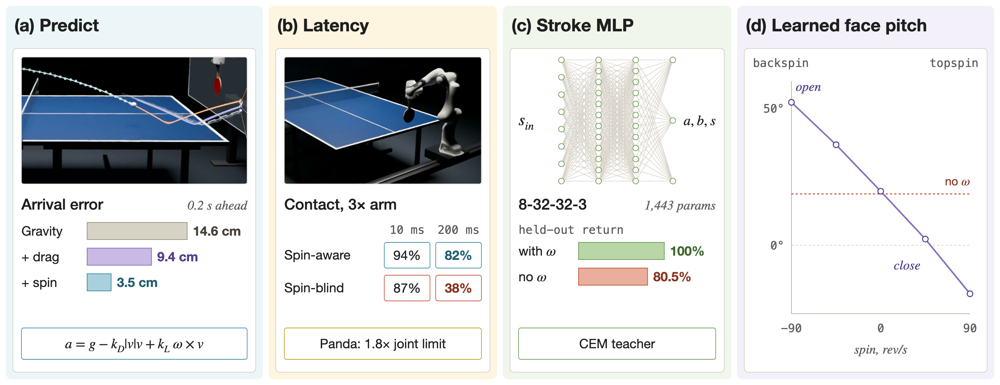
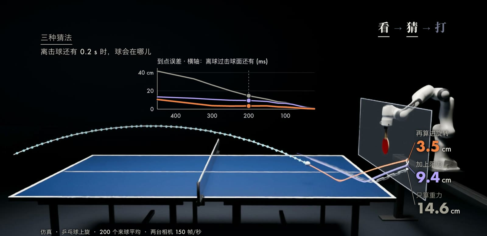
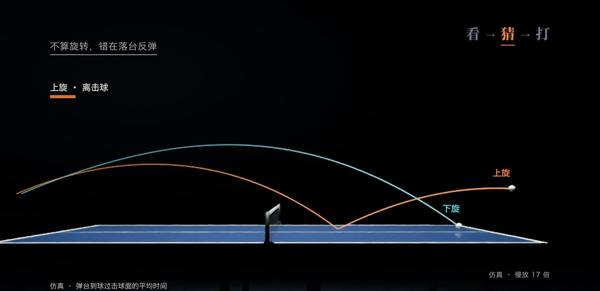
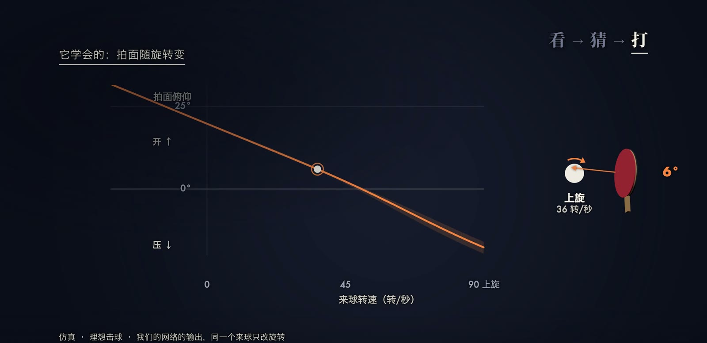

乒乓球对机器人而言首先是一个时间问题。
一个速度为 14 m/s 的球飞过 2.74 m 长的球台只需约 0.2 s，而感知、计算和执行构成的整条链路即使做到极致也需要约 20 ms，机械臂挥拍到位还要额外的时间。
因此机器人不能等球到了再反应，必须根据前几帧观测预测球何时、以何种速度和旋转穿过击球位置，并在此之前开始挥拍。
难点在于真实的球并不沿抛物线飞行：空气阻力使它持续减速，旋转产生的马格努斯力使轨迹弯曲，落台反弹又把旋转转化为速度的突变。
本文依次介绍球的飞行与弹跳模型、从轨迹中估计旋转的滤波方法、延迟预算，以及把“来球状态到拍面”这一映射交给小型神经网络的做法，随后介绍 Sony Ace 等代表性系统，最后给出我们在 MuJoCo 中用 Franka Panda 完成的仿真实验。

## 问题与记号

记球心位置为 $\mathbf{p}\in\mathbb{R}^3$，速度为 $\mathbf{v}$，角速度为 $\boldsymbol{\omega}$，球的状态为 $\mathbf{x}=(\mathbf{p},\mathbf{v},\boldsymbol{\omega})$。
坐标系的 $x$ 轴沿球台长边，$z$ 轴竖直向上。
机器人在自己一侧选定一个竖直的击球面 $x=x_h$，任务的第一部分是预测球穿过该平面的位置 $\hat{\mathbf{p}}_h$、时刻 $\hat t_h$ 以及此时的速度和旋转。

观测来自两台同步相机。
第 $k$ 帧时刻 $t_k$ 得到的三角化测量为

$$
\mathbf{z}_k=\mathbf{p}(t_k)+\boldsymbol{\eta}_k,\qquad \boldsymbol{\eta}_k\sim\mathcal{N}(\mathbf{0},R_k),
$$

其中 $R_k$ 由三角化的一阶误差传播给出，随球离相机的距离近似按平方增长。
注意角速度 $\boldsymbol{\omega}$ 从不被直接测量，它只能通过轨迹的弯曲和弹跳间接推断。

任务的第二部分是选择一次击球 $\mathbf{u}=(\mathbf{n},s)$：$\mathbf{n}$ 是拍面法线，$s$ 是球拍沿法线的速度。
击球后的球速 $\mathbf{v}^+$ 和旋转 $\boldsymbol{\omega}^+$ 由碰撞模型决定，随后球飞向对方台面，落点记为 $\boldsymbol{\ell}(\mathbf{x}_h,\mathbf{u})$。
目标是让落点接近目标点 $\boldsymbol{\ell}^\ast$、球安全过网，同时挥拍速度在机械臂能力之内。

时间约束可以写成一个简单的不等式。
设第 $k$ 帧的预测要到 $t_k+L$ 才交给控制器，$L$ 为感知、计算与执行的总延迟，机械臂从当前姿态挥到击球姿态需要 $T_{\mathrm{swing}}$，那么能用于决策的最后一帧满足

$$
t_k+L+T_{\mathrm{swing}}\le \hat t_h .
$$

$L$ 越大，可用的观测越少，预测必须越早就足够准确。

## 方法

### 飞行模型：重力、阻力与马格努斯力

忽略空气时，球只受重力，轨迹是抛物线。
真实的球还受到与速度反向的阻力和与旋转有关的升力，常用的模型为

$$
m\dot{\mathbf{v}}=m\mathbf{g}-\tfrac{1}{2}\rho C_D A\,\lVert\mathbf{v}\rVert\,\mathbf{v}+\tfrac{1}{2}\rho C_L A\,\lVert\mathbf{v}\rVert^2\,\frac{\boldsymbol{\omega}_\perp\times\mathbf{v}}{\lVert\boldsymbol{\omega}_\perp\times\mathbf{v}\rVert},
$$

其中 $m$ 是球的质量，$\rho$ 是空气密度，$A=\pi r^2$ 是迎风面积，$C_D$ 是阻力系数，$C_L$ 是升力系数，$\boldsymbol{\omega}_\perp$ 是角速度中垂直于速度的分量。
升力的方向沿 $\boldsymbol{\omega}\times\mathbf{v}$：上旋球的升力向下，因此落得更早；下旋球的升力向上，因此飞得更远。
这一现象即马格努斯效应。
升力系数通常写成自旋比 $S=r\lVert\boldsymbol{\omega}_\perp\rVert/\lVert\mathbf{v}\rVert$ 的函数，我们的实验采用 [Štěpánek (1988)](https://doi.org/10.1119/1.15692) 在网球上拟合的形式

$$
C_L(S)=\frac{1}{2.022+0.981/S},
$$

并把它借用到乒乓球上，这是我们的建模选择，并非乒乓球的测量值。
乒乓球的阻力系数取光滑球亚临界区的 $C_D=0.47$。
旋转本身也会因空气力矩而衰减，我们用 $\dot{\boldsymbol{\omega}}=-\tfrac{\rho A r^2 C_M}{2I}\lVert\mathbf{v}\rVert\boldsymbol{\omega}$ 表示，$I$ 是转动惯量，$C_M=0.03$ 是我们设定的值，没有找到可靠的测量依据。

阻力对轻球的影响很大。
令 $\dot{\mathbf{v}}=0$ 可得终端速度 $v_\infty=\sqrt{2mg/(\rho C_D A)}$，按上述常数，乒乓球约为 $8.6$ m/s，也就是说一个 14 m/s 的来球始终处在强烈的减速之中。
羽毛球更为极端：[Cohen et al. (2015)](https://iopscience.iop.org/article/10.1088/1367-2630/17/6/063001) 给出其终端速度约为 6.7 m/s，且倒着飞出的球会在约 20 ms 内翻转为球托朝前。

以下把三种逐级增加的模型称为预测器 (a)、(b)、(c)：(a) 只有重力，状态为 $(\mathbf{p},\mathbf{v})$；(b) 加入阻力；(c) 再加入马格努斯升力和旋转衰减，状态扩展为 $(\mathbf{p},\mathbf{v},\boldsymbol{\omega})$。
三者都用四阶 Runge-Kutta 积分向前推演。

### 弹跳：刚体冲量模型

落台反弹是预测误差最集中的地方。
设台面法线为 $\mathbf{n}$（指向球），台面速度为 $\mathbf{v}_s$（对球拍而言非零），碰前相对速度为 $\mathbf{u}=\mathbf{v}-\mathbf{v}_s$，其法向分量 $u_n=\mathbf{n}^\top\mathbf{u}<0$。
接触点的切向滑移速度为

$$
\mathbf{v}_c=(\mathbf{u}-u_n\mathbf{n})-r\,\boldsymbol{\omega}\times\mathbf{n}.
$$

法向冲量（按单位质量计）由恢复系数 $e$ 决定，$J_n=-(1+e)\,u_n$。
切向冲量先按“碰撞结束前停止滑动”计算，若超过库仑摩擦上限则截断为滑动摩擦：

$$
\mathbf{J}_t^{\mathrm{stick}}=-\frac{\mathbf{v}_c}{1+1/k},\qquad
\mathbf{J}_t=\begin{cases}\mathbf{J}_t^{\mathrm{stick}}, & \lVert\mathbf{J}_t^{\mathrm{stick}}\rVert\le\mu J_n,\\[2pt] \mu J_n\,\mathbf{J}_t^{\mathrm{stick}}/\lVert\mathbf{J}_t^{\mathrm{stick}}\rVert, & \text{otherwise},\end{cases}
$$

其中 $k=I/(mr^2)$（薄壳球为 $2/3$），$\mu$ 是摩擦系数。
碰后状态为

$$
\mathbf{v}^+=\mathbf{v}+J_n\mathbf{n}+\mathbf{J}_t,\qquad \boldsymbol{\omega}^+=\boldsymbol{\omega}-\frac{\mathbf{n}\times\mathbf{J}_t}{k\,r}.
$$

上旋球的接触点相对台面向后滑，摩擦冲量向前，所以弹起后又快又低；下旋球则相反，弹起后明显变慢。
在我们的仿真中，同一个以 5 m/s 向前、旋转 400 rad/s 的球，上旋落台后水平速度为 5.64 m/s、弹起角 21.5°，下旋为 3.70 m/s、25.6°。
同一组公式也用于球拍与球的碰撞，此时 $\mathbf{v}_s=s\,\mathbf{n}$，$e$ 和 $\mu$ 换成胶皮的参数。

### 从轨迹估计旋转

预测器 (c) 必须从位置序列中把 $\boldsymbol{\omega}$ 估计出来。
落台之前，我们对已看到的所有点做非线性最小二乘，求当前帧的状态：

$$
\hat{\mathbf{x}}_k=\arg\min_{\mathbf{x}}\ \sum_{j\le k}\big\lVert\mathbf{z}_j-\mathbf{p}\big(\Phi_{t_j-t_k}(\mathbf{x})\big)\big\rVert^2_{R_j^{-1}}+\boldsymbol{\omega}^\top P_\omega^{-1}\boldsymbol{\omega},
$$

其中 $\Phi_\tau$ 是飞行模型推演时长 $\tau$（可为负）的流映射，$\lVert\mathbf{e}\rVert^2_{W}=\mathbf{e}^\top W\mathbf{e}$。
旋转先验 $P_\omega$ 在垂直于飞行方向的两轴上取 600 rad/s 的宽松标准差，在沿飞行方向的轴上取 60 rad/s。
沿飞行方向的旋转不会使轨迹弯曲，因而在落台前不可观测，但它会在落台时把球向侧面踢开，所以需要一个较紧的先验。
每帧只做 3 步高斯-牛顿迭代，并从上一帧的解热启动。

一旦检测到落台，就用落台前的拟合结果初始化扩展卡尔曼滤波（Extended Kalman Filter，EKF），按碰撞模型穿过弹跳点，再用新的测量更新：

$$
\begin{aligned}
\hat{\mathbf{x}}^-_k&=\Phi_{\Delta t}(\hat{\mathbf{x}}_{k-1}), & P^-_k&=F_kP_{k-1}F_k^\top+Q,\\
K_k&=P^-_kH^\top\big(HP^-_kH^\top+R_k\big)^{-1}, & \hat{\mathbf{x}}_k&=\hat{\mathbf{x}}^-_k+K_k\big(\mathbf{z}_k-H\hat{\mathbf{x}}^-_k\big),
\end{aligned}
$$

其中 $F_k$ 是 $\Phi_{\Delta t}$ 的雅可比矩阵，$H=[I_3\ 0\ 0]$ 只取位置，$Q$ 是过程噪声。
每次更新后，把 $\hat{\mathbf{x}}_k$ 推演到击球面，即得到 $(\hat{\mathbf{p}}_h,\hat t_h)$ 以及过面时的速度和旋转。
我们最初让带旋转的 EKF 从零旋转开始，结果升力系数在零附近最陡，滤波器很快自信地停在只有真值一半左右的旋转上，直到落台才纠正，因此改为“落台前最小二乘、落台后 EKF”的组合。

### 延迟与重规划

每来一个新预测，控制器就重新规划一次：先由击球模型算出这一拍的 $(\mathbf{n},s)$，再用逆运动学求出击球姿态，最后用五次多项式从当前参考状态插值到“在 $\hat t_h$ 到达、带着击球速度”的关节轨迹。
第 $k$ 帧算出的预测在 $t_k+L$ 才生效，因此延迟越大，落台之后那几帧最有价值的修正越用不上。
对于不考虑旋转的预测器，这一点尤其致命，因为它在落台前的预测本身就是错的。

### 击球：从来球状态到拍面

给定过面时的来球状态，可以用模型反推一拍：选定落点和飞行时间，用飞行模型反解出需要的出球速度，再用球拍碰撞公式反解出 $\mathbf{n}$ 和 $s$。
这个映射光滑，但难以写成闭式，而且依赖模型是否准确。
另一种做法是先在仿真里为大量来球搜索最优的一拍，再用一个小网络去拟合这些答案。

我们把拍面法线参数化为 $\mathbf{n}=\mathrm{normalize}(-1,a,b)$，对每个来球用交叉熵方法（Cross-Entropy Method，CEM）最小化

$$
J(a,b,s)=\lVert\boldsymbol{\ell}-\boldsymbol{\ell}^\ast\rVert^2+0.004\,s^2+c_{\mathrm{net}}+c_{\mathrm{table}}+2\max(0,\,0.04-h_{\mathrm{clear}}),
$$

其中 $\boldsymbol{\ell}$ 是在真值世界中模拟得到的落点，$c_{\mathrm{net}}$ 和 $c_{\mathrm{table}}$ 是下网和出界的固定惩罚，$h_{\mathrm{clear}}$ 是过网余量（米）。
CEM 每代采样 96 个候选，保留代价最低的 10 个，用它们的均值和方差更新采样分布，迭代 7 代，并从模型反推的那一拍出发。
学生网络 $f_\theta:\mathbb{R}^8\to\mathbb{R}^3$ 的输入是过面位置 $(y,z)$、速度 $\mathbf{v}$ 和旋转 $\boldsymbol{\omega}$，输出 $(a,b,s)$，用均方误差回归 CEM 的答案：

$$
\min_\theta\ \frac{1}{N}\sum_{i=1}^{N}\big\lVert f_\theta(\mathbf{x}_h^{(i)})-(a,b,s)^{(i)}_{\mathrm{CEM}}\big\rVert^2 .
$$

网络结构为 8-32-32-3、tanh 激活，参数量为 $8\cdot32+32+32\cdot32+32+32\cdot3+3=1443$。
需要说明，这是“仿真搜索加监督回归”的简化做法；Ace 等系统直接用强化学习训练整个挥拍策略，见下一节。

### 算法步骤

综合起来，每个来球按以下步骤处理：

1. 两台相机以 150 帧每秒拍摄，三角化得到 $\mathbf{z}_k$ 及其协方差 $R_k$。
2. 落台前，对已有点做带旋转先验的非线性最小二乘，得到 $\hat{\mathbf{x}}_k$；检测到落台后，切换到 EKF，按碰撞模型过弹跳点并继续更新。
3. 把 $\hat{\mathbf{x}}_k$ 推演到击球面，得到过面位置、时刻、速度和旋转。
4. 经过延迟 $L$ 后，用网络 $f_\theta$（或模型反推）给出 $(\mathbf{n},s)$。
5. 用逆运动学求击球姿态，用五次多项式重规划关节轨迹，由 1 kHz 的计算力矩控制执行，击球后随挥 0.25 s。
6. 下一帧到来时回到第 1 步，直到球被击出。

## 代表工作

Sony AI 的 Ace（[Dürr et al., 2026](https://www.nature.com/articles/s41586-026-10338-5)）是目前最完整的系统。
它的机械臂有 8 个关节（2 个直线滑轨加 6 个转动关节），用 9 台 200 Hz 的普通帧相机三角化球的位置，平均误差 3.0 mm、延迟 10.2 ms。
旋转不靠轨迹倒推，而是由 3 套视线控制系统直接观测：事件相机通过振镜持续盯住球，读取球上 logo 的转动，先由 CNN 快速估计，再用对比度最大化精修。
事件相机只在像素亮度变化时输出事件，因而延迟极低，原理可参考 [Gallego et al. (2022)](https://arxiv.org/abs/1904.08405) 的综述。
按补充材料，从相机采集到伺服执行的整条链路约 20.2 ms（感知 10.2 ms、控制 5.06 ms、执行 5.0 ms）；作为对照，青少年精英运动员在实验室中对屏幕上快速运动的按键反应约 232 ms（[Hülsdünker et al., 2019](https://www.frontiersin.org/articles/10.3389/fnbeh.2019.00165)）。
它的策略每 32 ms 决策一次，用 [SAC](https://arxiv.org/abs/1801.01290) 全部在仿真中训练后零样本部署；训练时 critic 能看到真实的球状态，actor 只看带噪声的测量历史，即非对称 actor-critic（[Pinto et al., 2017](https://arxiv.org/abs/1710.06542)）。
策略网络由 4 个每层 256 单元的残差块组成，输入 157 个数，输出 8 个关节在 32 ms 后的目标位置和速度共 16 个数，推理约 0.52 ms。
输出不直接送给电机，而是先经一个最小化 jerk 的二次规划变成平滑且不撞桌的轨迹，再以 1 kHz 执行。
比赛中它对 5 位精英球员赢下 3 场，对 2 位职业选手两场皆负、7 局只赢 1 局；14 m/s 以内回球稳定，16 m/s 以上回球率明显下降。

Google DeepMind 的系统（[D'Ambrosio et al., 2024](https://arxiv.org/abs/2408.03906)）采用分层结构：17 个各约 1 万参数的低层技能网络，每个只会一种打法，由高层控制器在对手每次击球时挑选一个。
它用进化策略在 MuJoCo 中训练，整体延迟约 100 ms，29 场比赛赢 13 场，对初学者全胜，对高级及以上选手未胜，作者自称达到业余人类水平。
UC Berkeley 的 HITTER（[Su et al., 2025](https://arxiv.org/abs/2508.21043)）把同样的分层思路用到 Unitree G1 人形机器人上：上层用带阻力和弹跳的球模型规划击球点，下层用 PPO 训练的全身控制网络执行，但球的位置来自 9 台动捕相机，规划器假设旋转可以忽略。

其他球类把难点换到了别处。
ETH 的 ANYmal-D 打羽毛球（[Ma et al., 2025](https://arxiv.org/abs/2505.22974)）只用机载双目相机，用 EKF 和只含重力与阻力的球模型预测落点；一个来球约飞 1 s，其中平均 0.357 s 用于得到可用轨迹，策略还自行学会了抬头，让球在画面中停留更久。
人形网球的 LATENT（[Zhang et al., 2026](https://arxiv.org/abs/2603.12686)）在动捕场地的实机对打中正手 11 拍回了 10 拍，去掉训练中对球物理参数的随机化后，正手成功率降至 16.67%。

## 我们的实验

### 设置

实验全部在仿真中完成，物理引擎为 MuJoCo 4.0.0，运行在一台 Apple M5 Max 上。
机器人是 MuJoCo Menagerie 的 Franka Panda，装在一条沿底线方向的示意导轨上（行程 ±0.75 m），力矩上限使用 Panda 自身的 87 Nm 和 12 Nm，参考轨迹的关节速度不超过 Panda 的 2.175 和 2.61 rad/s。
MuJoCo 负责飞行积分和机器人动力学，气动力每步作为外力施加；碰撞没有使用 MuJoCo 的软接触，而是每 0.1 ms 检测一次并用上文的冲量公式计算，因为软接触给出的摩擦冲量只有库仑模型的约三成。
台面 $e=0.90$、$\mu=0.25$，球拍 $e=0.85$、$\mu=0.80$（后者为我们的设定）。
每个来球的真值各自抽取一组扰动后的常数，而预测器只知道名义值。
相机为两台 150 帧每秒、1280 × 1024 的同步相机，检测误差 0.5 像素，不模拟运动模糊和遮挡；三角化误差在 1.7 m 处为 1.4 mm，在 4.5 m 处为 4.9 mm。

实验分三组。
E2 比较三种预测器在过面前不同时刻的到点误差，每种旋转 5 个种子、每个种子 40 个来球。
E3 把总延迟从 10 ms 扫描到 200 ms，比较考虑与不考虑旋转的机器人（5 个种子 × 30 个球），并加入一条关节速度和力矩都放大 3 倍的“快手臂”作为对照，用于把延迟与手臂太慢的影响分开，它是示意性的设定。
E4 训练击球网络，训练集为 3240 个来球，测试集为另外 5 个种子的 450 个留出来球，网络本身训练 5 个种子。

### 结果

到点误差指在预测时刻球的真实位置与预测点之间的三维距离，时间猜错也计入其中。
下表取离过面还有 200 ms 时最新的预测，5 个种子平均。

| 来球 | (a) 只有重力 | (b) 加阻力 | (c) 加阻力和旋转 |
| --- | --- | --- | --- |
| 上旋 | 14.6 cm | 9.4 cm | 3.5 cm |
| 下旋 | 12.5 cm | 7.4 cm | 1.6 cm |
| 侧旋 | 21.5 cm | 16.6 cm | 3.9 cm |

预测器 (c) 估计的旋转在上旋球落台前一帧平均为 67 转/秒，真值为 64 转/秒，单个球的矢量误差平均约 11 转/秒。

延迟扫描的结果如下，每格是 5 个种子 × 30 个球的平均。

| 手臂 | 预测器 | 指标 | 10 ms | 50 ms | 100 ms | 200 ms |
| --- | --- | --- | --- | --- | --- | --- |
| 快手臂（示意） | 考虑旋转 | 回球上台 | 76% | 70% | 71% | 60% |
| 快手臂（示意） | 考虑旋转 | 碰到球 | 94% | 89% | 87% | 82% |
| 快手臂（示意） | 不考虑旋转 | 碰到球 | 87% | 77% | 57% | 38% |
| 快手臂（示意） | 不考虑旋转 | 回球上台 | 8% | 5% | 1% | 4% |
| 真实 Panda | 考虑旋转 | 回球上台 | 41% | 39% | 32% | 21% |

击球网络在留出测试球上的表现如下。
这里把网络给出的一拍原样施加到球上，球交给真值世界飞行，不含相机误差和机械臂误差，因此是理想击球测试。

| 击球方式 | 回球上台 | 上旋 | 下旋 | 侧旋 |
| --- | --- | --- | --- | --- |
| CEM 老师 | 100% | 100% | 100% | 100% |
| 模型反推，当作无旋转 | 22.4% | 4.0% | 37.3% | 26.0% |
| 网络，输入含旋转（5 个种子） | 100% | 100% | 100% | 100% |
| 网络，输入不含旋转（5 个种子） | 80.5% | 92.3% | 80.1% | 69.1% |

### 解读

到点误差的差距主要来自两处。
阻力使球持续减速，只有重力的模型会系统性地高估速度、猜错过面时间；旋转则决定了轨迹的弯曲和落台后的速度，下旋和侧旋球尤其如此。
考虑旋转的机器人在落台之前就已猜准，因此延迟从 10 ms 增加到 200 ms，碰球率只从 94% 降到 82%。
不考虑旋转的机器人只能等落台之后再追，而弹台到过面只剩约 120 到 170 ms，延迟一旦占去这段时间就来不及，碰球率从 87% 降到 38%。
即便碰到了球，不考虑旋转时拍面角度也是错的，回球上台率始终不到一成。

换回真实 Panda 后，瓶颈变成了手臂速度。
在 10 ms 延迟下，最后一次规划所需的关节速度（取最吃紧的关节）中位数是上限的 1.05 倍，其中下旋球为 1.82 倍，因为把下旋球托过网需要拍子快速向前上方发力，所以下旋球的回球率只有 18%。
这解释了为什么 Ace 和 DeepMind 都使用专门的高速机械臂并装在直线轴上。

网络把“上旋压拍、下旋开拍”学成了一条连续曲线：其他输入固定、来球从 90 转/秒的下旋变到 90 转/秒的上旋时，拍面俯仰角从向上打开 52.3° 单调变为向下压 17.7°；看不见旋转的网络只能输出一个约 18.8° 的平均角度。
看不见旋转的网络仍有 80.5% 的回球率，原因是在我们生成来球的方式下，旋转与出手速度相关，网络可以从速度和高度中间接猜出一部分旋转；在 60 到 90 转/秒的重旋转球上，它只剩 53.6%。

### 局限

所有数字都来自仿真，没有上实物。
导轨、快手臂、旋转衰减系数和胶皮参数是我们的设定，乒乓球的升力曲线借用自网球。
相机模型没有运动模糊、遮挡和漏检，是对感知最有利的情形。
把网络放进整机试验（20 ms 延迟）后，在真实 Panda 上含旋转与不含旋转的两个网络回球率分别为 39% 和 37%，差别被手臂速度限制所掩盖。
在快手臂上两者分别为 78% 和 57%，但上旋球反而是不看旋转的网络更好（96% 对 76%），因为估计出的旋转带有误差，会让网络把拍压得过头。
两台快手臂之间的对打在 24 个种子上平均连续 24.2 拍（最少 11 拍，最多 37 拍），而真实 Panda 平均只有 1.6 拍。

## 小结

高速击球可以分解为三步：用带阻力、马格努斯力和刚体弹跳的模型预测球，用滤波从轨迹或直接观测中获得旋转，再把来球状态映射为拍面朝向和挥拍速度。
其中旋转是关键量，它同时决定了预测能否在落台前收敛，以及拍面应当打开还是压下。
击球映射本身并不复杂，一个一千多个参数的网络就能在理想条件下学好，真正的约束来自感知延迟与手臂的速度上限。
尚未解决的问题包括仿真与真实球拍接触的差距、对手建模与战术选择，以及在没有动捕的情况下用机载视觉处理羽毛球和网球这类大场地、远距离的来球。
