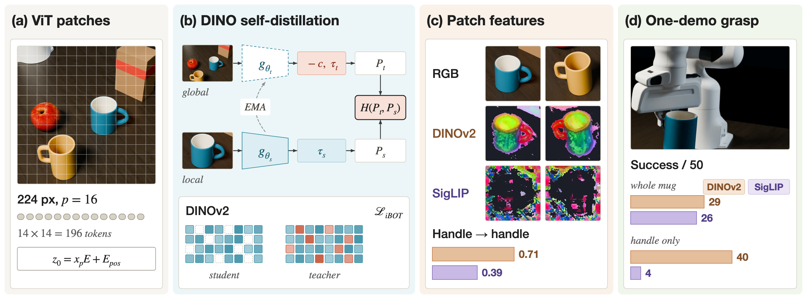
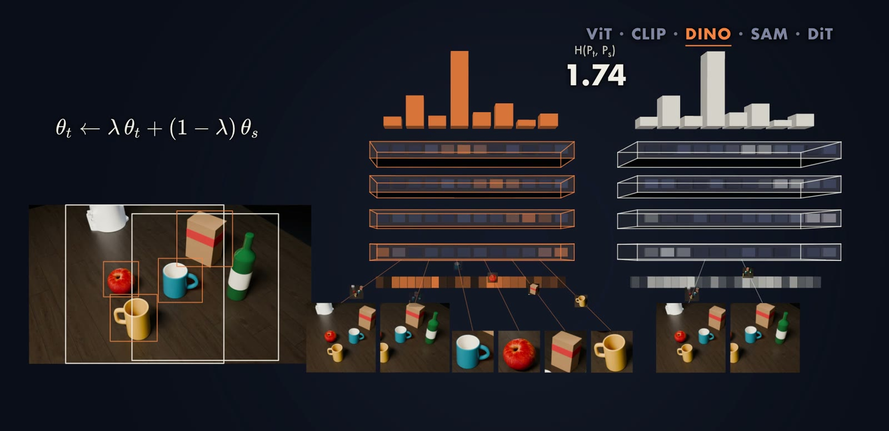
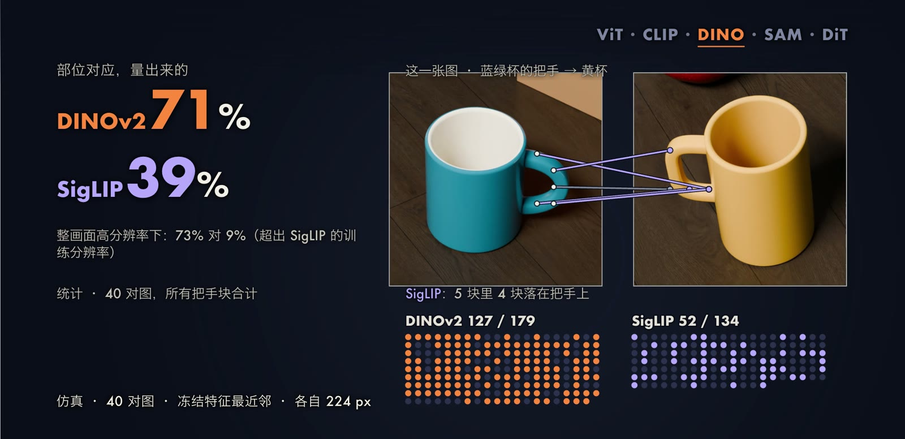
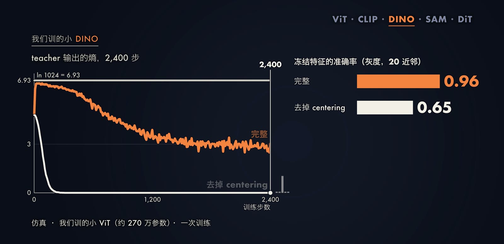
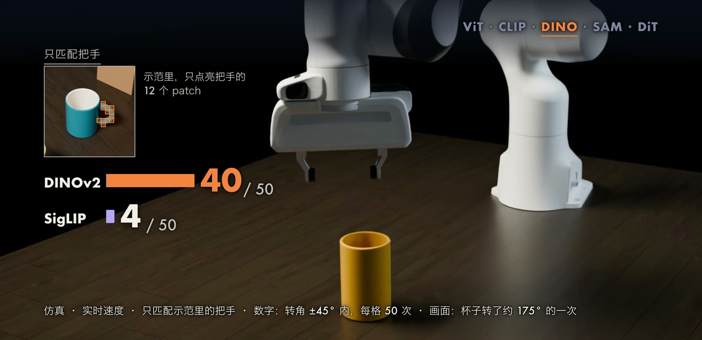

机器人的策略并不直接读取像素，它读取的是视觉编码器输出的一组 token。
同一张桌面经过不同的编码器，得到的 token 携带的信息可能完全不同：有的擅长说出“这是一只杯子”，有的擅长指出“这一小块是杯子的把手”。
对于抓取这类任务，后一种能力往往更重要，因为机械臂需要知道应当把手指放在物体的哪个部位。
本文从 Vision Transformer（ViT）的切块讲起，依次介绍图文对比学习（CLIP、SigLIP）、自蒸馏学习（DINO、DINOv2）以及它们为什么不会坍缩，再介绍 Segment Anything Model（SAM）和 Diffusion Transformer（DiT）在机器人系统中的位置，最后给出我们在 MuJoCo 桌面上完成的三组仿真实验。

## 问题与记号

设输入图像为 $I\in\mathbb{R}^{H\times W\times 3}$，视觉编码器 $f_\theta$ 把它映射为 $N$ 个 $D$ 维的 token：

$$
Z=f_\theta(I)=[z_1,\dots,z_N]\in\mathbb{R}^{N\times D},\qquad N=\frac{HW}{p^2},
$$

其中 $p$ 是切块（patch）的边长，每个 $z_i$ 对应图像中的一个 $p\times p$ 小块。
下游的策略 $\pi$ 以这些 token、语言指令 $\ell$ 和本体状态 $q_t$ 为条件输出动作，例如一段长度为 $H_a$ 的动作块 $a_{t:t+H_a}\sim\pi(\cdot\mid Z,\ell,q_t)$。
本文关心的问题是：编码器的训练目标 $\mathcal{L}(\theta)$ 决定了 $Z$ 里装着什么。

衡量 patch 特征好坏的一个直接指标是部位对应（dense correspondence）。
给定两张图 $I$ 和 $I'$，对 $I$ 中的第 $i$ 个 patch，在 $I'$ 中找余弦相似度最大的 patch：

$$
\hat{j}(i)=\arg\max_{j}\ \frac{\langle z_i,z'_j\rangle}{\lVert z_i\rVert\,\lVert z'_j\rVert}.
$$

如果 $\hat{j}(i)$ 落在与第 $i$ 块相同的物体部位上（例如两只不同杯子的把手），说明特征编码了部位和形状，而不只是物体类别。
后文的实验正是用这个量来比较不同编码器。

## 方法

### ViT 的切块与 patch embedding

ViT（[Dosovitskiy et al., 2021](https://arxiv.org/abs/2010.11929)）把图像切成互不重叠的 $p\times p$ 小块，每块拉平为长度 $p^2C$ 的向量 $x_p^i$，经过同一个线性层 $E\in\mathbb{R}^{(p^2C)\times D}$ 投影，再加上可学习的位置编码 $E_{pos}$：

$$
z_0=[x_{\mathrm{cls}};\,x_p^1E;\,x_p^2E;\,\dots;\,x_p^NE]+E_{pos}.
$$

$x_{\mathrm{cls}}$ 是一个额外的可学习 token，用来汇总整张图的信息。
以 224 像素的输入和 $p=16$ 为例，图像被切成 $14\times14=196$ 块，加上 class token 共 197 个 token；patch 边长为 14 的编码器（如 DINOv2）在 224 像素下得到 $16\times16=256$ 块。
之后的每一层都是标准的 Transformer 块，核心是自注意力

$$
\operatorname{Attn}(Q,K,V)=\operatorname{softmax}\Big(\frac{QK^{\top}}{\sqrt{d_k}}\Big)V,
$$

其中 $Q$、$K$、$V$ 是 token 经三个线性层得到的查询、键和值，$d_k$ 是键的维度。
自注意力让每个 patch 都能读取其他所有 patch 的信息，因此最后一层的 $z_i$ 既与第 $i$ 块的局部外观有关，也与它在整张图中的位置和上下文有关。
结构本身并不规定 $z_i$ 应当编码什么，这由训练目标决定。

### 图文对比：CLIP 与 SigLIP

CLIP（[Radford et al., 2021](https://arxiv.org/abs/2103.00020)）用图像编码器和文本编码器分别得到整张图的向量 $u_i$ 和整句话的向量 $v_j$（都做 L2 归一化），在一个批次的 $B$ 对图文上计算相似度矩阵 $s_{ij}=\langle u_i,v_j\rangle$，并对行和列各做一次交叉熵：

$$
\mathcal{L}_{\mathrm{CLIP}}=-\frac{1}{2B}\sum_{i=1}^{B}\Big[\log\frac{e^{s_{ii}/\tau}}{\sum_{j}e^{s_{ij}/\tau}}+\log\frac{e^{s_{ii}/\tau}}{\sum_{j}e^{s_{ji}/\tau}}\Big],
$$

$\tau$ 是可学习的温度。
目标只要求对角线上配对的那一格得分最高；论文中一个批次是 32,768 张图和 32,768 句话。
SigLIP（[Zhai et al., 2023](https://arxiv.org/abs/2303.15343)）把每一格独立地看作一个二分类问题，不再对整行归一化：

$$
\mathcal{L}_{\mathrm{SigLIP}}=-\frac{1}{B}\sum_{i=1}^{B}\sum_{j=1}^{B}\log\sigma\big(y_{ij}\,(t\,s_{ij}+b)\big),\qquad y_{ij}=\begin{cases}1,&i=j\\-1,&i\neq j\end{cases}
$$

其中 $\sigma$ 是 sigmoid，$t$ 和 $b$ 是可学习的尺度和偏置；论文把 $b$ 初始化为 $-10$，使训练开始时大量的负样本不会压垮少数正样本。
两种损失比较的都是整张图的一个向量和整句话的一个向量，没有对单个 patch 提出要求。
这样训练得到的编码器能够“叫出名字”，但 patch 特征是否编码了部位，并不在目标的约束之内。

### 自蒸馏：DINO

DINO（[Caron et al., 2021](https://arxiv.org/abs/2104.14294)）不使用文字和标注。
它有结构相同的两个网络：学生 $g_{\theta_s}$ 和教师 $g_{\theta_t}$，输出都是 $K$ 维向量（论文中 $K=65{,}536$）。
从同一张图裁出 2 个全局视角 $x_1^g,x_2^g$（面积通常超过原图一半）和若干局部视角，学生看全部视角，教师只看全局视角。
两个网络的输出经过带温度的 softmax 变成分布：

$$
P_s(x)=\operatorname{softmax}\Big(\frac{g_{\theta_s}(x)}{\tau_s}\Big),\qquad P_t(x)=\operatorname{softmax}\Big(\frac{g_{\theta_t}(x)-c}{\tau_t}\Big),
$$

训练目标是让学生在任意视角上的分布贴近教师在全局视角上的分布：

$$
\min_{\theta_s}\ \sum_{x\in\{x_1^g,x_2^g\}}\ \sum_{x'\in V,\ x'\neq x} H\big(P_t(x),P_s(x')\big),\qquad H(a,b)=-\sum_{k}a^{(k)}\log b^{(k)},
$$

其中 $V$ 是所有视角的集合。
由于小块必须预测出与大块相同的分布，网络被迫学会“这一小块属于哪个物体的哪个部位”。
教师不通过梯度训练，它的参数是学生参数的指数滑动平均（exponential moving average，EMA）：

$$
\theta_t\leftarrow\lambda\,\theta_t+(1-\lambda)\,\theta_s,
$$

$\lambda$ 在训练中按余弦曲线从 $0.996$ 增加到 $1$。

这个目标存在两个平凡解。
一是网络对任何输入都输出同一个尖峰分布，二是对任何输入都输出均匀分布；两种情况下学生和教师都完全一致，损失却不再提供有用的梯度，这称为坍缩（collapse）。
DINO 只在教师一侧做两件方向相反的操作来避免坍缩。
第一是 centering：从教师输出中减去中心 $c$，它是教师批内平均输出的滑动平均，

$$
c\leftarrow m\,c+(1-m)\,\frac{1}{B}\sum_{i=1}^{B}g_{\theta_t}(x_i),
$$

这样任何一维都不能对所有图像保持最大，抑制了第一种坍缩，但会把输出推向均匀分布。
第二是 sharpening：教师使用很低的温度（$\tau_t$ 从 $0.04$ 升到 $0.07$，学生 $\tau_s=0.1$），把分布压尖，抑制第二种坍缩。
论文把交叉熵分解为 $H(P_t,P_s)=h(P_t)+D_{\mathrm{KL}}(P_t\Vert P_s)$，并指出缺少任一操作时 $D_{\mathrm{KL}}$ 都趋于零：缺 centering 时教师熵 $h(P_t)$ 降到零，缺 sharpening 时 $h(P_t)$ 升到 $\log K$。

一个四维的手算例子可以说明二者的配合。
设两张图的教师输出为 $A=[3,0,0,0]$ 和 $B=[3,0.2,0,0]$，中心取二者平均 $c=[3,0.1,0,0]$，温度 $0.04$。
只压尖时，两者都变成 $[1,0,0,0]$，无法区分；先减中心再压尖，得到 $[0.32,0.03,0.32,0.32]$ 和 $[0.07,0.80,0.07,0.07]$，两张图被分开了。
只减中心而不压尖（温度为 1），两者都接近均匀分布，同样无法区分。

DINO 的训练过程可以概括为以下步骤：

1. 对一批图像，每张裁出 2 个全局视角和若干局部视角，并做颜色抖动等增广。
2. 教师对全局视角前向，得到 $g_{\theta_t}$，减去中心 $c$ 后以 $\tau_t$ 做 softmax，并停止梯度。
3. 学生对全部视角前向，以 $\tau_s$ 做 softmax。
4. 对每一对不同的（教师视角，学生视角）计算交叉熵并求平均，反向传播只更新 $\theta_s$。
5. 用 EMA 更新 $\theta_t$，用教师的批内平均输出更新 $c$。

### DINOv2：patch 级目标

DINOv2（[Oquab et al., 2023](https://arxiv.org/abs/2304.07193)）在 DINO 的图像级损失之外，加入了来自 iBOT（[Zhou et al., 2022](https://arxiv.org/abs/2111.07832)）的 patch 级损失。
学生的输入中随机遮住一部分 patch（集合 $M$），被遮的位置用 mask token 代替；教师看到完整图像。
学生需要在被遮的位置上预测教师在相同位置给出的分布：

$$
\mathcal{L}_{\mathrm{iBOT}}=-\sum_{i\in M}\sum_{k}P_{t,i}^{(k)}\log P_{s,i}^{(k)},\qquad \mathcal{L}=\mathcal{L}_{\mathrm{DINO}}+\mathcal{L}_{\mathrm{iBOT}}+\lambda_{\mathrm{K}}\,\mathcal{L}_{\mathrm{KoLeo}}.
$$

$P_{t,i}$ 和 $P_{s,i}$ 分别是教师和学生在第 $i$ 个 patch 上的输出分布，$\mathcal{L}_{\mathrm{KoLeo}}$ 是一个让批内特征在空间中分散开的正则项，$\lambda_{\mathrm{K}}$ 是它的权重。
与 CLIP 类目标不同，这一项直接对每个 patch 提供训练信号。
DINOv2 用约 1.42 亿张图训练，训练不使用任何标签；这些图像是从约 12 亿张网络图片中按相似度检索出来的，另外加入了一些现成数据集。
最大的模型约 11 亿参数，较小的模型由它蒸馏得到。
后续的 Registers 一文（[Darcet et al., 2024](https://arxiv.org/abs/2309.16588)）发现大模型中约 2% 的 patch 特征范数异常大，携带全局信息而不携带局部信息；给模型增加几个不对应任何图像块的 register token 后，这类伪影随之消失。
我们实验中使用的就是带 register 的 DINOv2。

DINOv2 论文给出的特征可视化方法是两次主成分分析（PCA）：先对一张图的所有 patch 特征做 PCA，第一主成分为正的 patch 视为前景；再只对前景 patch 做一次 PCA，把前三个主成分映射为红、绿、蓝。
本文的封面和图中的彩色特征图都按这一方法计算。

### SAM：可提示的分割

SAM（[Kirillov et al., 2023](https://arxiv.org/abs/2304.02643)）把分割写成一个可提示（promptable）的任务：

$$
\{M_k,\ \hat{s}_k\}_{k=1}^{3}=\mathrm{Dec}\big(\mathrm{Enc}(I),\ \mathrm{Prompt}(q)\big),
$$

其中 $q$ 是点、框或粗掩码等提示，$M_k$ 是输出的掩码，$\hat{s}_k$ 是模型对每个掩码预测的 IoU 分数。
图像编码器同样是 ViT（经 MAE 预训练），1024 像素的输入得到 $64\times64$ 个位置的特征；提示编码器把 $q$ 编码为 token；掩码解码器只有两层，结合图像特征和提示 token 输出掩码。
一个点的含义可能有歧义（整体、部分、子部分），因此 SAM 对单个提示同时输出 3 个掩码。
图像只需编码一次，之后每次点击只运行提示编码器和解码器，论文给出的耗时约为 50 毫秒（浏览器 CPU，图像嵌入已预先算好）。
训练数据来自一个逐步自动化的数据引擎：最终 11 亿个掩码中，99.1% 由 SAM 全自动生成。
SAM 2（[Ravi et al., 2024](https://arxiv.org/abs/2408.00714)）增加了一个记忆模块，使掩码可以在视频帧之间传递。
需要说明，在机器人系统中 SAM 通常用于分割物体、筛选抓取点或建立三维地图（例如 [OK-Robot](https://arxiv.org/abs/2401.12202)），而不是作为策略的视觉编码器。

### DiT：在噪声上做切块

扩散模型（[Ho, Jain & Abbeel, 2020](https://arxiv.org/abs/2006.11239)）的前向过程逐步向数据 $x_0$ 加入高斯噪声，任一步的样本可以直接写成

$$
x_t=\sqrt{\bar{\alpha}_t}\,x_0+\sqrt{1-\bar{\alpha}_t}\,\epsilon,\qquad \epsilon\sim\mathcal{N}(0,\mathbf{I}),
$$

其中 $\bar{\alpha}_t$ 由噪声方差表决定。
网络 $\epsilon_\theta$ 学习从 $x_t$ 中预测所加的噪声，训练目标是

$$
\mathcal{L}_{\mathrm{simple}}=\mathbb{E}_{x_0,\epsilon,t}\Big[\big\lVert\epsilon-\epsilon_\theta(x_t,t,c)\big\rVert^2\Big],
$$

$c$ 是条件（如类别）。
DiT（[Peebles & Xie, 2023](https://arxiv.org/abs/2212.09748)）把 $\epsilon_\theta$ 换成 Transformer：对 $256\times256$ 图像在 VAE 隐空间中的 $32\times32\times4$ 表示切块，$p=2$ 时得到 256 个 token，输出每个 token 上的噪声预测（以及协方差）。
时间步和类别通过自适应 LayerNorm（adaLN）进入每一个块：LayerNorm 的缩放和平移由条件向量回归得到；其 adaLN-Zero 变体还让每个残差分支乘以一个零初始化的系数，使每个块在训练开始时等价于恒等映射。
上式是 DDPM 的简化目标，DiT 在此之外还学习了方差项。

在机器人中，GR00T N1（[NVIDIA et al., 2025](https://arxiv.org/abs/2503.14734)）的动作模块是 DiT 的一个变体。
被去噪的是动作 token，图像和语言特征通过交叉注意力从旁边送入；模型一次生成 16 步动作，只走 4 步去噪，训练目标是流匹配（flow matching）。
以通用的线性插值形式写出（这是教学用的一般形式，GR00T N1 论文的符号约定可能不同），令 $A^{\tau}=\tau A+(1-\tau)\epsilon$，网络 $v_\theta$ 回归沿插值路径的速度：

$$
\mathcal{L}_{\mathrm{FM}}=\mathbb{E}_{\tau,\epsilon}\Big[\big\lVert v_\theta(A^{\tau},\tau,\phi)-(A-\epsilon)\big\rVert^2\Big],
$$

其中 $A$ 是真实动作块，$\phi$ 是视觉语言特征。
推理时从纯噪声出发，按 $v_\theta$ 积分若干步得到动作。

## 代表工作

ViT 证明了不依赖卷积、只靠切块加 Transformer 就能完成图像识别，之后几乎所有视觉编码器都沿用了这一结构。
CLIP 用约 4 亿对网络图文训练，在 ViT-L/14@336px、80 条提示模板集成的设定下，ImageNet 零样本准确率达到 76.2%；SigLIP 用逐格的 sigmoid 损失替代了按行归一化的 softmax。
DINO 发现自监督训练的 ViT 的注意力图能够分出物体，不过同一附录表也表明 MoCo-v2、BYOL、SwAV 等方法具有类似性质。
DINOv2 把这一路线扩展到大规模数据，在冻结特征、线性分类的设定下 ImageNet 准确率为 86.5%，与 OpenCLIP 的 86.2% 基本持平；差别主要体现在稠密任务上。

Probe3D（[El Banani et al., 2024](https://arxiv.org/abs/2404.08636)）系统比较了冻结特征的三维感知能力。
在 SPair-71k 关键点对应上（冻结特征最近邻，ViT-B 级别，每个模型取最好的一层），DINOv2 约 57%，CLIP 约 6%，SigLIP 约 8%；室内深度估计的 $\delta_1$，DINOv2 为 93.4%，SigLIP 63.8%，CLIP 52.1%。
论文同时说明，造成这一差距的原因尚未查清，数据、判别式目标或对比损失单独都不能完全解释。
另一方面，Prismatic（[Karamcheti et al., 2024](https://arxiv.org/abs/2402.07865)）发现单独用 DINOv2 作为视觉语言模型的视觉输入，效果不如 CLIP 和 SigLIP，而把 DINOv2 与 SigLIP 的特征按通道拼接，可以在定位类任务上获得提升。
OpenVLA（[Kim et al., 2024](https://arxiv.org/abs/2406.09246)）的视觉部分正是这样拼接的 DINOv2 加 SigLIP。

DINOBot（[Di Palo & Johns, 2024](https://arxiv.org/abs/2402.13181)）直接利用了 patch 特征的对应关系：先用整图特征检索最相似的示范，再在两张图之间对 DINO 的 patch 特征做互为最近邻的匹配，借助深度算出机械臂应当执行的刚体变换。
在它的干扰物实验中（3 个任务、没见过的物体、目标图人工给定），一条示范加特征对应的成功率为 0.80，十条示范的行为克隆为 0.20。
LIBERO-Plus（[Fei et al., 2025](https://arxiv.org/abs/2510.13626)）则揭示了尚未解决的问题：在 LIBERO 上微调的 OpenVLA 原始任务成功率为 76.5%，挪动第三人称相机的位姿和视场角后降到 1.1%（仿真）。

## 我们的实验

### 设置

所有实验都在一台 Apple M5 Max 上完成，全部是仿真。
物理引擎为 MuJoCo 4.0.0，机械臂为 MuJoCo Menagerie 的 Franka Panda，桌面上有两只自建的杯子（蓝绿色和芥末黄，形状和把手都不同）、苹果、酒瓶和纸箱。
固定的第三人称 RGB-D 相机分辨率为 $1280\times720$，深度不加噪声。
编码器均为公开权重：DINOv2 with registers 的 ViT-B/14 和 ViT-S/14、SigLIP base-patch16-224、SAM 2.1 hiera-tiny，全部冻结，不做任何微调。

实验 E2 测量部位对应：从主角杯的每个 patch 出发，在第二张图中找余弦相似度最大的 patch，统计把手 patch 是否落在目标杯子的把手上，每个条件 40 对图。
实验 E3 测量单次示范抓取，做法参照 DINOBot 的单步简化版：示范一次抓把手，在新场景中对示范区域的 patch 做互为最近邻的匹配，用深度把匹配点抬到三维，经 RANSAC 和 SVD 估计刚体变换，再把示范轨迹整体变换后在物理仿真中执行；每格 50 次，杯子偏航在示范的 $\pm45^\circ$ 以内。
E3 用整只杯子的 patch 去匹配，E3b 只用示范中落在把手上的 12 个 patch，其余流程完全相同。
实验 E5 训练一个约 270 万参数的小型 DINO（ViT，patch 8，6 层），数据是我们桌面的 64 像素物体裁剪图，每组训练 2400 步、一个种子，分别去掉 centering、sharpening 和 EMA 教师。

### 结果

| 实验 | 条件 | DINOv2-B | SigLIP-B | 只比颜色 |
| --- | --- | --- | --- | --- |
| E2 把手落到把手上，换一只杯子 | 各自 224 像素，40 对图 | 0.71 | 0.39 | |
| E2 把手落到把手上，换一只杯子 | 整画面高分辨率，40 对图 | 0.73 | 0.09 | 0.00 |
| E3 整只杯子匹配，同一只杯子 | 每格 50 次 | 29/50 | 26/50 | 27/50 |
| E3b 只匹配把手，同一只杯子 | 每格 50 次 | 40/50 | 4/50 | 23/50 |
| E3b 只匹配把手，换一只杯子 | 每格 50 次 | 27/50 | 0/50 | 0/50 |
| E3b 只匹配把手，换光照 | 每格 50 次 | 43/50 | 1/50 | 5/50 |

作为参照，直接重放示范轨迹的成功率为 7/50，使用真实物体位姿的上限为 50/50。
整画面设定下 SigLIP 的输入超出了它的训练分辨率，因此表中第一行（各自在训练分辨率下）对 SigLIP 更公平。

E5 中，在灰度留出集上用冻结特征做 20 近邻分类：完整 DINO 为 0.956，去掉 centering 为 0.646，去掉 sharpening 为 0.596，去掉 EMA 教师为 0.526，未训练的随机初始化网络为 0.628。
去掉 centering 后，从第 300 步起教师熵降到约 0.003，批内平均输出中一维占 100%；去掉 sharpening 后，教师熵从第 100 步起停在 $\ln 1024\approx6.93$；两种情况下 $D_{\mathrm{KL}}(P_t\Vert P_s)$ 都趋于零。

### 解读

部位对应上，DINOv2 在每个条件下都优于 SigLIP，差距在“换一只杯子”时最大。
但抓取实验给出了更细致的结论：用整只杯子去匹配时，DINOv2、SigLIP 甚至只比颜色的基线成功率都在一半左右，配对符号检验没有显著差别。
原因是示范掩码中的 95 个 patch 有 51 个在光滑的杯身外侧，旋转体的杯身无法告诉匹配器杯子转了多少，RANSAC 选择了“不转”的多数派；估计的偏航对真实偏航的拟合斜率，DINOv2-B 只有 0.09。
只匹配把手后，DINOv2-B 的抓取点中位误差从约 27 mm 降到 5.7 mm，成功率升到 40/50；SigLIP 的 12 个把手 patch 几乎找不到互为最近邻的伙伴，大多数试验因不足 3 对匹配而无法估计变换。
因此，DINOv2 的优势体现在部位这一级，与前文的训练目标一致：iBOT 项对每个 patch 提出了要求，而 CLIP 类目标只约束整图向量。
这一解释是我们的推论，Probe3D 也指出原因尚无定论。

### 局限

其一，所有结果都来自仿真，深度没有噪声，没有在真机上验证。
其二，E3b 是看完 E3 的结果之后设计的变体，示范中的把手位置由真值标注，相当于人为指定一次“抓这里”；E5 只训练了一次、一个种子。
其三，这套流程只用一个固定相机拍一次、做一步对齐，杯子转过 $45^\circ$ 以后所有特征组都基本失败，而真实位姿仍然 100% 成功，瓶颈在姿态估计而非特征本身。
其四，相机绕工作区转 $60^\circ$ 时（E4），DINOv2-B 降到 10/50，反而不如只比颜色的基线（23/50），所以这一组结果不能作为“DINOv2 对视角更鲁棒”的证据。
我们的 40/50 与 DINOBot 论文的 0.80 只是数字相同，任务、相机和物体都不同，不能视为复现。

## 小结

视觉编码器的结构大同小异，都是切块加 Transformer；决定 token 内容的是训练目标。
图文对比让整图向量与文字对齐，因此擅长识别类别；DINO 的自蒸馏要求小视角预测大视角的分布，DINOv2 再对被遮的 patch 提出要求，因此 patch 特征能够跨物体对应到同一部位。
自蒸馏之所以不坍缩，依赖于教师一侧方向相反的 centering 和 sharpening，以及缓慢变化的 EMA 教师。
SAM 把同样的 ViT 特征接上轻量的提示解码器用于分割，DiT 则把切块用在加噪的数据或动作上，成为生成动作的骨干。
尚未解决的问题包括视角变化下的鲁棒性、从对应关系到完整姿态的估计，以及语义特征与几何特征如何在一个编码器中兼得。
