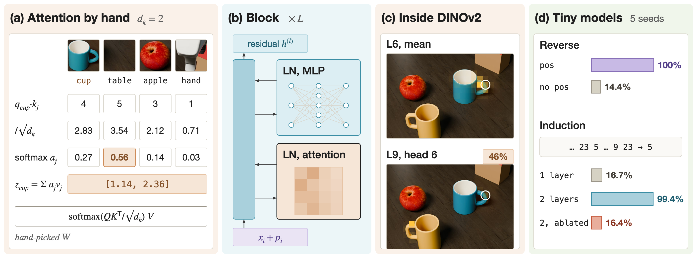
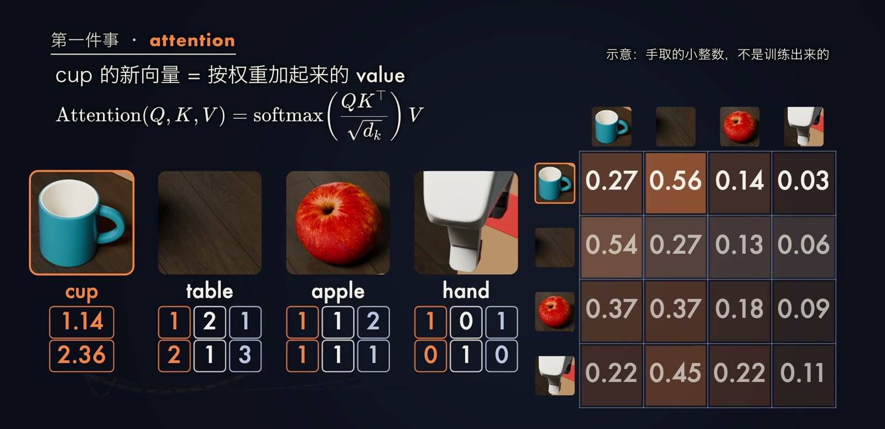
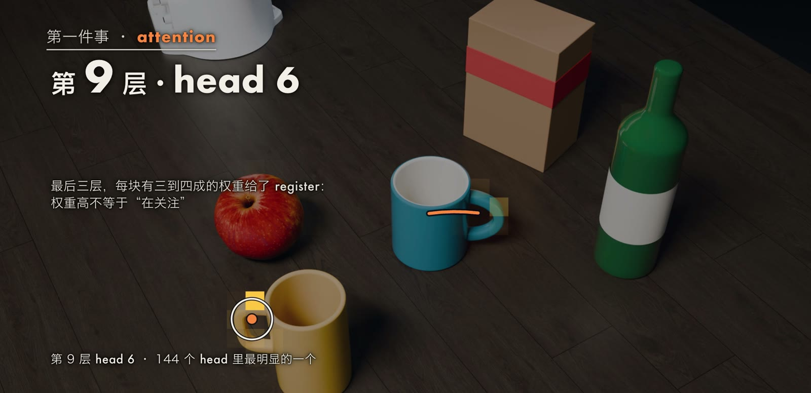
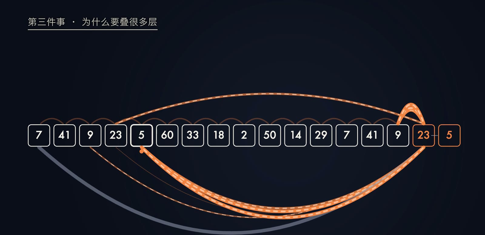

今天的大语言模型、[上一篇](https://yusenthebot.github.io/blog/posts/ep14-vision-encoder/)介绍的视觉编码器 ViT，以及机器人领域的视觉-语言-动作模型（Vision-Language-Action，VLA），内部使用的都是同一种骨架：Transformer。
它要解决的问题可以用一句话说明：“杯子放不进箱子，因为它太大了。”
这里的“它”指杯子；若把“大”换成“小”，“它”就指箱子。
一个词的含义取决于它周围的词，模型因此需要一种机制，让序列中的每个元素都能读取其他元素的信息，并据此更新自己的表示。
Transformer 把输入切成 token，让每个 token 先从其他 token 那里取回有用的信息，再单独加工一次，并把这两个步骤叠加很多层。
本文把它拆成三件事讨论：token 之间如何交换信息（注意力），模型如何知道先后顺序（位置编码），以及为什么需要叠加多层（深度）。
文中的注意力用四个 token 完整手算一遍，最后给出我们打开 DINOv2 的注意力、从零训练几个小模型的实验结果。

## 问题与记号

设输入是 $n$ 个 token，每个 token 先被映射为一个 $d$ 维向量，排成矩阵

$$
X=[x_1;\,x_2;\,\dots;\,x_n]\in\mathbb{R}^{n\times d}.
$$

对文本，$x_i$ 是词表嵌入矩阵 $E\in\mathbb{R}^{|\mathcal{V}|\times d}$ 中对应词的那一行，$|\mathcal{V}|$ 是词表大小；对图像，$x_i$ 是一个图块（patch）经线性投影得到的向量，做法见上一篇。
一个 $L$ 层的 Transformer 是一个从 $\mathbb{R}^{n\times d}$ 到 $\mathbb{R}^{n\times d}$ 的映射：

$$
h^{(0)}=X+P,\qquad h^{(l)}=\mathrm{Block}_l\big(h^{(l-1)}\big),\quad l=1,\dots,L,
$$

其中 $P\in\mathbb{R}^{n\times d}$ 是位置编码，$h^{(l)}$ 是第 $l$ 层之后所有 token 的表示。
输出的 $h^{(L)}$ 再接一个与任务有关的头。
以语言模型为例，第 $t$ 个位置预测下一个 token 的分布

$$
p(x_{t+1}\mid x_{\le t})=\operatorname{softmax}\big(h_t^{(L)}W_U\big),
$$

$W_U\in\mathbb{R}^{d\times|\mathcal{V}|}$ 是输出投影，训练目标是对真实下一个 token 的负对数似然求平均。
本文关心的是 $\mathrm{Block}$ 内部的计算：它如何让第 $i$ 个 token 的表示依赖其他所有 token，如何区分顺序，以及多个 $\mathrm{Block}$ 叠加后能完成哪些单个 $\mathrm{Block}$ 完成不了的计算。

## 方法

### 缩放点积注意力

自注意力（self-attention）先用三个可学习的矩阵把每个 token 投影成查询（query）、键（key）和值（value）：

$$
Q=XW_Q,\qquad K=XW_K,\qquad V=XW_V,
$$

其中 $W_Q,W_K\in\mathbb{R}^{d\times d_k}$，$W_V\in\mathbb{R}^{d\times d_v}$。
可以把 $q_i$ 理解为第 $i$ 个 token“在寻找什么”，$k_j$ 是第 $j$ 个 token“是什么”，$v_j$ 是它“能提供什么”。
[Vaswani et al., 2017](https://arxiv.org/abs/1706.03762) 定义的缩放点积注意力（scaled dot-product attention）为

$$
\operatorname{Attention}(Q,K,V)=\operatorname{softmax}\!\Big(\frac{QK^{\top}}{\sqrt{d_k}}\Big)V .
$$

逐元素写开，第 $i$ 个 token 对第 $j$ 个 token 的权重和它的输出分别是

$$
a_{ij}=\frac{\exp\big(q_i\cdot k_j/\sqrt{d_k}\big)}{\sum_{m=1}^{n}\exp\big(q_i\cdot k_m/\sqrt{d_k}\big)},\qquad z_i=\sum_{j=1}^{n}a_{ij}\,v_j .
$$

每一行权重非负且和为 1，所以 $z_i$ 是所有 value 的加权平均，权重由 query 与 key 的匹配程度决定。
这一步是 Transformer 中唯一让不同 token 交换信息的运算，其余部分都对每个 token 单独进行。

除以 $\sqrt{d_k}$ 的理由在原论文中只是一个推测。
论文脚注指出，若 $q$ 和 $k$ 的分量相互独立、均值为 0、方差为 1，则 $q\cdot k=\sum_{m=1}^{d_k}q_mk_m$ 的方差为 $d_k$；维度越高，点积越大，softmax 越容易接近 one-hot，梯度随之变小。
我们用随机向量验证了这一点（$d_k=64$，一个 query 对 10 个 key，5 个种子共 5,000 次试验）：不缩放时，最大的那个权重平均为 86.2%，34.0% 的试验超过 0.99，16.2% 的试验中 softmax 的雅可比范数小于 $10^{-3}$；缩放后最大权重平均为 31.8%，没有一次出现这种梯度消失。
这是在随机向量上的计算，不是训练出来的模型。

### 一个手算的例子

为了看清每一步，我们取 cup、table、apple、hand 四个 token，令 $d=3$、$d_k=d_v=2$，只有一个 head。
下面的输入和三个投影矩阵都是手取的小整数，不是训练得到的，也没有加位置编码，仅用于教学：

$$
X=\begin{bmatrix}1&0&1\\0&1&1\\1&1&0\\1&0&0\end{bmatrix},\quad
W_Q=\begin{bmatrix}1&0\\0&1\\1&1\end{bmatrix},\quad
W_K=\begin{bmatrix}0&1\\1&0\\1&1\end{bmatrix},\quad
W_V=\begin{bmatrix}1&0\\1&1\\0&2\end{bmatrix}.
$$

$X$ 的四行依次是 cup、table、apple、hand。
相乘得到

$$
Q=\begin{bmatrix}2&1\\1&2\\1&1\\1&0\end{bmatrix},\quad
K=\begin{bmatrix}1&2\\2&1\\1&1\\0&1\end{bmatrix},\quad
V=\begin{bmatrix}1&2\\1&3\\2&1\\1&0\end{bmatrix}.
$$

以 cup 为例，它的 query 是 $q_{\mathrm{cup}}=(2,1)$，与四个 key 的点积为 $(4,5,3,1)$。
除以 $\sqrt{2}$ 得到 $(2.83,3.54,2.12,0.71)$，取指数后为 $(16.92,34.31,8.34,2.03)$，总和为 $61.60$，归一化得到权重

$$
a_{\mathrm{cup}}=(0.27,\ 0.56,\ 0.14,\ 0.03).
$$

也就是说，cup 把 56% 的权重放在 table 上，27% 留给自己，14% 给 apple，3% 给 hand。
cup 的输出是四个 value 按这组权重的加权和：

$$
z_{\mathrm{cup}}=0.27\,(1,2)+0.56\,(1,3)+0.14\,(2,1)+0.03\,(1,0)\approx(1.14,\ 2.36).
$$

若不除以 $\sqrt{2}$，cup 的权重变为 $(0.24,0.66,0.09,0.01)$，最大值从 0.56 升到 0.66；在 $d_k=2$ 时差别不大，在 $d_k=64$ 时差别就是上一节所说的 86% 对 32%。
对四个 token 同时做这一计算，得到一个 $4\times4$ 的权重矩阵，就是图中 (b) 里的那张小热力图。

### 多头注意力

一个 head 只能产生一种加权方式。
多头注意力（multi-head attention）并行地计算 $h$ 组独立的注意力，再拼接起来做一次线性投影：

$$
\operatorname{MultiHead}(X)=\operatorname{Concat}(\mathrm{head}_1,\dots,\mathrm{head}_h)\,W_O,\qquad \mathrm{head}_r=\operatorname{Attention}\big(XW_Q^{r},XW_K^{r},XW_V^{r}\big),
$$

其中 $W_Q^{r},W_K^{r}\in\mathbb{R}^{d\times d_k}$，$W_V^{r}\in\mathbb{R}^{d\times d_v}$，$W_O\in\mathbb{R}^{hd_v\times d}$。
原论文的 base 模型取 $d=512$、$h=8$、$d_k=d_v=d/h=64$，总计算量与单个全维度的 head 相近；论文的消融表显示，单个 head 比最佳设置低 0.9 BLEU，head 过多时质量也会下降。
不同的 head 可以分别关注不同的关系，例如一个 head 看前一个 token，另一个 head 看同一物体上的其他图块。

生成文本的模型使用因果掩码（causal mask）：在 softmax 之前，把 $j>i$ 的分数设为 $-\infty$，

$$
a_{ij}=\operatorname{softmax}_j\Big(\frac{q_i\cdot k_j}{\sqrt{d_k}}+M_{ij}\Big),\qquad M_{ij}=\begin{cases}0,&j\le i\\-\infty,&j>i\end{cases}
$$

这样第 $i$ 个位置只能读取它之前的 token，训练时所有位置的“预测下一个 token”可以在一次前向中并行完成。

### 位置编码

注意力本身不知道顺序。
不带掩码、不带位置信息时，一个 Transformer block 是置换等变（permutation equivariant）的（[Yun et al., 2020](https://arxiv.org/abs/1912.10077)）：设 $\Pi$ 是任一置换矩阵，则

$$
\mathrm{Block}(\Pi X)=\Pi\,\mathrm{Block}(X).
$$

打乱输入的顺序，每个 token 得到的输出完全相同，只是跟着换了位置。
在上面的手算例子中，把四个 token 的顺序换成 apple、cup、hand、table 重算一遍，每个 token 的输出向量都不变，最大差别为 $4.4\times10^{-16}$，只是浮点误差。
因此，“狗咬人”和“人咬狗”这类只差顺序的输入，若不额外提供位置信息，模型无法区分。

原论文的做法是把位置编码 $P$ 加到嵌入上，第 $pos$ 个位置的第 $2i$ 和 $2i+1$ 维分别为

$$
P_{pos,2i}=\sin\!\Big(\frac{pos}{10000^{2i/d}}\Big),\qquad P_{pos,2i+1}=\cos\!\Big(\frac{pos}{10000^{2i/d}}\Big).
$$

不同维度对应不同波长，波长从 $2\pi$ 到 $10000\cdot2\pi$ 成几何级数；对任意固定偏移 $k$，$P_{pos+k}$ 可以写成 $P_{pos}$ 的线性函数，作者据此假设模型容易学会按相对位置寻址。
论文也试过可学习的位置嵌入，英德开发集上为 25.7 BLEU，正弦版本为 25.8 BLEU，两者几乎相同；GPT 和 ViT 使用的都是可学习的位置嵌入。

去掉位置信息的后果取决于任务和结构。
[Sinha et al., 2021](https://arxiv.org/abs/2104.06644) 让 RoBERTa 在预训练和微调中都不使用位置嵌入，专门考察词序的 PAWS 准确率从 94.5 降到 57.2。
在图像上，ViT 论文的消融显示，去掉位置嵌入后 ImageNet 5-shot 线性评估从 64.2% 降到 61.4%，论文称之为明显的差距，而不同的位置编码方式之间几乎没有差别。
带因果掩码的模型则是一个反例：[Haviv et al., 2022](https://arxiv.org/abs/2203.16634) 训练了 13 亿参数、不加任何位置编码的语言模型，验证困惑度为 13.10，使用可学习位置时为 13.05。
作者推测，因果掩码让每个位置能看到的 token 数不同，模型可以据此“数出”自己的位置。
所以准确的说法是：双向注意力需要显式的位置信息，因果注意力可以从掩码中隐式获得一部分位置信息。

### 残差流、LayerNorm 与 MLP

一个 block 除了注意力，还有逐位置的前馈网络（MLP）、残差连接（[He et al., 2016](https://arxiv.org/abs/1512.03385)）和层归一化（LayerNorm，[Ba, Kiros & Hinton, 2016](https://arxiv.org/abs/1607.06450)）。
原论文把归一化放在残差相加之后（post-norm），每个子层的输出为 $\mathrm{LayerNorm}(x+\mathrm{Sublayer}(x))$。
后来的大多数模型（包括 DINOv2）改为先归一化再进入子层（pre-norm），[Xiong et al., 2020](https://arxiv.org/abs/2002.04745) 从理论上说明了这种放法在初始化时梯度更稳定，可以不依赖学习率预热。
pre-norm 的一个 block 写为

$$
\begin{aligned}
u&=h+\operatorname{MultiHead}\big(\mathrm{LN}(h)\big),\\
h'&=u+\operatorname{MLP}\big(\mathrm{LN}(u)\big),
\end{aligned}
$$

其中

$$
\mathrm{LN}(x)=\gamma\odot\frac{x-\mu(x)}{\sqrt{\sigma^2(x)+\epsilon}}+\beta,\qquad \operatorname{MLP}(x)=\phi(xW_1+b_1)W_2+b_2 .
$$

$\mu(x)$ 和 $\sigma^2(x)$ 是向量 $x$ 各分量的均值和方差，$\gamma,\beta$ 是可学习的缩放和平移，$\epsilon$ 是防止除零的小常数；$W_1\in\mathbb{R}^{d\times d_{ff}}$，$W_2\in\mathbb{R}^{d_{ff}\times d}$，$\phi$ 是激活函数（原论文用 ReLU，GPT 和 ViT 用 GELU）。
原论文取 $d_{ff}=2048=4d$。
MLP 不读取其他 token，只对每个 token 自己的向量做非线性变换，相当于把注意力取回来的信息“消化”一遍。
它的参数却占多数：我们直接数了 DINOv2-B 一个 block 的参数，注意力部分（Q、K、V 和输出投影，含偏置）为 2,362,368 个，MLP 为 4,722,432 个，MLP 占 66.6%。

上式中两个子层的输出都是加到 $h$ 上，而不是替换 $h$。
[Elhage et al., 2021](https://transformer-circuits.pub/2021/framework/index.html) 把贯穿所有层的这条加法通路称为残差流（residual stream）：每个注意力层和 MLP 层都从残差流读取输入，再把自己的结果写回同一条流，

$$
h^{(L)}=h^{(0)}+\sum_{l=1}^{L}\Big(\mathrm{Attn}_l(\cdot)+\mathrm{MLP}_l(\cdot)\Big),
$$

这里省略了各项的输入，它是一种示意写法，用来强调“只加不改”。
由于前面各层写下的内容一直留在流中，后一层可以读到前一层的计算结果，这正是叠加多层有意义的前提。

### 前向计算的步骤

综合以上各部分，一个 pre-norm、仅解码器（decoder-only）的 Transformer 对一段输入的前向计算如下：

1. 把输入切成 $n$ 个 token，查表或线性投影得到 $X\in\mathbb{R}^{n\times d}$，加上位置编码，得到 $h^{(0)}=X+P$。
2. 对 $l=1,\dots,L$ 依次执行：
   1. 对每个 token 做 LayerNorm，按 $W_Q^r,W_K^r,W_V^r$ 计算每个 head 的 $Q,K,V$。
   2. 计算 $QK^{\top}/\sqrt{d_k}$，加因果掩码，按行做 softmax 得到权重，再乘以 $V$。
   3. 拼接 $h$ 个 head 的输出，乘以 $W_O$，加回残差流。
   4. 对每个 token 再做一次 LayerNorm 和 MLP，结果加回残差流。
3. 对 $h^{(L)}$ 做最后一次 LayerNorm，接任务头：语言模型乘以 $W_U$ 并做 softmax 得到下一个 token 的分布，ViT 读取 class token 或图块特征。

计算量的主要来源是第 2 步中的打分：每个 head 每层要为 $n$ 个 token 两两计算分数，共 $n^2$ 个，时间复杂度为 $O(n^2d)$。
token 数翻一倍，分数变为四倍；10 万个 token 时，一个 head 一层就有 $10^{10}$ 个分数。

### 为什么要叠加多层

单层注意力只能把信息搬运一次：第 $i$ 个位置的输出取决于各 token 原始表示之间的匹配。
有些计算需要先搬运一次、再根据搬运的结果搬运第二次。
一个典型的例子是“上下文中出现过 A 后面跟着 B，再次看到 A 时预测 B”，即归纳头（induction head，[Elhage et al., 2021](https://transformer-circuits.pub/2021/framework/index.html)；[Olsson et al., 2022](https://transformer-circuits.pub/2022/in-context-learning-and-induction-heads/index.html)）。
它由两层中的两个 head 组合完成：

1. 第一层的 previous-token head 让 B 所在位置读取前一个 token A，并把“我前面是 A”写进 B 位置的残差流。
2. 第二层的 head 在当前位置（又一个 A）发出 query，它与 B 位置的 key 匹配得最好，因为那里的 key 是由包含“前面是 A”的残差流计算出来的；于是它把 B 的信息复制过来，用于预测。

第二层的 key 依赖第一层写下的结果，这在单层模型中无法实现。
Elhage 等人的分析指出，只有注意力的一层模型相当于二元语法（bigram）和 skip-trigram 的组合，归纳头从不出现；Olsson 等人给出证据，认为归纳头可能是模型在上下文中“现学现用”的主要机制之一。
我们在实验部分用一个从零训练的小模型复现了这一现象。

## 代表工作

注意力并非 Transformer 首创。
[Bahdanau et al., 2015](https://arxiv.org/abs/1409.0473) 在循环神经网络（RNN）的编码器-解码器中，已经用 softmax 权重对编码器各位置的状态求加权和，只是打分函数是一个与整个网络一起训练的小型前馈网络，而不是点积。
[Vaswani et al., 2017](https://arxiv.org/abs/1706.03762) 的改变在于去掉了循环结构，只用注意力、MLP、残差和位置编码搭建编码器和解码器，使所有位置可以并行计算，任意两个位置之间只隔一步。
该文的 base 模型约 6,500 万参数，在 8 块 P100 上训练约 12 小时，在 WMT 2014 英德翻译上达到 27.3 BLEU，超过了当时表中所有的单模型和集成模型。

此后的路线主要是更换输入和扩大规模，骨架变化不大。
第一代 GPT（[Radford et al., 2018](https://cdn.openai.com/research-covers/language-unsupervised/language_understanding_paper.pdf)）只保留了解码器一侧，用 12 层、768 维、上下文 512 个 token 的仅解码器 Transformer，只做一件事：预测下一个 token。
GPT-3（[Brown et al., 2020](https://arxiv.org/abs/2005.14165)）把同样的结构扩大到 1,750 亿参数，上下文为 2,048 个 token。
[Grattafiori et al., 2024](https://arxiv.org/abs/2407.21783) 报告的 Llama 3.1 最大模型是 4,050 亿参数的稠密 Transformer，上下文最长 128K token。
对注意力权重的解读也需谨慎：[Clark et al., 2019](https://arxiv.org/abs/1906.04341) 发现 BERT 第 6 到 10 层一半以上的注意力落在分隔符 [SEP] 上，作者推测这是一种“无操作”的停靠位置，权重高并不等于模型在关注它。

把词换成图块，就是 ViT（[Dosovitskiy et al., 2021](https://arxiv.org/abs/2010.11929)）。
DINOv2（[Oquab et al., 2023](https://arxiv.org/abs/2304.07193)）用自监督目标训练 ViT，[Darcet et al., 2024](https://arxiv.org/abs/2309.16588) 发现大模型中约 2% 的 token 范数异常大、被用作内部的全局存储，给模型加几个 register token 后这种伪影随之消失；上一篇和本文的实验用的都是带 register 的 DINOv2。
在蛋白质结构预测中，AlphaFold 2（[Jumper et al., 2021](https://www.nature.com/articles/s41586-021-03819-2)）的 Evoformer 包含大量注意力，但也有不属于注意力的部件，不能简单地称其为 Transformer。

在机器人中，RT-1（[Brohan et al., 2022](https://arxiv.org/abs/2212.06817)）用一个约 3,500 万参数的 Transformer 从图像和语言指令输出动作，训练数据约 13 万条示范。
RT-2（[Brohan et al., 2023](https://arxiv.org/abs/2307.15818)）把动作写成文本 token，与网络规模的视觉语言数据一起训练，最大的版本为 550 亿参数，并把这类模型称为 VLA。
π0（[Black et al., 2024](https://arxiv.org/abs/2410.24164)）由一个 30 亿参数的视觉语言模型和约 3 亿参数的动作专家组成，动作通过流匹配（flow matching）生成。
这些模型的输入分别是词、图块、蛋白质的序列与残基对以及机器人的动作，内部的核心计算仍然是本文介绍的注意力与 MLP 的叠加。

## 我们的实验

### 设置

所有实验都在一台 Apple M5 Max（64 GB）上本地完成，使用 PyTorch 2.15.0（MPS 后端）和 Python 3.12，没有下载新的模型或数据。
MPS 上的训练不保证逐位可复现，同一种子重跑时数字会在小数点后第三位左右浮动。
实验分为三组：

- 打开 DINOv2（E1、E3a）：模型为公开权重 DINOv2 with registers ViT-B/14（12 层，每层 12 个 head，4 个 register），输入是上一篇的桌面渲染图，按 16:9 不裁边缩放到 $672\times378$ 像素，即 $48\times27=1{,}296$ 个图块，加 1 个 class token 和 4 个 register，共 1,301 个 token。查询图块按真值标签自动选取，不是手挑的。
- 位置（E3b、E3c、E3d）：两层 pre-norm Transformer（宽 128，4 个 head，MLP 512），任务包括把 8 个 token 倒序输出（需要顺序）和输出每个 token 在集合中的名次（不需要顺序），各训练 4,000 步；另有一个 82.7 万参数的小 ViT，在上一篇的物体小图上分类，灰度、只用 500 张训练图，训练 3,000 步。
- 深度（E4）：只有注意力、没有 MLP 和 LayerNorm 的因果模型，宽 128，4 个 head，词表和序列长度都是 64。每条序列先随机抽取 12 到 32 个 token，再重复到 64 个，只在重复段上计算准确率，随机猜测为 1.6%。训练 6,000 步，1 层、2 层、3 层使用完全相同的数据和超参数，没有单独调参。

除特别说明外，每个条件都训练 5 个种子，表中给出平均值和 5 个种子的范围。

### 结果

| 实验 | 条件 | 结果（5 个种子） |
| --- | --- | --- |
| E4 归纳任务 | 1 层，只有注意力 | 16.7%（16.5% 到 16.9%） |
| E4 归纳任务 | 2 层，只有注意力 | 99.4%（98.2% 到 99.75%） |
| E4 归纳任务 | 3 层，只有注意力 | 99.86%（99.83% 到 99.88%） |
| E4 归纳任务 | 2 层，去掉第一层的 previous-token head | 16.4%（13.8% 到 20.1%） |
| E4 归纳任务 | 2 层，去掉第一层其余的 head | 83.3%（77.7% 到 89.6%） |
| E3b 倒序输出 | 有位置 / 无位置（无位置上限 1/7 = 14.3%） | 100% / 14.4%（14.2% 到 14.6%） |
| E3b 名次 | 有位置 / 无位置 | 100% / 100% |
| E3c 小 ViT，灰度，500 张训练图 | 有位置 / 无位置 | 93.8% / 90.4% |
| E3d 输出自己是第几个，无位置嵌入 | 因果掩码 / 双向 | 100% / 11.8% |
| E3a DINOv2 打乱 1,296 个图块，12 层 | 无位置 / 有位置 | 相对差约 $10^{-6}$ / 余弦相似度 0.49 到 0.51 |
| E1 DINOv2 把手图块的注意力 | 第 2 到 8 层，落在自己杯子上的比例（杯子占画面 2.0%） | 26% 到 56%（单张图） |
| E1 DINOv2 第 9 层 head 6 | 把手看向另一只杯子的把手，两个方向 | 46% 和 54%（单张图） |

E4 的去除实验在评测时把第一层中 previous-token 分数大于 0.5 的 head 的输出置零（阈值事先定好），第二层的参数保持不变。
E3a 的“有位置”一行是 5 种随机排列的范围，E1 的两行只来自一张图，不是多种子结果。
E1 的 1,301 个 token 下，一个 head 一层要计算 1,692,601 个分数，12 层、每层 12 个 head 一次前向共约 2.4 亿个。

### 解读

深度的作用在 E4 中最清楚。
一层模型训练 6,000 步停在 16.7%，把同一设置训练到 30,000 步（种子 0）仍是 16.8%，说明它是学不会，而不是学得慢；两层模型在第 75 步时为 12.7%，第 100 步突然升到 62.4%，5 个种子都在第 100 步越过 50%。
打开两层模型，5 个种子的第一层都出现了至少一个 previous-token head（分数 0.75 到 0.99），第二层都有 3 到 4 个 head 看向“前文中同一 token 的下一个位置”。
去掉第一层的 previous-token head 后，第二层的参数一点没变，准确率却掉回 16.4%，第二层的匹配分数从 0.85 到 0.94 降到 0.07 到 0.11：第二层确实依赖第一层写进残差流的结果。

位置的结果与前面的分析一致。
双向模型没有位置时，倒序任务只能在其余 7 个 token 中猜，实测 14.4% 恰好落在理论上限 1/7 附近；不需要顺序的名次任务有无位置都是 100%。
因果掩码确实会泄漏位置：没有任何位置嵌入的因果模型能 100% 输出自己是第几个，双向模型只有 11.8%。
对图像，去掉位置只让小 ViT 从 93.8% 降到 90.4%，下降幅度与 ViT 论文同一量级，远小于文字顺序任务；不过两者的模型、数据和评测都不同，数字不能直接比较。
在真实的 DINOv2 上，不加位置时把 1,296 个图块打乱，12 层之后每个图块的输出只是跟着换了位置，差别是浮点误差；加上位置后，同一图块的输出与原来几乎无关。

在 DINOv2 内部，从第 2 层起，物体上的图块平均有一半左右的注意力留在自己所在的物体上，约为面积占比的 20 倍。
第 9 层 head 6 是 144 个 head 中最明显的一个“部位选择性”例子：两只杯子的把手互相看向对方，而苹果、纸箱、酒瓶上的图块在这个 head 中只有 0.1% 到 0.7% 的权重落在把手上。

### 局限

其一，DINOv2 的结果只来自一张图，只能说明“这张图上的这个 head 这样做”，不能推出 DINOv2 有专门寻找把手的 head。
高注意力权重也不等于重要：第 1 层有一个 head 把 98.9% 的权重放在同一个图块上，与查询无关；最后三层每个图块平均有三到四成的注意力交给 4 个 register。
其二，E4 训练出的模型并不是教科书中最简单的归纳头：只按“找到前文同一个 token、复制它后面那个”的规则在这份评测数据上只有 72.8%，用前两个 token 一起匹配可到 94.7%，而模型达到 99.4%，说明它还用了别的 head（例如看前两个 token 的 head）。
去掉第一层其余的 head 也会损失 10 到 20 个百分点，previous-token head 不是唯一起作用的部分。
训练过程中第二层的匹配 head 也比第一层的 previous-token head 更早成形，与理想化的先后顺序不完全一致。
其三，所有任务都很小，小 ViT 用的是 5 类渲染物体；文字一侧没有打开真实的语言模型，正文中关于大模型的数字都来自各自的论文。
其四，开头的“杯子放不进箱子”和四个 token 的手算都是示意，手算中的矩阵是手取的小整数。

## 小结

Transformer 的一个 block 做两件事：注意力让每个 token 按 query 与 key 的匹配程度，从其他 token 的 value 中取回信息；MLP 再对每个 token 单独加工。
注意力本身对顺序不敏感，双向模型需要显式加入位置编码，因果模型可以从掩码中获得一部分位置信息。
所有子层的结果都加在同一条残差流上，后一层能读取前一层写下的内容，因此两层可以完成一层做不到的组合计算，归纳头是其中最小的一个例子。
从 2017 年的翻译模型到今天的 GPT、ViT 和 VLA，这一骨架基本未变，变化主要在输入、规模和训练方式上。
尚未解决的问题包括 $O(n^2)$ 的计算代价、大模型内部机制的可解释性，以及为什么同样的骨架在规模扩大后能表现出推理等能力，这些留待后续文章讨论。
