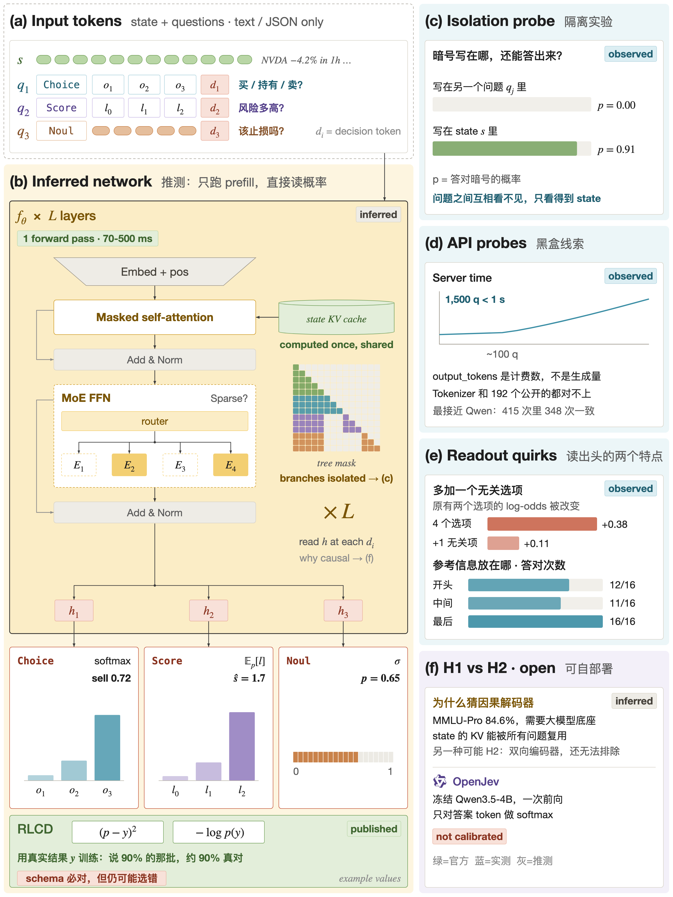
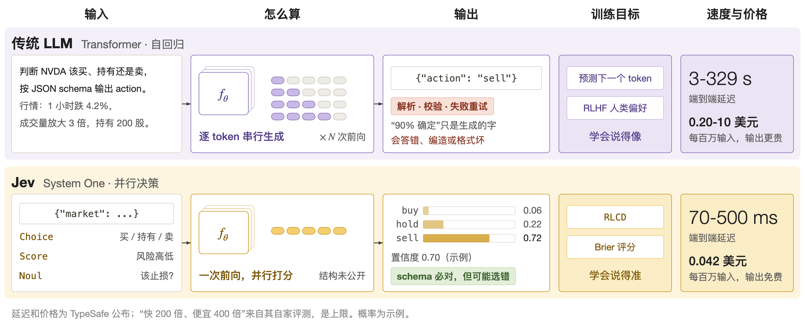
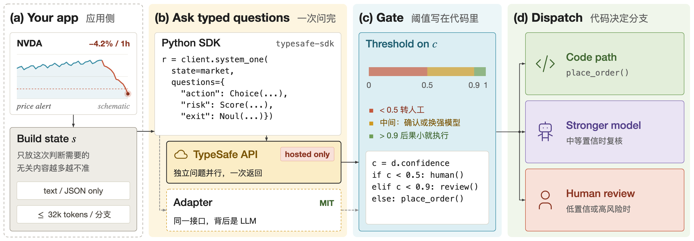
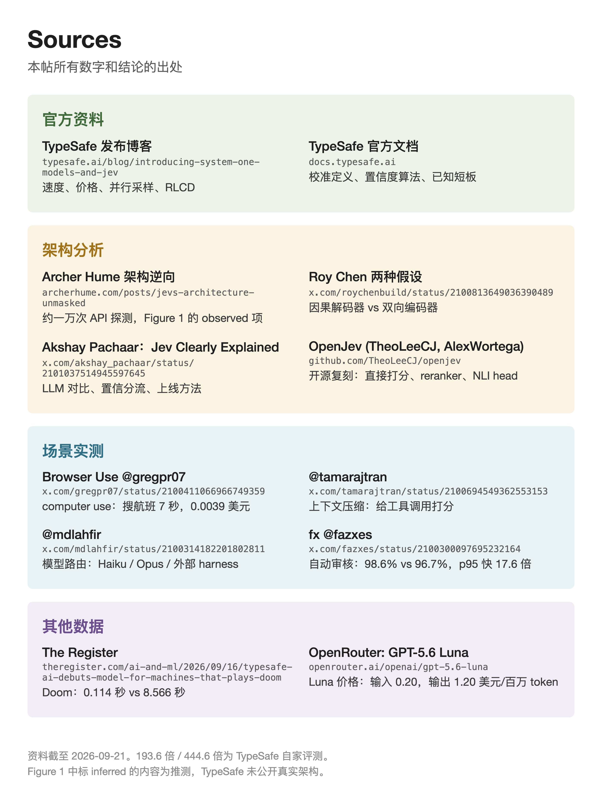

在 agent 系统中，许多模型调用并不需要一段文字，而只需要一个决策：下一步点击哪个元素，某条上下文是否保留，任务交给哪个模型，某条命令是否放行。通用大语言模型（Large Language Model，LLM）处理这类调用的方式是先生成文字，再由代码解析、校验、重试，而它给出的“我有 90% 把握”也只是一串文字，并不是经过校准的概率。TypeSafe 发布的 Jev 走了另一条路：不生成文字，在一次前向计算中直接读出各个问题的答案分布。

本文按证据来源的强弱来组织。官方声明来自 TypeSafe 的[发布博客](https://typesafe.ai/blog/introducing-system-one-models-and-jev)与[文档](https://docs.typesafe.ai)；第三方测量主要来自 [Hume (2026)](https://archerhume.com/posts/jevs-architecture-unmasked/) 对 API 的黑盒实验；其余为本文的推断，会明确标出。官方没有发布单独的技术报告，架构、训练数据和奖励设计都没有公开。

全文使用同一个例子：一个自动交易 agent 监控 NVDA，该股票 1 小时内下跌 4.2%。agent 需要同时回答三个问题：买入、持有还是卖出；风险是否偏高；是否应当立即止损。

## 问题设定与输出契约

设输入为程序状态 $s$（文本或 JSON），以及一组问题 $q_1,\dots,q_K$。每个问题 $q_k$ 带有预先声明的类型。官方文档给出三种基本类型：

- Choice：从选项列表中选一个，返回 `choice`、`probabilities` 与 `confidence`。
- Score：按评分量表打分，返回 `score`、`probabilities` 与 `confidence`。
- Noul：判断一个陈述是否成立，返回 0 到 1 之间的数值。

对 Choice 问题，模型输出选项集合 $\mathcal{A}_k$ 上的分布 $p_k(a\mid s)$，满足

$$
\sum_{a\in\mathcal{A}_k} p_k(a\mid s)=1,\qquad p_k(a\mid s)\ge 0 .
$$

由于输出空间在调用前就已固定，返回值只能落在声明的 schema 内。官方据此称模型“不会出现类型错误”；发布博客同时说明，LLM 对照组的类型错误率来自 OpenRouter 的统计，而 Jev 的 0% 是由 schema 匹配所保证的，并非实测所得。需要注意，类型正确并不意味着判断正确：模型仍可能以较高概率选中一个合法但错误的选项。

作为代价，Jev 放弃了自由文本生成，因此不能用于对话或写代码。官方还说明，选项数超过 255 时可能采用两阶段打分，偶尔会变慢。

## 并行采样与推测的架构

### 自回归与并行读出

自回归 LLM 将一段输出的概率分解为逐 token 的条件概率：

$$
p(y\mid s)=\prod_{t=1}^{T} p(y_t\mid s,\,y_{<t}),
$$

其中 $y_t$ 是第 $t$ 个 token。输出长度 $T$ 决定了串行解码的步数，延迟随之增长。官方对 Jev 的描述是：在一次查询中并行生成全部输出，而不是逐 token 采样。若把 $K$ 个问题的答案记为 $a_1,\dots,a_K$，则可以将它写成

$$
p(a_1,\dots,a_K\mid s)=\prod_{k=1}^{K} p_k(a_k\mid s),
$$

即在给定共享状态 $s$ 的条件下，各问题的答案被当作条件独立的分支来读出。这个式子是对官方“并行”说法的形式化，也是下文第三方实验所检验的性质，并非官方公布的公式。

### 第三方测量给出的线索

[Hume (2026)](https://archerhume.com/posts/jevs-architecture-unmasked/) 通过约一万次 API 调用，对内部结构做了黑盒推断，其结论自称是推断而非披露。主要证据如下。

1. 分支隔离。把一个秘密暗号写在相邻问题里，被问到该暗号的概率约为 0.00；写进共享状态则为 0.90 到 0.92。这说明各问题之间不共享信息，只通过共享状态 $s$ 间接相关。
2. 位置效应。参考卡片放在选项之前、中间、末尾时，选对的次数分别是 12/16、11/16、16/16；卡片放入共享状态时为 48/48。因此选项的顺序会影响结果。
3. 选项间相互作用。加入一个无关选项后，原有两项的平均 log-odds 从 +0.38 降到 +0.11。若每个选项被独立打分，这个量不应改变，所以读出头不是固定的、相互独立的选项分数。
4. 计费字段。API 返回的 `output_tokens` 只是计费数字，不能作为生成了文本的证据。

作者的推断是：一个因果 Transformer（可能是稀疏混合专家），只做 prefill，共享状态 $s$ 编码一次并写入 KV cache（Key-Value cache），每个问题在隔离的分支中读取，最后在输出位置读出概率。Roy Chen 的 [Behind Jev](https://x.com/roychenbuild/status/2100813649036390489) 讨论了两种架构假设，该页面本文未能自动核验。作者本人也指出，混合专家这一点最不确定，且分词器与 192 个公开分词器都不匹配，结果只对应一个模型版本和一个服务区域。

据此可以得到一个工程上的结论：Jev 没有改变 Transformer 本身，变化在于接口（类型化问题）、服务方式（单次前向读出）和训练目标这一组合。选项顺序与干扰项会影响结果，所以上线前需要做选项打乱测试。

## 校准与 RLCD

### 校准的定义

官方 [AI primer](https://docs.typesafe.ai/introduction/machine-learning-primer) 对校准的表述是：在许多次预测中，模型给出 0.2 概率的结果应约有 20% 发生，给出 0.8 的约有 80%，给出 1.0 的应始终发生。这些比例描述的是一组预测，而不是任何单个答案。形式化地说，若 $\hat{Y}$ 为预测类别，$\hat{P}$ 为其置信度，则完美校准要求

$$
\Pr\left(\hat{Y}=Y \mid \hat{P}=p\right)=p,\qquad \forall\, p\in[0,1].
$$

“说 80% 时真有约 80% 对”正是这个式子的口语写法。常用的度量是期望校准误差（Expected Calibration Error，ECE）。按 [Guo et al. (2017)](https://arxiv.org/abs/1706.04599) 的做法，把预测按置信度分成 $M$ 个区间 $B_m$，则

$$
\mathrm{ECE}=\sum_{m=1}^{M}\frac{|B_m|}{n}\,\bigl|\operatorname{acc}(B_m)-\operatorname{conf}(B_m)\bigr|,
$$

其中 $n$ 是样本总数，$\operatorname{acc}(B_m)$ 是区间内的实际准确率，$\operatorname{conf}(B_m)$ 是区间内的平均置信度。ECE 越小说明置信度越可信。

### RLCD 官方说了什么

RLCD 的全称是 Reinforcement Learning for Calibrated Decisions。官方文档的表述是，它训练模型返回决策和校准过的概率，而不是生成文本；发布博客把它与 RLHF（基于人类反馈的强化学习）和 RLVR（基于可验证奖励的强化学习）相对照，认为后两者优化的是人类偏好或可验证奖励。官方没有公开训练数据、损失函数和奖励设计，文档中也没有出现 Brier 分数或 ECE。

为了说明“用结果来奖励概率”大致意味着什么，可以看一个标准的严格适当评分规则（proper scoring rule），例如 Brier 分数：

$$
\mathrm{BS}=\frac{1}{n}\sum_{i=1}^{n}\sum_{a\in\mathcal{A}}\bigl(p_i(a)-\mathbb{1}[a=y_i]\bigr)^2 .
$$

该规则的期望在预测分布等于真实条件分布时取到最小，因此以它（或对数似然）为奖励，会同时推动准确率与校准。这只是对原理的说明，并不表示 RLCD 使用了 Brier 分数，官方页面没有支持这一说法。

### confidence 字段不等于“答对的概率”

官方 [Confidence](https://docs.typesafe.ai/confidence) 页明确说明，confidence 是从概率分布派生的 0 到 1 之间的数，分布集中在一个结果上时为 1，均匀分布时为 0，它并不是答案正确的概率。对 $n$ 个选项的 Choice，若最大概率为 $p_{\max}$，则

$$
\text{confidence}=\frac{p_{\max}-1/n}{1-1/n}.
$$

例如两个选项且 $p_{\max}=0.75$ 时，confidence 为 0.5。对 Noul，概率本身就是信号，文档建议以 0.7 与 0.3 作为起始阈值。因此做阈值分流时，应当使用所选选项的概率，而不是 confidence 字段。Hume 也观察到该字段只是分布最大值的简单变换，而不是学习得到的正确率估计。

### 第三方的校准测量

Hume 在 1200 道 MMLU 题上测得 ECE 为 0.031，但其中 990 题落在 0.9 到 1.0 的区间内，也就是总体误差小，主要是因为大部分样本集中在高置信区间。在自己生成的两步数学应用题上，准确率为 32%，而平均最大概率为 0.30，两者接近。这些是单个第三方、单一模型版本的测量，不能推广为一般结论。语言模型能在一定程度上估计自己是否正确，是 [Kadavath et al. (2022)](https://arxiv.org/abs/2207.05221) 的结论；Jev 的区别在于，概率直接来自分布读出并以校准为训练目标。

## 延迟、价格与准确率

下表区分了数字的来源。

| 项目 | 数值 | 来源类别 |
| --- | --- | --- |
| Jev 端到端延迟 | 70 到 500 ms | 官方，评测自西海岸笔记本 |
| 前沿 LLM 端到端延迟 | 3 到 329 秒 | 官方 |
| 加速倍数（一般 System One 查询）| 40 到 200 倍 | 官方 |
| 首页标称 | 193.6 倍更快、444.6 倍更便宜 | 官方自评，官方称接近真实收益的上限 |
| Jev 输入价格 | 0.042 美元 / 百万 token，输出免费 | 官方，官方也承认无法证明价格没有补贴 |
| 安全审批替换（210 次判断）| 中位延迟快 4.7 倍，最慢 5% 快 17.6 倍，准确率 96.7% 升至 98.6% | 第三方（fx 团队），转引自帖子 |
| Browser Use 搜航班 | 7 秒，0.0039 美元 | 第三方，转引自帖子 |

官方在发布博客中列出了若干会影响这些数字的前提：评测由 TypeSafe 自己运行；四个工作流没有固定标准答案，参考答案是 GPT-6 Astra 与 Fable 5.1 预测的平均，因此可能偏向 OpenAI 与 Anthropic 的模型；LLM 对照组使用了把输出约束为结构化决策的包装器，比不加约束的调用更慢更贵；演示输入是结构化文本而不是图像。

价格对比方面，[OpenRouter](https://openrouter.ai/openai/gpt-5.6-luna) 上 GPT-5.6 Luna 的输入价格因提供方而异，页面列出 0.10 到 0.40 美元每百万 token 不等，fx 帖子采用的是 0.20 美元。按 0.20 美元计，Jev 的 0.042 美元约为其五分之一。由于不同提供方价格不同，这个比例应按实际使用的提供方重新计算。

## 在 agent 中的用法

Jev 适合的是“判断”型调用，已有的使用场景包括：以它作为 computer use 的操作判断层（[Browser Use](https://x.com/gregpr07/status/2100411066966749359)）、给每次工具调用打相关性分数以压缩上下文、按难度在不同模型之间路由，以及自动审核命令。这些场景的共同点是输出空间小、调用频繁、对延迟敏感。

推荐的调用流程如下。

1. 由代码筛选状态 $s$，只保留本次判断所需的信息。无关内容越多，结果越不稳定，而且当前只接受文本与 JSON。
2. 把针对同一个 $s$ 的独立问题一次性提交，使它们共享一次状态编码。
3. 对每个答案取所选选项的概率 $p$，按阈值分流。例如 $p<0.5$ 转人工，$0.5\le p<0.9$ 交给更强的模型或人工确认，$p\ge 0.9$ 且后果可逆时自动执行。阈值应写在代码里，并用自己的数据确定。
4. 先在影子模式下与现有流程并行运行，度量一致率与分桶后的准确率（即在自己数据上重算 ECE），再放权。

## 局限

Jev 是闭源托管 API，不提供权重，不能自部署，也没有微调接口。官方的 [Model jaggedness](https://docs.typesafe.ai/model-jaggedness/jev-1.13) 页列出了已知短板：按字面理解问题，对否定与隐含条件敏感；不能可靠计数，应由代码迭代并逐项提问后自行求和；把日期当作文本而非有序量，日期算术应交给代码；状态默认不被视为对抗性内容，注入的指令或误导性表述可能改变答案。

另有一个独立项目 [SemIf（原 OpenJev）](https://github.com/TheoLeeCJ/SemIf-OpenJev)，它与 TypeSafe 无关，用冻结的小型开源模型在一次前向中读取选项 logits，不采样答案 token。其说明指出，概率只有在置信度与实际准确率相符时才有用，并采用按任务拟合的温度缩放来改善校准；作者也说明在部分任务上改善落在重叠的置信区间内。换言之，原始 softmax 概率不等于校准概率，这正是 Jev 声称由 RLCD 解决的部分，但目前缺少公开的独立复现来验证它。

## 小结

Jev 的新意主要在接口与训练目标：类型化的输出契约保证格式正确，并行读出避免了逐 token 解码的延迟，以校准为目标的训练使概率可以直接用于阈值决策。尚未被证实的部分包括：内部架构、RLCD 的具体奖励、官方自评的倍数在真实工作负载上能保留多少，以及校准在分布外输入上是否依然成立。实际采用时，建议挑选 agent 中最慢的一个判断步骤，在影子模式下用自己的数据测量延迟、一致率和分桶准确率，再决定放权的范围。

