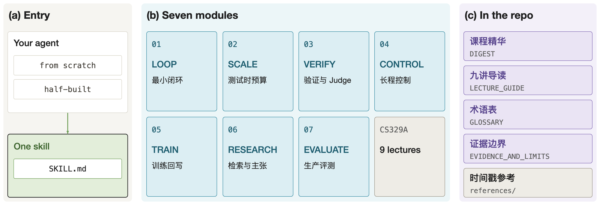

斯坦福大学 CS329A《Self-Improving AI Agents》（2025 年秋季学期）讨论的核心问题是：预训练的边际收益放缓之后，系统能否利用自己的推理轨迹、工具交互和训练经验继续改进；如果可以，哪些反馈能证明改进是真实的，哪些计算值得花费，如何避免系统更高效地强化自己的错误。课程共九讲，涵盖测试时计算、验证、工具反馈、规划、强化学习、Deep Research、长程评测和未来系统，见[课程主页](https://cs329a.stanford.edu/)和 [Stanford Online 的课程视频](https://www.youtube.com/watch?v=6YnLB0XbTnI)。

我把这门课整理成了一个可安装的 [Agent Skill](https://github.com/yusenthebot/stanford-ai-agent-skill)，对外只有一个入口，内部拆为七个模块，提问后按需加载其中一个。本文不介绍安装方式，而是依次说明七个模块背后的技术内容：每个模块要回答的问题、涉及的方法与公式、对应的论文，以及方法的适用边界。整套材料是基于该课程制作的非官方社区学习资料，与斯坦福大学及课程团队无隶属关系。蒸馏方法参考了 [cangjie-skill](https://github.com/kangarooking/cangjie-skill)。

七个模块沿着同一条因果链排列：把目标变成可验证的规约，执行受约束的动作，观察环境，用 verifier 选择、纠正或拒绝，把成功与失败的轨迹送入搜索或训练，最后在真实任务上审计整个闭环的可靠性与资源成本。每个模块在仓库中的写法统一为：引用原文、解读、过去的应用、未来的触发条件、执行步骤和适用边界。

## 模块一：agent loop 与可验证的停止

### 形式化

课程对 agent 的最小定义是操作性的：系统接收目标，规划并与环境交互，根据反馈修正步骤，在目标达成时停止，或明确报告无法达成。可以把它写成一个有状态的控制系统。设目标为 $g$，状态为 $s_t$，策略（模型加提示）为 $\pi$，工具集合为 $\mathcal{T}$，则

$$
a_t\sim\pi(\cdot\mid g,s_t),\qquad o_t=\operatorname{env}(a_t),\qquad s_{t+1}=U(s_t,a_t,o_t),
$$

其中 $a_t\in\mathcal{T}$ 是受约束的动作，$o_t$ 是环境返回的观测，$U$ 是状态更新函数。停止条件由外部的验证器 $v$ 判定：当 $v(g,s_t)=1$ 时输出完成；当不存在安全的下一步时输出失败，并给出缺失信息和最后一个可靠状态。这是对课程操作性定义的形式化，不是课程的原始公式。

设计时需要显式定义六个要素：可执行的目标、允许的动作、环境状态、动作后的观测、完成验证和终态。完成必须有外部证据，不能以模型自称“已完成”为准。

### 代表工作

[ReAct](https://arxiv.org/abs/2210.03629) 把推理、动作与观测交替放在同一个循环中，使模型在开放环境里能够依据观测修正计划。课程指出，ReAct 在 WebShop 上优于若干基线，但仍低于人类专家，所以“循环成立”并不等于“可靠”。没有外部观测的更长思维链仍然是内部猜测；动作空间越大，错误越容易传播；噪声反馈会使系统陷入重复状态；修复过程中使用的公开测试不应同时作为最终证明。一次确定性的函数调用或简单检索通常不需要 agent。

## 模块二：测试时计算与 best-of-N

### 覆盖率与交付准确率

测试时扩展在不改变权重的前提下，把有限预算分配给并行采样、串行修订、搜索、排序和融合。课程强调要分别度量两条曲线。设单个问题 $x$ 的单次采样正确率为 $p_x$，独立采样 $k$ 次，则覆盖率（coverage，即 pass@k 的总体期望）为

$$
\operatorname{pass@}k=\mathbb{E}_x\bigl[1-(1-p_x)^k\bigr].
$$

而部署的选择器 $S$ 实际交付的准确率是 $\operatorname{acc}_{S}(k)=\Pr[S(y_1,\dots,y_k)\ \text{正确}]$。二者之差

$$
\Delta(k)=\operatorname{pass@}k-\operatorname{acc}_{S}(k)
$$

就是课程所说的生成与验证之间的差距（generation-verification gap）。只看覆盖率，会把“候选里藏着一个正确答案”误认为“系统能够交付正确答案”。[Brown et al. (2024)](https://arxiv.org/abs/2407.21787) 报告了覆盖率随样本数持续增长，而多数投票很早就趋于平稳。

### 自洽投票与 verifier 选择

自洽（self-consistency）对 $N$ 条推理路径的最终答案做多数表决：

$$
\hat{y}_{\mathrm{SC}}=\arg\max_{y}\sum_{i=1}^{N}\mathbb{1}[y_i=y]\ ,
$$

这是 [Wang et al. (2022)](https://arxiv.org/abs/2203.11171) 的做法，即对推理路径做边缘化。[Cobbe et al. (2021)](https://arxiv.org/abs/2110.14168) 则训练一个 verifier $V$ 对候选打分，取最高者，即 best-of-N：

$$
\hat{y}_{\mathrm{BoN}}=\arg\max_{i\in\{1,\dots,N\}}V(x,y_i).
$$

两者的失败模式不同。多数投票把频率当作真值，若正确答案本身很稀少，多数反而是错的。以只有两种答案的简化情形为例，设每条路径独立地以概率 $p$ 给出正确答案，则 $N$ 为奇数时多数表决正确的概率为

$$
\sum_{m>N/2}\binom{N}{m}p^m(1-p)^{N-m},
$$

当 $p<1/2$ 时它随 $N$ 增大趋于 0，也就是说样本越多越不可能选对。best-of-N 依赖 verifier 的精度：对一个带噪声的打分器取最大值，会放大极端的打分错误，候选池越大，越可能出现某个错误答案获得极高分。课程把这一现象概括为“verifier 精度随候选池增大而下降时应停止加样本”。

### 预算分配

并行采样拓宽路径分布，串行修订加深已有路径。哪一种更好取决于任务难度，必须在同一个预算口径（延迟、token、成本）下用同一个验证集测量。模块给出的流程是：冻结任务与预算，测量 verifier 的工作范围，绘制 $k=1,2,4,8,\dots$ 下的覆盖率与交付准确率曲线，比较独立候选、串行修订和混合方案，最后设定上限与熔断条件。[AlphaCode](https://arxiv.org/abs/2203.07814) 是一个完整的例子：大规模生成程序，用测试过滤，按语义行为聚类，最后只提交少量多样的候选，说明生成、验证和多样性筛选缺一不可。若覆盖率本身不再增长，说明答案不在基础模型的分布内，更多采样无法代替知识、训练或更强的模型。

## 模块三：verifier 与 LLM judge 的审计

验证不是一个分数。课程区分三层：结果验证检查最终产物能否通过可执行测试、形式证明或明确规则；过程验证检查中间推理、工具调用和状态转移；元验证（meta-verification）检查 judge 所指出的缺陷是否真实存在，以及该缺陷能否支撑所给分数。

### 结果与过程奖励

结果奖励模型（Outcome Reward Model，ORM）给整条解答一个分数，过程奖励模型（Process Reward Model，PRM）给每一步一个分数。对由 $T$ 步组成的解答，常见的聚合是取最小值或连乘：

$$
R_{\mathrm{PRM}}=\min_{t\le T}r_t\quad\text{或}\quad R_{\mathrm{PRM}}=\prod_{t=1}^{T}r_t ,
$$

这是文献中的常见做法，具体采用哪种取决于论文。[Math-Shepherd](https://arxiv.org/abs/2312.08935) 不依赖人工标注，而是从中间步骤出发做多次展开，用最终答案的成功率给该步骤打标签；课程指出这种标签不是真值，小样本会漏掉稀有的正确路径，后面的步骤也可能修复前面的错误。

### 弱 verifier 的组合

把多个弱 verifier 组合成一个更强的信号，[Weaver](https://arxiv.org/abs/2506.18203) 的做法是用弱监督估计每个 verifier 的准确度，对输出做归一化并过滤低质量的 verifier，再加权汇总。它依赖一个假设：每个 verifier 捕捉的正确性方面相互独立。若这些 judge 共享基础模型、训练数据和提示，错误就是相关的，一致不是独立证据。仓库的建议是优先使用异质证据：代码执行、数据库状态、检索到的来源、规则引擎、独立的人工审查。

### 元验证

在定理证明中，verifier 可能“幻觉出”一个并不存在的缺陷。[DeepSeekMath-V2](https://arxiv.org/abs/2511.22570) 用元验证器检查指出的问题是否存在，以及分数是否由该问题导出。课程把这视为一种升级检查的模式，而不是通用的安全证明，其证据集中在可验证的数学领域。

## 模块四：长程任务的依赖与可逆性

在三步内成功的循环，在三百步内可能失败：错误通过状态传播，工具会超时，分支之间共享依赖，有些外部动作无法撤销。因此模块要求用显式的状态搜索与依赖图代替线性清单。

### 树搜索与依赖图

[LATS](https://arxiv.org/abs/2310.04406) 把环境状态存入搜索树，依次做选择、扩展、评估、模拟、反向传播和反思，选择阶段通常使用上置信界（UCT）：

$$
\operatorname{UCT}(s)=\bar{v}(s)+c\sqrt{\frac{\ln N(\mathrm{parent}(s))}{N(s)}},
$$

其中 $\bar{v}(s)$ 是节点的平均价值，$N(\cdot)$ 是访问次数，$c$ 是探索系数。课程同时指出，真实动作可能代价高昂甚至不可逆，所以不能在支付、发送消息、删除、部署和改权限上自由探索。[SPRINT](https://arxiv.org/abs/2506.05745) 把步骤及其依赖组织成有向无环图（Directed Acyclic Graph，DAG），只让相互独立的节点并行执行。设节点 $v$ 的耗时为 $t_v$，则并行执行的墙钟时间下界是关键路径长度

$$
T_{\mathrm{par}}\ge\max_{P\in\text{paths}}\sum_{v\in P}t_v ,
$$

而串行执行的时间是 $\sum_v t_v$。节点只有在没有数据依赖或副作用依赖时才可以并行，分支汇合处要做集成检查。

### 可逆性决定探索权限

模块把动作分为只读、沙箱或可回滚、有限副作用和不可逆四类，未分类的动作按不可逆处理：只读与可回滚动作允许分支探索，有限副作用需要检查点，不可逆动作需要预览、隐藏验证和明确批准。[SWiRL](https://arxiv.org/abs/2504.04736) 在训练侧对应这一点，它保留多工具轨迹的推理、调用、观测、恢复与停止，而不只是最终答案，使模型学会从错误中恢复并知道何时停止。

## 模块五：轨迹回写训练的门控

测试时搜索可能找到成功轨迹，但重复搜索代价高昂，把成功蒸馏回模型很有吸引力，也很危险：verifier 错误、奖励被钻空子、同质的合成数据和不稳定的强化学习，会把暂时的错误变成长期行为。课程把这称为训练时扩展（train-time scaling），模块的核心是一道“门”：基础系统必须能找到一定数量的有效成功；这些成功要能被独立验证；轨迹要包含你想教给模型的决策；训练后要在 pass@1、pass@k、分布外行为和安全性上同时改善。

### STaR 与 GRPO

[STaR](https://arxiv.org/abs/2203.14465) 让模型生成推理过程，只保留得出正确答案的样本做微调，失败的题目提供答案提示后重新生成。它能自举已有能力，但会停滞，而且正确答案不保证推理过程可信。对有可验证奖励的强化学习，GRPO（提出于 [DeepSeekMath](https://arxiv.org/abs/2402.03300)）对同一问题采样一组 $G$ 个输出，用组内相对奖励代替价值函数：

$$
\hat{A}_i=\frac{r_i-\operatorname{mean}(r_1,\dots,r_G)}{\operatorname{std}(r_1,\dots,r_G)} .
$$

由此可见，一组输出若全部正确或全部错误，$r_i$ 都相同，优势全为零，这一组没有梯度，这就是课程提醒的“零梯度组”。

### DAPO 与监控

[DAPO](https://arxiv.org/abs/2503.14476) 针对熵坍缩、无效分组与长度被钻空子等问题，采用不对称裁剪（上下界取不同的 $\varepsilon_{\mathrm{high}}>\varepsilon_{\mathrm{low}}$）、动态采样（过滤掉全对或全错的组）、token 级损失和软长度惩罚。课程据此强调训练监控不能只看 loss，要同时看奖励、熵、输出长度、完美得分比例和零方差分组的比例，并保留一个隐藏评测集。若 pass@1 上升而 pass@k 不变，更可能是把已有能力压缩成了更一致的行为，而不是获得了新知识。奖励上升但隐藏评测或人工质量下降，则是奖励钻空子。选择训练方式时，演示充足优先用监督微调（SFT），仅在奖励快速、已校准、难以被钻空子且探索有意义时才使用强化学习。

## 模块六：证据缺口驱动的 Deep Research

开放研究没有固定答案。agent 可能检索了大量页面却漏掉奠基性来源，也可能引用一篇真实文档，但它并不支持相邻的论断。模块要求从明确的知识缺口出发：把要回答的问题拆成原子论断，标记每条论断缺少的事实，一次只针对一个缺口检索，在文档内部推理，只提取与论断相关的证据，并维护论断与证据的对应表。

[Search-o1](https://arxiv.org/abs/2501.05366) 在推理过程中检测知识缺口并生成查询，把检索到的文档压缩为相关证据再放回主推理链，而不是把整篇文档塞进上下文。[DeepScholar-Bench](https://arxiv.org/abs/2508.20033) 把研究质量拆成综合质量、重要来源的检索、关键事实的覆盖和引用的支持程度，并指出即使给出理想的来源，也不能保证正确抽取。可以用一个简单的指标来审计论断集合 $\mathcal{C}$：

$$
\operatorname{coverage}=\frac{|\{c\in\mathcal{C}:\exists\,e\ \text{支持}\ c\}|}{|\mathcal{C}|},
$$

即至少有一条证据支持的论断所占比例。这是本文给出的示意性定义，不是课程或论文中的原式。检索内容是不可信输入，可能过时、互相冲突或带有提示注入；引用数量不等于证据覆盖，需要保留来源、时间、支持强度与矛盾。

## 模块七：多轴生产就绪度评测

能力与部署授权是两个不同的决定。[METR 的时间视距](https://arxiv.org/abs/2503.14499)用熟练人类完成任务所需的时间来度量任务长度，再拟合 agent 的成功率。常见做法是对任务时长的对数做逻辑回归：

$$
p(\tau)=\sigma\bigl(\alpha-\beta\ln\tau\bigr),\qquad \tau_{q}=\exp\!\Bigl(\frac{\alpha-\operatorname{logit}(q)}{\beta}\Bigr),
$$

其中 $\tau$ 是人类任务时长，$\sigma$ 是 sigmoid，$\tau_q$ 是成功率为 $q$ 的视距，$\operatorname{logit}(q)=\ln\frac{q}{1-q}$。当 $q=0.5$ 时 $\tau_{0.5}=e^{\alpha/\beta}$；$q=0.8$ 时 $\tau_{0.8}=\exp\bigl((\alpha-\ln 4)/\beta\bigr)$，必然更短。所以 50% 视距是能力边界，不是生产门槛，高可靠视距通常更短（该公式为对常见拟合方式的说明，细节以论文为准）。

模块还要求同时度量专家相对价值（[GDPval](https://arxiv.org/abs/2510.04374) 以经验丰富的行业专业人员作为对照）、研究类任务的证据质量（DeepScholar-Bench）、严重的尾部失败、恢复能力、延迟与成本，以及能耗。课程第 9 讲引入的每瓦智能（intelligence per watt）定义为平均任务准确率除以平均功耗：

$$
\operatorname{IPW}=\frac{\overline{\mathrm{acc}}}{\overline{P}} ,
$$

用于在端侧与云端之间路由，参见 [Saad-Falcon et al. (2025)](https://arxiv.org/abs/2511.07885)。平均分不能抵消灾难性失败。输出应是限定范围的 `go`、`limited go` 或 `no-go` 决定，并附带人工检查、监控和回滚条件。

## 边界与小结

仓库的“证据与局限”一文明确了几条限制：数学、代码、搜索和定理证明上的结果，不能说明政策、创意、谈判或真实科学研究中有同等收益；共享基础模型和训练偏差的 agent、样本或 judge 可能产生相关错误；pass@k 升高只说明候选集中某处有正确答案，不说明选择器能交付它；许多“自我改进”系统仍依赖人工设计的动作、奖励、测试、过滤器和安全门，这不是开放式自主学习的证据。课程发布于 2025 年秋季，仓库记载 Stanford Online 于 2026 年 8 月 3 日发布视频；模型名称与排行榜会很快过时，所以 Skill 保留的是稳定的机制，产品能力、价格和法规需要查阅当前的一手资料。

七个模块给出的实际顺序是保守的：先建立最小闭环和可信的验证，再优化推理计算；轨迹只有在带有可审计证据后才进入训练；生产权限依据真实任务上的可靠性与资源约束授予，而不是依据“自我改进”这个说法。尚未解决的问题包括：模型在自己的轨迹上生成、过滤、再训练时多样性的收缩，如何验证 verifier 本身，如何构造处于求解者能力前沿的自适应课程，以及何时更新权重、何时写入记忆或查询外部数据库。
